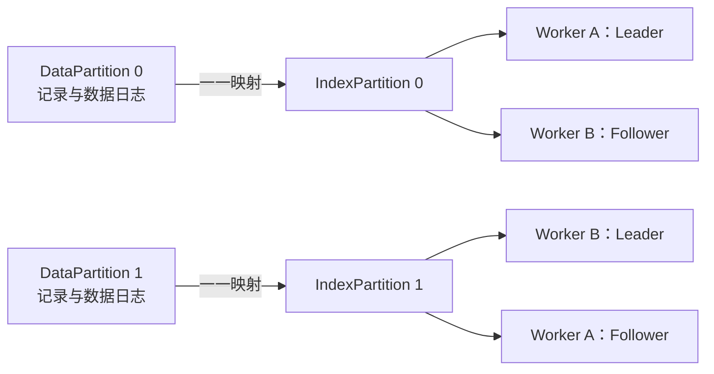
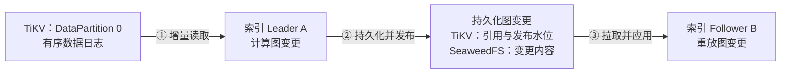
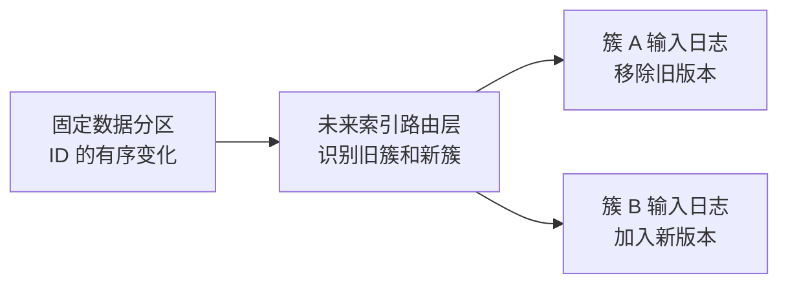

# 当前架构与分区设计

本文整理截至 2026-11-16 的实现及设计取舍，是理解仓库的架构入口。重点描述 `CLUSTER_MODE=1 REPLICAS=2 INDEX_REPLICATION=graph`；默认 `INDEX_REPLICATION=independent` 仍保留，各副本独立构图。消费保留与图日志回收需另设 `CONSUMER_RETENTION=1`，所有角色配置一致并使用新 namespace。具体启动参数见 [CLI.md](CLI.md)。

## 1. 三个角色与三个存储边界

- **Gateway**：提供 HTTP/gRPC，按 ID 定位原始数据，分发向量查询并合并结果。Python/Go SDK 与 vectorctl 通过对外接口访问。
- **Master**：通过 TiKV 事务竞争主租约，分配索引副本，管理故障接管、迁移和负载调度。备 Master 不转发业务数据。
- **Worker**：承载索引副本。每个索引分片只有一个构图 Leader，其余副本重放已计算的变更；所有可服务副本都可查询。

三个角色使用同一二进制，可以合并或拆成进程。Master Leader 是集群控制角色，索引 Leader 是单个分片的构图角色，两者不同。

| 存储位置 | 保存内容 | 边界 |
|---|---|---|
| TiKV | 原始记录、数据日志、幂等凭证、图日志引用、快照清单、租约、分配、迁移任务、消费 ACK | 权威持久化数据与协调状态 |
| SeaweedFS / S3 | 不可变图变更对象、完整图快照 | 图日志载荷与恢复基线 |
| Worker 内存 | HNSW、最新记录视图、节点版本映射、属性倒排 | 可由快照及日志恢复的查询视图 |

## 2. 分区与部署：只画归属，不混入复制流程

图中同名 Worker 是同一个进程承载的不同副本，并非四个 Worker。连线表达逻辑归属，不代表网络传输。

| 概念 | 当前定义 |
|---|---|
| DataPartition | 按 ID hash 划分的原始数据与有序数据日志，存入 TiKV |
| IndexPartition | 一份逻辑 HNSW 索引，当前与 DataPartition 一一对应 |
| 索引副本 | IndexPartition 在某个 Worker 上的内存实例，有自己的已应用位置 |
| Worker | 容纳多个索引副本的进程；主备身份按分片区分 |

DataPartition 没有应用层 Leader/Follower，也不等于 TiKV Region。底层数据复制由 TiKV 承担。只有索引副本需要应用层放置、构图选主和迁移。

当前数据路由为 `bigEndianUint64(SHA256(ID)[:8]) % DataPartitions`，使用 ID 的 UTF-8 字节，与向量、属性无关。分区数支持 1～64，持久化后不可直接修改。索引映射保存在 layout 中，当前 `data 0 → index-0000`，依此类推。

## 3. 单分片主备复制：只画数据传递

A 不直接向 B 复制进程内存。B 读取 TiKV 中的已发布图日志，再从 SeaweedFS 获取变更载荷。因此 A 故障后，已提交的变更仍可恢复。Follower 不重新执行 HNSW 插入时的邻居选择，但仍承担读取、校验和应用变更的成本。

详细提交顺序：

1. 任意 Gateway 将记录、数据日志、分区 log-head 和幂等凭证写入同一个 TiKV 事务。支持 expected_revision 条件更新；提交结果不确定时用原 request_id 重试。
2. Leader 从上次数据 offset 增量读取，每批最多 256 条。500 ms 同步触发器不是全量扫描 Outbox。
3. Leader 在写锁内构图，捕获修改过的节点和记录等状态，再回退推测修改，避免查询提前看到未提交结果。
4. 上传并校验不可变图对象，在带 fencing 的 TiKV 事务中提交图日志引用和数据消费位置。
5. Leader 验证变更可重放，推进 Visible；不等待 Follower ACK。随后 Leader 应用已发布图变更。
6. Follower 按顺序拉取已发布图日志、校验并应用，推进本地位置。

| 位置 | 含义 |
|---|---|
| 数据 offset | 一个 DataPartition 内的数据事件序号 |
| 图 sequence | 一个 IndexPartition 内的图变更批次序号 |
| Committed | 已持久化、接管后必须继续处理的图位置 |
| Visible | 已发布、允许副本应用并查询的图位置 |
| 副本 position | 该副本实际已经应用的位置 |

图位置包含数据 offset 和链式 hash；数据 offset 与图 sequence 不能混用。当前最多允许一批已提交但未发布的图变更，简化恢复并限制推测状态规模。

一致性约定：同一图位置应有相同的图结构、记录版本和删除状态；不同副本允许处于不同位置。原始写入成功表示 TiKV 提交成功，不表示所有索引副本立即可见。

## 4. 查询与故障接管

按 ID 读取走 TiKV。向量搜索由 Gateway 并行访问全部 IndexPartition，每片选择一个可服务副本，最后归并各片 Top-K。当前没有聚类选簇；任一必要分片不可用时返回错误，不将缺片结果报告为完整成功。

分片内使用属性等值倒排筛选。小候选集合或显式 Exact 查询使用精确距离与有界 Top-K 堆；大集合走 HNSW，过滤旧版本/删除节点，并以原始向量重新计算候选距离。候选不足则扩大预算，达到上限仍不足时回退精确搜索。候选重算不消除 ANN 召回误差。全局层仍排序最多 `分片数 × K` 个候选，不排序全部向量。

普通查询允许落后；MinVisible 要求指定 ID 至少达到指定 revision。跨分片查询不是统一时间点快照。

Leader A 故障后的流程：

1. Master 根据租约更新副本计划和 Publisher。租约时间使用 TiKV 事务时间，过期的是租约，epoch 是递增的身份代次。
2. B 在有效 ownership 下领取新图任期，先追平已发布图，再完成已提交但尚未发布的批次。
3. B 从 Committed.DataOffset 继续消费数据日志，构图并发布。
4. 旧 A 的提交和发布受到事务内 ownership、Publisher 与 fencing 检查约束，不能凭旧身份继续修改权威状态。

Gateway 与 TiKV 可用时，接管不要求停止原始数据读写。有效的可服务副本可继续查询旧视图；没有可服务副本时搜索暂时不可用。路由重试有时间上限，不承诺任意故障下零中断。

Master 维护的 ReplicaPlan 区分 Desired、Serving、Publisher、Barrier 和 Version。迁移先恢复目标、追赶屏障，再原子切换服务集合，最后退休源副本；任务持久化在 TiKV，Master 更换后可以续跑。负载策略使用内存估算、查询耗时与容量权重，预算不是 RSS 硬限制。细节见 [DESIGN.md](DESIGN.md)、[BALANCING.md](BALANCING.md)。

## 5. 快照、订阅和回收

完整快照包含原生 HNSW、记录、节点版本映射、配置、构图随机数状态，以及图 sequence/hash 和数据 offset。恢复使用完整快照加增量图日志，不需要重新逐条构图。目前不是 RocksDB 式分层检查点，完整快照成本仍随分片大小增长。

对外提供 data 和 graph 两种分页拉取流，分别对应数据变化和已发布图变化。Gateway 直接读取持久化日志，不依赖 Worker 在线。graph 流提供对象引用和邻接关系投影；HNSW 导航边不等于精确最近 N 个点。

启用消费保留后，消费者以 session、epoch、ACK 和 TTL 登记进度。data 日志清理受检查点、副本保留约束和有效消费者 ACK 限制；graph 日志清理受图检查点和有效消费者 ACK 限制。登记、续租与清理通过事务冲突协调。落后副本遇到已回收日志时加载检查点，再追增量。

对象先登记上传意图，提交图引用时转为 live；清理时先持久化 garbage 标记，再删除 S3 对象。删除失败和迟到上传可以重试处理。当前通过 `cluster prune` 有界触发，保留历史检查点、未登记旧对象和回收标记。订阅不承诺下游 exactly-once。协议见 [RPC.md](RPC.md) 和 [DESIGN.md](DESIGN.md#消费租约与图日志回收)。

## 6. 设计决策：保留 DataPartition，但不增加第二套控制面

**决定：保留数据分区与索引分区两个概念，当前继续一一对应。DataPartition 是稳定的数据与日志边界，不承担独立的应用层主备和节点迁移。**

理由：

- Get、更新、删除根据 ID 定位，不依赖向量簇和 HNSW 是否可用。
- 每个数据分区有自己的有序日志和 head，避免全 namespace 共用一个写热点。同一分区的 head 仍会产生事务竞争。
- 数据订阅 cursor、ACK 和回收位置不必随索引部署变化。
- 未来同一份数据可供不同索引使用；索引分片的拆分、合并和迁移不必移动权威记录。

若删除 DataPartition，日志分流、顺序和保留范围仍需要定义；将这些职责并入 IndexPartition 会把数据布局绑定到索引布局。当前节省少量类型和映射代码，不足以抵消后续耦合。

### 未来聚类索引：方向，尚未实现

同一 ID 的向量从簇 A 变到簇 B 时，原始记录位置不变，索引侧处理旧簇移除和新簇加入。该图不是当前代码路径。

当前一个索引只有一个来源 offset。未来多对多映射不能仅替换 IndexForRecord：需要在以下方案中明确选择。

| 方案 | 取舍 |
|---|---|
| 索引直接消费多个数据分区 | 维护来源 offset 集合；过滤、恢复、消费保留协调较复杂 |
| 路由层生成各索引分片自己的输入日志 | 增加处理与持久化成本，但每个索引具有清晰的顺序和重放边界 |

倾向第二种，暂不实施。实现前必须设计路由版本、幂等分发、跨簇移除/加入的可见性、旧版本过滤、进度与 GC 依赖、簇拆分合并、选簇召回和恢复协议。保留两层分区只是解耦基础，不等于已经解决这些问题。

数据分区自身的在线扩容也尚未实现：当前 hash 取模依赖固定分区数，不能改环境变量扩容。它与索引分片迁移是两个不同问题。

## 7. 代码阅读入口与验证边界

| 主题 | 入口 |
|---|---|
| 角色装配与启动参数 | [cluster.go](internal/vector/cluster.go)、[main.go](cmd/vector-server/main.go) |
| 两层路由与跨片查询 | [partitions.go](internal/vector/partitions.go) |
| 记录事务、数据日志 | [repository.go](internal/vector/repository.go)、[log.go](internal/vector/log.go) |
| 分配、租约与副本 fencing | [master.go](internal/vector/master.go)、[coordinator.go](internal/vector/coordinator.go)、[replicas.go](internal/vector/replicas.go) |
| Worker 生命周期、Gateway 路由 | [worker_runtime.go](internal/vector/worker_runtime.go)、[gateway_router.go](internal/vector/gateway_router.go) |
| 构图、图日志与重放 | [graph_delta.go](internal/vector/graph_delta.go)、[graph_journal.go](internal/vector/graph_journal.go)、[graph_replica.go](internal/vector/graph_replica.go) |
| 查询与快照 | [hnsw.go](internal/vector/hnsw.go)、[graph_snapshot.go](internal/vector/graph_snapshot.go) |
| 订阅、消费租约、回收 | [subscription.go](internal/vector/subscription.go)、[consumer.go](internal/vector/consumer.go)、[graph_gc.go](internal/vector/graph_gc.go)、[object_gc.go](internal/vector/object_gc.go) |

验收入口见 [ACCEPTANCE.md](ACCEPTANCE.md)：包括 2 Gateway + 2 Master + 3 Worker 单进程流水线、真实 TiKV/SeaweedFS 集成、多进程暂停/终止/恢复和清理后接管。当前未完成真实跨物理机器故障、TiKV/SeaweedFS 自身高可用验收；这些测试不能替代生产容量与容灾验证。
