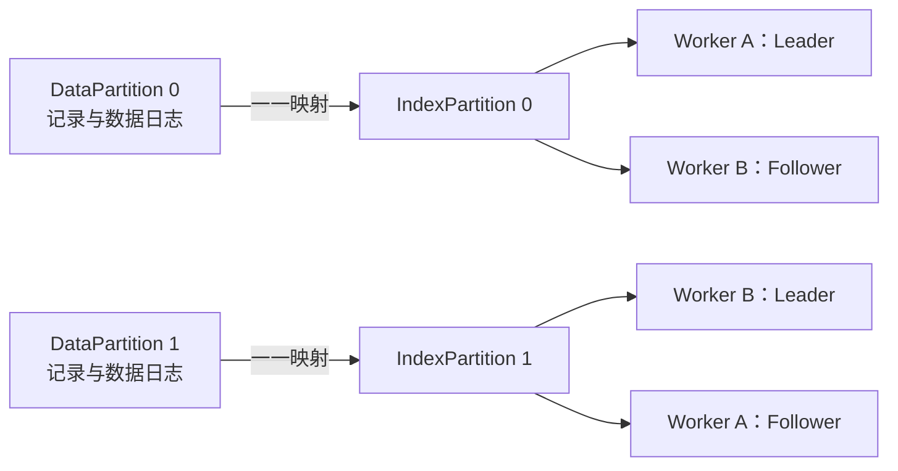
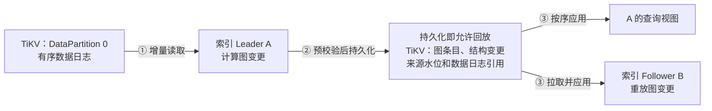
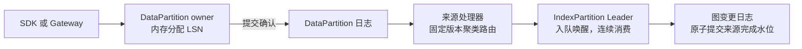

# 当前架构与分区设计

本文整理截至 2026-11-18 的实现及设计取舍，是理解仓库的架构入口。重点描述 `CLUSTER_MODE=1 REPLICAS=2 INDEX_REPLICATION=graph`；默认 `INDEX_REPLICATION=independent` 仍保留，各副本独立构图。消费保留与图日志回收需另设 `CONSUMER_RETENTION=1`，所有角色配置一致并使用新 namespace。具体启动参数见 [CLI.md](CLI.md)。

本文下述一一映射是默认布局。现已增加可选聚类布局，数据/索引分区数量独立：见 [CLUSTER_ROUTING.md](CLUSTER_ROUTING.md)。该模式不保存逐事件路由计划，使用固定簇中心、来源处理器和持久化完成水位；split/merge 仍未实现。

## 1. 三个角色与三个存储边界

- **Gateway**：提供 HTTP/gRPC，按 ID 定位原始数据，分发向量查询并合并结果。Python/Go SDK 与 vectorctl 通过对外接口访问。
- **Master**：通过 TiKV 事务竞争主租约，分配索引副本，管理故障接管、迁移和负载调度。备 Master 不转发业务数据。
- **Worker**：承载索引副本。每个索引分片只有一个构图 Leader，其余副本重放已计算的变更；所有可服务副本都可查询。

三个角色使用同一二进制，可以合并或拆成进程。Master Leader 是集群控制角色，索引 Leader 是单个分片的构图角色，两者不同。

| 存储位置 | 保存内容 | 边界 |
|---|---|---|
| TiKV | 原始记录、数据日志、幂等凭证、图日志引用、快照清单、租约、分配、迁移任务、消费 ACK | 权威持久化数据与协调状态 |
| SeaweedFS / S3 | 完整图快照与重建 reset | 恢复基线 |
| Worker 内存 | HNSW、最新记录视图、节点版本映射、属性倒排 | 可由快照及日志恢复的查询视图 |

## 2. 分区与部署：只画归属，不混入复制流程

图中同名 Worker 是同一个进程承载的不同副本，并非四个 Worker。连线表达逻辑归属，不代表网络传输。

| 概念 | 当前定义 |
|---|---|
| DataPartition | 按 ID hash 划分的原始数据与有序数据日志，存入 TiKV |
| IndexPartition | 一份逻辑 HNSW 索引，当前与 DataPartition 一一对应 |
| 索引副本 | IndexPartition 在某个 Worker 上的内存实例，有自己的已应用位置 |
| Worker | 容纳多个索引副本的进程；主备身份按分片区分 |

底层数据复制由 TiKV 承担。聚类布局的 DataPartition 在应用层有一名可接管的写入 owner，IndexPartition 另外选举构图 Leader。

当前数据路由为 `bigEndianUint64(SHA256(ID)[:8]) % DataPartitions`，使用 ID 的 UTF-8 字节，与向量、属性无关。分区数支持 1～64，持久化后不可直接修改。索引映射保存在 layout 中，当前 `data 0 → index-0000`，依此类推。

## 3. 单分片主备复制：只画数据传递

A 不直接向 B 复制进程内存。B 读取 TiKV 中的已持久化图日志，在同一 TiKV 快照读取图载荷及其引用的数据日志。因此 A 故障后，已提交的变更仍可恢复。Follower 不重新执行 HNSW 插入时的邻居选择，但仍承担读取、校验和应用变更的成本。

详细提交顺序：

1. 聚类布局下，SDK 按 ID 直连 DataPartition owner，Gateway 收到的写入也转给该 owner。owner 仅在恢复时读取持久化日志末尾，正常批次按内存 LSN 连续编号。当前记录、日志事件和幂等凭证在同一个 TiKV 事务提交。支持 expected_revision 条件更新；提交结果不确定时用原 request_id 重试。
2. 一一对应模式下，Leader 每 500 ms 从上次数据 offset 增量读取，每批最多 256 条。聚类投递模式改由来源处理器投递到队列，入队唤醒 Leader 连续消费，见第 6 节。
3. Leader 在写锁内构图，捕获修改过的节点和记录等状态，再回退推测修改，避免查询提前看到未提交结果。
4. Leader 先验证图变更可重放，再拆出向量、属性的数据日志引用。
5. 带 fencing 的 TiKV 事务追加图条目，条目与图载荷分块、累计来源水位原子持久化；**持久化成功即允许回放**，没有第二个 ACK／Visible 发布事务。
6. A、B 分别按序应用持久化日志，推进各自内存位置。B 不需要等下一条日志，也不需要等 A 应用。

| 位置 | 含义 |
|---|---|
| 数据 offset | 一个 DataPartition 内的数据事件序号 |
| 图 sequence | 一个 IndexPartition 内的图变更批次序号 |
| Committed | 已持久化、接管后必须继续处理的图位置 |
| Visible | 兼容字段，等于 Committed；表示允许回放，不代表本地已经可查 |
| 副本 position | 该副本实际已经应用的位置 |

图位置包含数据 offset 和链式 hash；数据 offset 与图 sequence 不能混用。Leader 一批完成预校验、持久化和本地 apply 后才构建下一批；没有“已提交但未发布”状态。控制 head 只在任期、检查点、清理时更新，最新位置和来源水位从尾记录派生。协议细节见 [GRAPH_JOURNAL.md](GRAPH_JOURNAL.md)。

一致性约定：同一图位置应有相同的图结构、记录版本和删除状态；不同副本允许处于不同位置。原始写入成功表示 TiKV 提交成功，不表示所有索引副本立即可见。

## 4. 查询与故障接管

按 ID 读取走 TiKV。向量搜索由 Gateway 并行访问全部 IndexPartition，每片选择一个可服务副本，最后归并各片 Top-K。当前没有聚类选簇；任一必要分片不可用时返回错误，不将缺片结果报告为完整成功。

分片内使用属性等值倒排筛选。小候选集合或显式 Exact 查询使用精确距离与有界 Top-K 堆；大集合走 HNSW，过滤旧版本/删除节点，并以原始向量重新计算候选距离。候选不足则扩大预算，达到上限仍不足时回退精确搜索。候选重算不消除 ANN 召回误差。全局层仍排序最多 `分片数 × K` 个候选，不排序全部向量。

普通查询允许落后；MinVisible 要求指定 ID 至少达到指定 revision。跨分片查询不是统一时间点快照。

Leader A 故障后的流程：

1. Master 根据租约更新副本计划和 Publisher。租约时间使用 TiKV 事务时间，过期的是租约，epoch 是递增的身份代次。
2. B 在有效 ownership 下领取新图任期，先追平全部已持久化图条目。
3. B 从 Committed.DataOffset 继续消费数据日志，构图并追加图日志。
4. 旧 A 的追加受到事务内 ownership、Publisher 与 fencing 检查约束，不能凭旧身份继续修改权威状态。

按 ID 读取只依赖 Gateway 与 TiKV。聚类布局的写入还要求目标 DataPartition owner 就绪。有效的可服务副本可继续查询旧视图；没有可服务副本时搜索暂时不可用。路由重试有时间上限，不承诺任意故障下零中断。

Master 维护的 ReplicaPlan 区分 Desired、Serving、Publisher、Barrier 和 Version。迁移先恢复目标、追赶屏障，再原子切换服务集合，最后退休源副本；任务持久化在 TiKV，Master 更换后可以续跑。负载策略使用内存估算、查询耗时与容量权重，预算不是 RSS 硬限制。细节见 [DESIGN.md](DESIGN.md)、[BALANCING.md](BALANCING.md)。

## 5. 快照、订阅和回收

完整快照包含原生 HNSW、记录、节点版本映射、配置、构图随机数状态，以及图 sequence/hash 和数据 offset。恢复使用完整快照加增量图日志，不需要重新逐条构图。目前不是 RocksDB 式分层检查点，完整快照成本仍随分片大小增长。

对外提供 data 和 graph 两种分页拉取流，分别对应数据变化和已持久化图变化。Gateway 直接读取持久化日志，不依赖 Worker 在线。graph 流提供 TiKV 图载荷、数据引用和邻接关系投影；HNSW 导航边不等于精确最近 N 个点。

启用消费保留后，消费者以 session、epoch、ACK 和 TTL 登记进度。data 日志清理受检查点、副本保留约束和有效消费者 ACK 限制；graph 日志清理受图检查点和有效消费者 ACK 限制。登记、续租与清理通过事务冲突协调。落后副本遇到已回收日志时加载检查点，再追增量。

对象先登记上传意图，提交图引用时转为 live；清理时先持久化 garbage 标记，再删除 S3 对象。删除失败和迟到上传可以重试处理。后台按每片 30 MB / 3 分钟检查点及有界 GC 推进，也可通过 `cluster prune` 显式触发，保留历史检查点、未登记旧对象和回收标记。订阅不承诺下游 exactly-once。协议见 [RPC.md](RPC.md) 和 [DESIGN.md](DESIGN.md#消费租约与图日志回收)。

## 6. 设计决策：保留 DataPartition，支持可选聚类布局

**保留数据分区与索引分区两个概念。默认布局一一对应；可选聚类模式中数据分区数和索引分区数独立。DataPartition 是稳定的数据与日志边界，聚类布局的来源处理器持有独占写租约，负责追加原始日志并异步投递。**

保留数据分区的原因：按 ID 的 Get/更新/删除不依赖索引，各数据分片可以独立提交，数据订阅与保留范围不随索引位置变化。同一数据分片的提交保持有序，热点 ID 仍受单分片吞吐限制。

选定的解耦方式是来源直接投递：

聚类模式使用 Publisher lease 保护内存中的 owner、角色、图头和来源水位。正常消费批次不再读这些控制 key 或重复 Claim；后台续租和刷新计划。Master 切主必须等待旧 lease 到期，主动迁移先标记 lease_draining。图提交仍由 TiKV Index guard 隔离迟到旧请求；首次接管、未知提交和维护追加后重新建立持久化屏障并恢复缓存。详见 [图日志的租约处理路径](GRAPH_JOURNAL.md#租约保护的内存处理路径)。

没有增加持久化索引输入日志，也不先保存逐事件路由结果。来源保留原始日志并承担重试；数据写入和图提交会异步唤醒来源处理器，来源读取持久化 commit_lsn，按各事件目标计算连续完成前缀，窗口完成后立即读下一窗口。500 ms 控制巡检负责租约与漏通知兜底。处理器故障后只需从完成位置恢复有界窗口。具体投递、去重、空洞、订阅及恢复协议见 [CLUSTER_ROUTING.md](CLUSTER_ROUTING.md)。

每个本地索引副本有独立消费循环：Leader 由入队事件唤醒，逐批完成持久化和本地 apply 后立即取下一批，队列为空时阻塞等待。不同索引可以并行，单个索引仍有序提交；Follower 当前每 100 ms 追赶持久化图日志。切主计划变化和提交失败也能唤醒恢复流程。时延对比与观测见 [PIPELINE_LATENCY.md](PIPELINE_LATENCY.md)。

这一取舍减少一层日志持久化，但慢索引会通过来源窗口产生反压。未来若需要隔离积压，可再评估独立索引输入日志。

当前簇中心由配置提供并在 namespace 内固定，不自动训练。向量更新可以进入新簇，旧位置后台清理；查询校验权威版本。进程故障和 Worker 迁移只改变 Leader 地址，不改变逻辑路由。split/merge 尚未实现，后续必须具备存量导入、增量屏障、新旧查询集合切换及退休协议；不能只依靠后台删除多余向量来保证完整性。

数据分区在线扩容同样未实现：当前 hash 取模依赖固定数量，不能修改环境变量直接扩容。这与索引副本搬迁是两个不同问题。

## 7. 代码阅读入口与验证边界

| 主题 | 入口 |
|---|---|
| 角色装配与启动参数 | [cluster.go](internal/vector/cluster.go)、[main.go](cmd/vector-server/main.go) |
| 两层路由与跨片查询 | [partitions.go](internal/vector/partitions.go) |
| 记录事务、数据日志 | [repository.go](internal/vector/repository.go)、[log.go](internal/vector/log.go) |
| 分配、租约与副本 fencing | [master.go](internal/vector/master.go)、[coordinator.go](internal/vector/coordinator.go)、[replicas.go](internal/vector/replicas.go) |
| Worker 生命周期、Gateway 路由 | [worker_runtime.go](internal/vector/worker_runtime.go)、[gateway_router.go](internal/vector/gateway_router.go) |
| 构图、图日志与重放 | [graph_delta.go](internal/vector/graph_delta.go)、[graph_journal.go](internal/vector/graph_journal.go)、[graph_replica.go](internal/vector/graph_replica.go) |
| 查询与快照 | [hnsw.go](internal/vector/hnsw.go)、[graph_snapshot.go](internal/vector/graph_snapshot.go) |
| 订阅、消费租约、回收 | [subscription.go](internal/vector/subscription.go)、[consumer.go](internal/vector/consumer.go)、[graph_gc.go](internal/vector/graph_gc.go)、[object_gc.go](internal/vector/object_gc.go) |

验收入口见 [ACCEPTANCE.md](ACCEPTANCE.md)：包括 2 Gateway + 2 Master + 3 Worker 单进程流水线、真实 TiKV/SeaweedFS 集成、多进程暂停/终止/恢复和清理后接管。当前未完成真实跨物理机器故障、TiKV/SeaweedFS 自身高可用验收；这些测试不能替代生产容量与容灾验证。
