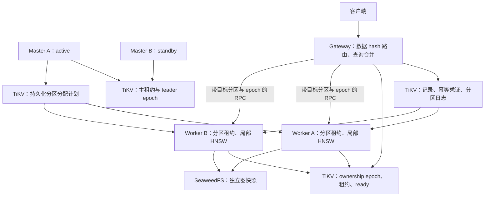

# Master / Gateway / Worker：同一二进制的三种角色

本版实现主备 Master、固定分区分配、多进程查询和 Worker 故障接管。三个角色可以组合在一个进程，也可以使用同一 `vector-server` 二进制分别启动。Master 通过 TiKV 选主；不再由 Worker 自己决定分区归属。

新增可选双副本与排空迁移：见 [REPLICAS.md](REPLICAS.md)。本文原有流程描述默认 `REPLICAS=1` 模式。

## 架构



数据分区和索引分区继续保持一一对应。数据由 TiKV 承担持久化，任意 Gateway 可以按 ID hash 直接写正确的数据分区；不需要先把写请求转给 Worker。Worker 仅持有被分配索引的内存视图，消费对应来源日志。

| 角色 | 职责 | 不承担的工作 |
|---|---|---|
| Master | 主备选举、读取存活 Worker、发布分配计划、故障重新分配 | 不执行查询，不保存 HNSW |
| Gateway | HTTP 记录接口、写入事务、读取索引归属、RPC 扇出及全局 Top-K | 不决定归属，不要求本地有图 |
| Worker | 按计划申请分区租约、恢复图、重放日志、查询、快照和重建 | 不自主计算调度策略 |

对应代码为 `master.go`、`gateway.go`、`worker.go`。`coordinator.go` 提供 TiKV 协调协议；`cluster.go` 组合角色、管理生命周期及内部 RPC。

## 主备选举与分配计划

所有进程注册唯一 Node ID 和本次启动的随机 session。注册携带角色、可达地址和过期时间；同一 Node ID 的另一个 session 在原注册仍有效时不能抢占。

Master 候选通过 TiKV 乐观事务竞争特殊的 `_master` 租约，持有者续租，其他候选保持 standby。接管时 leader epoch 递增。租约时间来自事务 start timestamp 的 PD 物理时间部分，不使用各进程本地时钟决定归属。

只有 active Master 能更新 assignments。第一版对固定索引分区和存活 Worker 使用确定性的 rendezvous hash 计算目标，不使用 QPS、内存或簇大小。Gateway 和 Master-only 节点不会被当作 Worker。计划包含目标 Node ID、session、地址和产生该计划的 leader epoch。

计划是“期望归属”，分区租约是“实际持有权”。新目标必须等旧租约释放或过期，取得新的 ownership epoch，并完成图恢复和日志追赶后才能标记 ready。Gateway 读取实际 ready 持有者，不直接把计划目标当作已可查询实例。

Master 切换不要求改变现有 Worker ownership epoch。新主读取存活节点和持久化状态继续协调；目标没有变化的分区继续运行，不重建图。

## 两层 fencing

| 元数据 | 作用 |
|---|---|
| Master lease / leader epoch | 限制谁可以生成分配计划 |
| 分区 lease / ownership epoch | 限制谁可以提供该索引的服务并修改快照及清理位点 |
| 独立 fencing 键 | 与实际修改同事务写入，使旧 epoch 的在途事务与接管产生写冲突 |

只读取租约、在内存判断“我是主”是不够的。调度计划写入、快照 manifest 发布、日志删除和 floor 推进均在同一 TiKV 事务中检查相应租约并写 fencing 键。新的接管事务更新该 fencing 键，因此即使旧进程在检查后暂停、稍后恢复，其在途事务也不能越过已经提交的新 epoch。

租约续期更新租约键，不修改独立 fencing 键，避免正常心跳频繁干扰快照提交。释放和接管都会修改 fencing 键。租约有效性按该事务的 PD 起始时间检查；不能把它解读为对任意网络延迟下本地时钟的实时承诺，跨 epoch 的安全性由事务冲突保证。

内部查询 RPC 携带 namespace、分区 ID 和 ownership epoch，Worker 在操作前后检查当前归属。旧 Worker 恢复后不能用旧 epoch 返回成功查询，也不能发布快照或清理日志。移交后的本地图等待在途读操作结束，再释放原生内存。

## 故障行为

- **active Master 单独失效**：standby 等租约到期后接管；已有 Worker 根据持久化计划直接向 TiKV 续租，查询不经过 Master。
- **全部 Master 暂时失效**：现有健康 Worker 可以继续服务，但不能生成新的调度计划。此时再发生 Worker 故障，需要等待 Master 恢复后重新分配。
- **Worker 失效**：Master 排除过期注册并重新分配；新 Worker 从图快照和剩余日志恢复。等待接管、加载期间，涉及缺片的查询返回错误或超时，不返回伪装完整的部分结果。
- **旧进程恢复**：旧 epoch 被拒绝，进程重新按当前计划协调；旧 Master 成为 standby，旧 Worker 只有再次得到分配并取得新 epoch 后才能服务。
- **TiKV / PD 不可用**：不能保证选主、续租、查询归属检查或写入继续成功。Master 容灾不等于元数据存储容灾。

如果 Master 与 Worker 组合在同一进程，强杀该进程会同时失去两种角色；“Master 切换不影响已有查询”的测试使用独立 Master 进程，不能把这个结论套到同时丢失 Worker 的情况。

## 启动配置

公共配置相同，每个进程使用不同 NODE_ID 和监听地址。ADVERTISE_URL 必须能被其他进程访问。

```bash
export CLUSTER_MODE=1
export PARTITIONS=4
export NAMESPACE=demo/cluster-master-v1
export API_TOKEN=local-public-api-token
export CLUSTER_TOKEN=local-peer-rpc-secret
export LEASE_TTL=9s
```

两个组合角色进程（分别在两个终端启动）：

```bash
NODE_ID=node-a ROLES=master,gateway,worker \
  LISTEN_ADDR=127.0.0.1:18110 ADVERTISE_URL=http://127.0.0.1:18110 \
  .tools/vector-server

NODE_ID=node-b ROLES=master,gateway,worker \
  LISTEN_ADDR=127.0.0.1:18111 ADVERTISE_URL=http://127.0.0.1:18111 \
  .tools/vector-server
```

ROLES 默认是 `master,gateway,worker`，也支持任意不重复组合，例如 `master,gateway`。分开部署时用以下角色和各自端口启动同一个命令即可：

| NODE_ID | ROLES | 示例端口 |
|---|---|---:|
| master-a | master | 18100 |
| master-b | master | 18101 |
| worker-a | worker | 18102 |
| worker-b | worker | 18103 |
| gateway | gateway | 18104 |

仅 Gateway 角色开放业务读写和查询；Master/Worker-only 节点保留 health、layout、cluster 状态接口。Worker 的 `/internal/partition` 使用单独 CLUSTER_TOKEN，不能用公开 API_TOKEN 调用。当前示例是可信网络中的 HTTP 原型，尚未提供生产 TLS/mTLS 和细粒度授权。

`LEASE_TTL` 允许 3s..60s，默认 9s，协调周期为 TTL/3。过短的租约容易把进程暂停或抖动当成故障。故障恢复时间还包括协调周期和图加载时间，不能只看 TTL。

## 状态接口

带 API_TOKEN 调用 `GET /v1/cluster`，可以看到：

- `node.roles`、`node.session`：当前进程角色与启动身份。
- `leader`、`master_available`：当前 Master 及 leader epoch。
- `assignments`：Master 的期望计划。
- `owners`：实际 Worker、ownership epoch、ready 与租约期限。
- `local_partitions`：当前进程已加载的图。
- `ready`：各分区均有未过期且 ready 的持有者，不表示网络无故障。

`/healthz` 只说明 HTTP 进程已启动，不等同于所有分区完成恢复。Gateway 当前每次请求读取归属，没有路由缓存；正确性优先，但增加 TiKV/PD 请求成本，后续再优化。

## 元数据与升级

namespace 下保存 `cluster/nodes/`、`cluster/owners/`、`cluster/fences/`、`cluster/assignments/`。`_master` 的计数和每个索引分区的计数完全独立。

Master 协议标记为 `cluster-mode=v2-master`，根 schema 为 v5。单进程入口拒绝打开集群 namespace，旧二进制也不能重新打开 v5 schema。升级必须停止旧写者；不支持与之前实验性的无 Master 协议混跑，也没有对旧实验 namespace 自动迁移。单进程模式保持现有兼容行为；本轮仅在新随机 namespace 测试，没有迁移 demo 数据。

分区数仍固定、每片单个查询持有者；没有查询副本、跨主机网络故障注入、按负载均衡、限速在线迁移、聚类路由、旧节点注册清理或完整容量治理。当前节点注册扫描上限为 1024 条（包括未清理的历史注册）。

## 验收入口

- `master_test.go`：主备、计划持久化、旧主拒绝、角色与计划约束。
- `worker_test.go`：Worker 只跟随计划、无 Master 时续租、重分配和图退休等待在途读者。
- `coordinator_test.go`：租约、过期、重复 Node ID、ownership epoch、旧 owner 的发布和清理拒绝。
- `cluster_test.go`：内部 RPC、身份校验、角色 HTTP 隔离、远程错误和取消。
- `TestMasterElectionAndFenceTiKV`：真实并发选主只有一个获胜；旧主检查后的在途事务不能越过新主提交。
- `TestLeaseFenceTransactionConflictTiKV`：真实 Worker 接管使旧 ownership 的在途事务失败。
- `python3 scripts/verify_cluster.py`：两个组合角色进程。
- `python3 scripts/verify_roles.py`：两个 Master、两个 Worker、一个 Gateway；Master 暂停、全 Master 暂停、Worker 暂停/强杀及恢复。

两种进程验收均已加入 `scripts/acceptance.sh`。结果分别在 reports/cluster-http.json、reports/roles-http.json；用例只操作自身子进程，不停止 TiKV/PD/SeaweedFS。

## 一键运行多个 Worker 与扩缩容

`scripts/cluster_local.py` 是前台本机进程管理器，使用同一个 Go 二进制启动 **2 个 Master、1 个 Gateway 和 N 个独立 Worker**。底层 TiKV/PD/SeaweedFS 需先启动；它只停止自己创建的子进程，不负责底层服务生命周期。Python 仅使用标准库。

```bash
bash scripts/go.sh build -o .tools/vector-server ./cmd/vector-server
export API_TOKEN=local-public-api-token
export CLUSTER_TOKEN=local-peer-rpc-secret
python3 scripts/cluster_local.py --namespace demo/multiworker-v1 \
  --workers 2 --partitions 8 --dimension 16 --base-port 18200
```

默认端口：Master 18200/18201，Gateway 18202，Worker 从 18203 开始。所有业务请求发到 `http://127.0.0.1:18202`。启动器继承 PD_ENDPOINTS、S3_*、LEASE_TTL 等环境变量；namespace、维度和固定分区数由命令行设置。默认租期 9 秒。日志目录在启动时输出。

启动完成后，在同一终端输入：

```text
status
scale 3
scale 1
quit
```

- `status` 输出角色、期望分配、实际归属和本次启动的进程 PID/退出码。
- `scale N` 支持 0..32 个 Worker。只改变 Worker 数量，数据分区和索引分区数量保持固定。存活节点增加后，Master 按 rendezvous hash 重新分配受影响的索引分区；不需要重启 Gateway 或 Master。
- 非零扩缩容会等待节点注册、Master 分配和实际 ready owner 收敛后返回。超时会显示当前状态，进程仍由启动器管理，可用 `status` 查看。
- 缩容先停止末尾 Worker，等待 Master 重新分配，再从 SeaweedFS 快照和 TiKV 日志恢复。当前不是无损在线迁移，涉及迁移分区的查询可能暂时失败。
- `scale 0` 停止所有 Worker，查询不能返回完整结果；Gateway 仍可持久化写入 TiKV。再 `scale 2` 时恢复所有分区及期间的写入。
- `quit`、输入结束、Ctrl-C 或 SIGTERM 统一回收子进程。它是交互式本机工具，不是生产守护进程；不自动重启异常退出的子进程，也不管理远程主机。

每次 Worker 启动采用新的节点身份，避免旧注册租期尚未到期时重用 Node ID。旧注册会等租期失效，但当前服务尚未清理历史注册；长时间反复扩缩容仍受上文 1024 条注册扫描上限约束。一个 namespace 应由一个本机启动器管理；跨主机部署仍使用上文的独立角色配置。

`python3 scripts/verify_multiworker.py` 在真实后端验证 2 → 3 → 1 → 0 → 2 个 Worker、8 个固定分区；使用 1,600 条有簇结构的向量，确保每片记录数超过精确回退阈值；按属性分组比较全部精确查询结果和版本/属性，检查分布式 HNSW、未迁移分区 epoch 保持不变、快照加增量恢复、缺片失败和子进程清理。报告为 `reports/multiworker-http.json`，已加入普通验收脚本。启动器单测入口：

```bash
python3 -m unittest discover -s scripts -p test_cluster_local.py -v
```

跨终端控制本机集群，以及调用状态和业务接口，可使用 `vectorctl`，详见 [CLI.md](CLI.md)。
