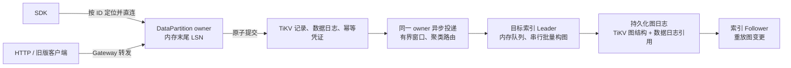

# 数据分片异步投递与聚类索引

状态：已实现固定簇中心路由、数据与索引分区数量独立、来源完成水位、接管恢复和旧位置清理。split/merge、在线重新训练簇中心尚未实现。聚类布局使用带 `-owner-append-v1` 后缀的写入协议。一一映射布局使用独立的 namespace。升级已有 v14 聚类布局时，先停止所有旧进程并等待节点租约过期，再启动新版。已有数据和幂等凭证可继续使用。

## 部署和数据流



DataPartition 按向量 ID 的 SHA-256 哈希划分。Master 将每个分片分配到一个 Worker。该 Worker 同时负责追加日志和异步投递，两者各自推进。一次业务写入在 TiKV 提交成功时返回 durable ACK，后续构图与图复制独立进行。

| 时机 | 末尾 LSN 的来源与更新 |
|---|---|
| 接管 | 旧 lease 到期后才能拿到新 epoch，主动释放会取消 ready 并保留原到期时间。新 owner 反向只读一个 `log/` 尾键。日志已全部回收时使用 `log-floor`，新分片从 0 开始。加载完成后发布 ready。 |
| 正常写入 | 分片内检查本地已确认的 owner 租约。空闲时首条请求立即提交，提交完成后合并此时已排队的请求，每批最多 32 条，按请求编码大小计的预算为 2 MiB。分片内一次只提交一笔事务，确认持久化后才返回。租约失效后停止接单。重复请求返回原始 revision，CAS 冲突不分配 LSN。不同分片可同时提交。 |
| 提交确认 | 原始记录、事件和 namespace 级幂等凭证在同一事务内持久化。数据写事务的提交时间戳必须早于租约到期时间，包括 TiKV 要求更换时间戳后的重试。成功后推进内存末尾，唤醒投递。 |
| 回包丢失 | 结果不确定的 owner 停止追加，交回租约并走恢复流程。客户端用原 request_id 重试。 |
| 旧节点恢复 | 新 owner 到期后取得的快照会看到更早已提交的数据，或者处理旧事务的预写锁。已开始的旧事务不能申请超过租约边界的提交时间戳。 |

例：内存末尾为 900，批内两个新事件取得 901、902。TiKV 确认后，下一批从 903 开始。如果提交响应丢失，新 owner 从持久化日志恢复到 900 或 902，重试通过幂等凭证判定原事务是否成功。

这个协议区分三个位置。末尾 LSN 表示已持久化的数据，`completed_lsn` 表示已完成索引投递的连续前缀，`log-floor` 表示已回收前缀。按 ID 读、运维状态、订阅和检查点使用 TiKV 的事务快照。分片写入在 owner 接管期间可能短暂不可用，其他就绪数据分片可独立写入。

## TiKV 元数据访问清单

以下统计适用于聚类布局、DataPartition 单写入 owner 和 Index 图复制。计数单位为代码路径上的逻辑键、事务或反向扫描，一次 BatchGet 在 TiKV 内部可能跨多个 Region。

**普通数据批次不读取 guard。** 每个数据分片在当前任期内每确认 100 个有实际变更的批次，就在第 100 批的同一笔事务里写入一次 `cluster/write-epochs/data-NNNN`。幂等回放和失败尝试不计数，新任期从头开始计数。获取和主动释放任期也会更新该键。生产数据 owner 使用 TiKV 两阶段提交，先完成预写，再将每批的提交时间戳限定在 lease 内。Index Leader 的图批次仍写入一次 `cluster/index-guards/index-NNNN`，与图接管发生写冲突。当前数据末尾和图末尾均由日志承载，稳态追加单独更新最大 LSN 键的次数为 **0**。

举例来说，32 个不同 ID 各成功写入一次，DataPartition 事务写 32 条记录、32 条事件和 32 个请求凭证，共 96 个逻辑键。遇到第 100 批，多写一个 guard 键。请求凭证按 request_id 保存首次结果，客户端在回包丢失后仍可取回原 revision。普通图增量事务追加图条目及其载荷分块，条目保存累计来源 ACK。接收新来源 epoch、发布快照、推进完成位点和 GC 各有单独的事务。

| 路径 | 原有操作 | 当前操作 |
|---|---|---|
| 1. 来源唤醒 | 每次查 assignment 并续租，续租中再校验 owner 和 assignment | 健康 owner 在本地租约期限内处理唤醒。控制巡检负责获取和续租，未知写入结果触发恢复。 |
| 2. 来源窗口 | 每轮重读 `dispatch-completed`，已追平的空窗口也读取 `log-floor` | 接管及完成事务失败后重新读持久化位置。已有窗口和已追平的空窗口各开 0 个读取事务。推进持久化位置仍校验旧值。 |
| 3. 来源状态 | 每轮另开事务读 owner，完成位置变化时再写 owner.offset | 完成位置在既有续租中顺带上报。状态接口从同一数据快照的 `completed_lsn` 填充 offset。 |
| 4. 来源 ACK | 每窗口读取全部 I 个图控制头，再反查 I 次图尾 | 只读本窗口涉及的 T 个 Index，每个图尾反查一次。单簇写入 T=1，含广播删除时 T=I。 |
| 5. 图副本进度 | 每次已就绪心跳后，分别提交副本状态和 `progress/<replica>` | 位置、计划版本或已上报状态变化时合并为 1 个事务，稳定时额外事务数为 0。首次上报、进程重启或上次提交未确认会重新上报。 |
| 6. 集群状态 | 同一次状态请求为 graph_heads 和 log_heads 分别读同一图头及尾记录 | 从一次图头读取同时生成两个字段。 |
| 7. 图订阅 | 一页 N 条成功返回的事件，正常路径反查图尾 N+1 次，还为带载荷事件另开事务 | 每页在同一个 MVCC 快照定位图尾 1 次，再按序号读取条目和分块、校验哈希。并发 GC 后，新页可用检查点重置。 |
| 8. 图检查点 | 同一事务写图头内的检查点描述和 `index/<id>/manifest` 镜像 | 聚类布局只更新图头内的描述，旧镜像可留存。数据流使用自己的 data manifest。一一映射布局仍写入供数据订阅和清理使用的 manifest。 |
| 9. 数据检查点巡检 | 每秒每个 Worker 对全部 D 个数据分片查询归属 | 各 Worker 只验证本地持有且写入结果确定的分片。在归属稳定、每片一个 owner 时，全组从 D×W 次降至 D 次，发布和 GC 保留事务内 fencing。 |

### 接管、回收和进度判断需要的持久状态

| 状态 | 保留依据 |
|---|---|
| `log-floor` | 记录已经回收的连续前缀。整段日志删空后用于恢复下一 LSN，也决定订阅何时需要重置。 |
| `dispatch-completed` | 是跨 Index 的连续完成证明。数据 owner 接管、允许跳过已完成区间、数据 GC 都依赖它。单个 Index 的最大来源 ACK 无法证明中间事件已全部完成。 |
| `cluster/graph/<index>/head` | 保存图任期、快照、回收边界及其来源覆盖。普通数据增量的最新位置和累计 ACK 来自不可变图条目。尾条目回收后控制头仍提供恢复依据。 |
| 图副本的 `progress/<replica>` | 记录指定 owner 实际应用的图序号、哈希和数据位点，用于跨进程状态观测。图提交成功时 Follower 还可能落后。 |
| 数据 manifest、消费者 lease/ACK、对象登记 | 分别定位恢复对象、保护活跃订阅所需日志、协调对象发布与回收。消费者数量和 ACK 由订阅方决定。 |
| assignment、owner、replica-plan、lease、guard 和迁移任务 | 决定当前服务者及切换边界。可以缓存路由提示，持久化写入仍需与接管或回收在 TiKV 中互斥。 |

剩余值得单独测量的读取是来源向实际目标投递前解析其 replica-plan 和 publisher owner，以及 Index 通知来源时解析 DataPartition owner。将这些地址改成路由缓存需要在旧地址、旧 session 和租约过期时重新发现。来源侧还能继续减少对实际目标的 ACK 查询，但必须区分入队成功与图日志已提交，并保留丢通知后的持久化校准。

## 固定聚类路由

启动参数 `CLUSTER_ROUTING_FILE` 指向 JSON：

```json
{"version":1,"centers":[[-10,0],[0,10],[10,0]]}
```

这个例子有三个二维索引簇：index-0000、index-0001、index-0002。选择 squared-L2 距离最近的中心，平局取较小索引编号。路由版本 1、中心坐标和索引编号持久化在布局中，不随进程故障或副本搬迁变化。此版本由配置提供中心，不自动训练或更新中心。

数据分区数量由 `PARTITIONS` 独立配置，索引数量由 centers 数量决定，两者各支持 1..64。所有角色必须提供相同配置，启动时校验持久化布局。恢复使用原事件向量计算目标，不读取最新记录替代历史事件，也不先持久化逐事件路由计划。

`GET /v1/layout` 中 `routing` 描述簇中心；`bindings` 此模式只枚举索引，`data_partition=-1` 表示没有一一绑定。数据分区集合由 data_partitions 定义。gRPC 同样暴露 routing，中心使用 Center.vector 消息表示。

## 投递窗口与完成水位

- 数据事务提交后，owner 就地唤醒该分片的投递队列；图事务结束后，Index 也通知来源重新读取持久化水位。来源按实际目标推进连续完成前缀，一个窗口完成后立即读取下一窗口。通知合并且不承担 ACK，失败或丢失由 500 ms 控制巡检兜底；正常处理不等待该定时器。
- 每个来源窗口最多 32 条、2 MiB 的编码事件；达到限制停止加载，积压保留在 TiKV。
- 索引队列每个来源最多一批，排队编码载荷预算 4 MiB；另有当前正在处理的一批。处理批次按来源轮转。投递接口不等待构图；首次接受更高 epoch 时先写小型控制日志，普通同 epoch 请求校验后入队。
- 入队通过可合并通知唤醒该索引的独立消费者，Leader 连续处理到队列为空再阻塞等待；不再依赖 500 ms 或 10 ms 队列轮询。计划变更、失败重试和启动恢复同样可以触发处理。
- 一轮可合并队列中已经存在的多个来源批次，最多 128 条事件、约 2 MiB 编码输入；不等待凑批，单个合法大批次允许带协议头的有界余量。所有来源的 Index 本地 epoch、完成水位与同一个图引用原子校验和提交，任一来源 epoch 已被更高 epoch 替换则整批不提交。
- 每个图批次串行完成预校验、提交和本地 apply 再处理下一批。批次中同一个 ID 的多个版本折叠为最后的最高版本，再生成可回退图变更。
- 图增量先验证可回放，再去掉向量字节、保存历史数据引用；TiKV 图条目、载荷分块与累计 `GraphEntry.sources` 写在同一条日志中，事务提交即确认持久化。`GraphHead.sources` 从最新尾记录派生，不再逐批写 head。sources 的键是数据分区编号的十进制字符串，值是该来源的数据 LSN；它不是图 sequence。
- 图提交检查 Index Publisher 和每个来源的 Index 本地持久化 epoch，不再锁共享来源 fence。更高 epoch 通过图日志控制条目接受；旧请求在该 Index 接受新 epoch 后被拒绝。
- 同一来源可在多个 Index 独立提交，互不写来源锁。Index 内追加与 epoch 升级由本地追加锁和持久化 guard 串行化，切主等待 Publisher lease 到期并改变 guard；图 GC 保留检查点和来源水位约束；仅确定写冲突做有限重试，未知结果重新读取图日志恢复。
- 来源水位是持久化确认，不保证 Follower 已经应用，也不等待 Follower。

投递包含 `source`、来源 ownership、`route_version`、`previous`、`through` 和选中的原始事件。previous 是已覆盖边界：等于目标已有水位，或跳过到来源已持久化的 completed_lsn。跳过到尚未完成的位置会被拒绝。目标事件自身必须严格递增，来源 hash 和聚类目标均被校验。网络重试不能改变批次内容；授权的来源处理器负责完整选择范围内应投递的事件。

先校验 epoch；更高 epoch 即使全部事件已完成，也先持久化控制条目，再按提交水位去重。未提交的相同来源批次在有界队列中合并。构图中的重复批次即使重新排队，也会在下一次取出时按最新持久化水位跳过。进程退出丢失队列后，由来源重投，不需要恢复接收端内存。

## 连续完成位置与恢复

例：100 → I0，101 → I1，102 → I0。I0 确认 102 而 I1 尚未确认 101 时，来源 completed_lsn 只能到 100。I1 确认后才能越过空洞。不能取全部索引水位的最大值或最小值；没有收到事件的索引不参与该事件的完成条件。

处理器从窗口头逐条检查，遇到第一条未完成事件就停下。已完成前缀以来源租约 fencing 写入 TiKV，持久化后释放窗口前部。读取不同索引的进度不必是同一时刻，因为它们都是同一路由版本内单调的持久化完成事实。

来源进程故障后：

1. Master 分配新处理器，新节点领取递增 epoch。
2. 加载持久化 completed_lsn，查询目标来源水位。
3. 从 completed_lsn + 1 读取一个有界窗口，使用固定路由重算目标。
4. 索引已经完成的事件直接越过；其余重投，继续推进。

不会全量扫描数据，也不会重新构建 HNSW。恢复等待主要取决于租约检测、Master 调度和存储响应；不承诺固定秒数。可以恢复处理后逐步追赶积压，不必先把全部积压放进内存。来源故障不妨碍原始读写；若同一 Worker 还承载索引，索引故障走独立副本接管协议。

## 更新、删除、旧位置清理和查询

向量更新只投递到新向量所属的簇，不保存逐 ID 路由历史。删除事件没有向量，因此投递到全部索引，来源需要等待所有目标确认该删除。

索引 Leader 的后台维护按权威数据的分页扫描检查旧位置，每页最多 128 条返回记录（底层扫描另有界限）。当最新版本更高且已删除或属于其他簇时，用该版本生成本地索引墓碑，再通过图日志复制。它不修改原始数据，也不直接修改 Follower。检查和构图由本地同步锁串行化，版本比较保护重新返回该簇的新版本。扫描游标只在本页处理成功后推进，重启可重新扫描。当前后台维护沿用 30 秒周期，单轮检查一页，不承诺大数据量下的清理时延。

查询读取副本已应用的 HNSW/记录内存视图，不逐候选回查 TiKV。更新、跨簇移动和删除未在该副本应用前，允许返回旧版本/旧位置。Gateway 按返回候选中的最新 revision 去重；未被任何查询分片返回的新版本无法被推断。原始 Get/List 仍读取 TiKV，不承诺跨片查询快照。

Worker 在既有心跳的 `load` 中上报 `live_records` 与 `records_known`。SDK 首次近簇搜索加载轻量 GetSearchRoutes，此后默认每 5 秒刷新一次；相同逻辑分片的副本数量取最大值，不相加。根据查询向量到固定簇中心的距离排序，累计估计记录数达到 K 时停止扩片；实际结果少于 K 时继续添加相邻簇。缺少计数或缓存过期时查询全部分片。数量不计属性过滤，是规划提示而非一致性证明。GetSearchRoutes 在一个快照内批量扫描路由记录，不生成完整运维状态。Gateway 对副本地址缓存至多 2 秒/TTL 的三分之一；错误会触发副本切换和路由刷新。Worker 的查询前后校验使用确认续租后建立的本地单调时钟读租约，地址缓存不提供权限；退休先失效本地租约再释放 ownership。

近簇选片是近似召回，即使最近一片有 K 条记录，也不保证全局最近 K；簇边界附近的记录可能位于其他分片。Python `all_partitions=True`、Go `SearchAll` 和 SDK `exact=True` 使用全片搜索。协议 `index_partitions` 可显式选择分片；未指定时服务端保持全片广播，指定时 Exact 只保证所选索引视图内的精确距离。

MinVisible 先等待一个有限的来源数据头完成投递与提交，再同步持久化图日志的本地应用，并对目标索引检查当前记录版本。查询不再用权威墓碑逐条过滤；旧簇位置仍可能等待后台清理。持续写入不会不断延长已捕获的等待目标。

## 快照、订阅、清理与状态

图快照保存完整 HNSW、记录/属性/墓碑、图位置，以及捕获时的 sources/source_epochs/log_bytes；每片 30 MB 或 3 分钟触发，上传期间可以继续追加。此模式下 GraphPosition.data_offset 是索引内部的单调构图批次进度，用于副本屏障；来源 LSN 必须读取 sources，不能与该字段比较。副本搬迁屏障取当前图提交位置，不再读取某个绑定的数据日志头。

数据快照单独从一个 TiKV 事务快照读取记录并从日志尾键确定快照 LSN，保存为 `data-records-v1` 的 JSON Record 数组。检查点响应包含 index-NNNN 图快照和 data-NNNN 数据快照。数据订阅 reset 使用自己的数据快照，不再借用某个 HNSW 快照。

- data 流：以 `data-NNNN` 寻址；graph 流：以 `index-NNNN` 寻址。
- 消费租约、ACK、cursor 继续按流独立管理。
- 数据 GC 受数据快照位置、持久化 completed_lsn、各实际目标的 floor_sources 和有效 data 消费者 ACK 限制；先回收图日志，才能回收它引用的数据日志。索引完成证明依赖保留的图日志/图快照恢复链。
- 图 GC 继续受图快照与 graph 消费者约束；已回收日志的副本从图快照恢复。累计来源水位、已接受 epoch 及已退休来源水位保留在图日志头，不随图条目清理而丢失。
- 后台自动运行有界清理；`cluster prune` 也可显式触发；本模式返回 data-NNNN 的 floor。图 floor 在 cluster status 中查看。
- 数据快照暂不回收；历史图快照和永久对象回收标记的既有保留边界不变。

`vectorctl cluster status`、HTTP `/v1/cluster` 和 gRPC GetCluster 提供 `data_progress`：每个数据分区的 head、completed_lsn、floor、处理器 ownership；`graph_heads[*].sources` 展示来源完成水位，`source_epochs` 展示该 Index 已接受的来源 epoch。响应中的来源 owner.offset 取该数据快照的 completed_lsn。owner 续租时同时上报 offset 与最近一次处理错误。状态是观测信息，不是全局原子快照。

## 启动与验收

先启动 TiKV、SeaweedFS 并编译。使用仓库示例 `examples/cluster-routing.json`，或准备自己的 routing JSON，然后用新 namespace：

```bash
CLUSTER_ROUTING_FILE="$PWD/examples/cluster-routing.json" \
INDEX_REPLICATION=graph CONSUMER_RETENTION=1 \
  .tools/vectorctl --socket "$PWD/.state/cluster-routing.sock" \
  cluster start --namespace demo/cluster-routing-v1 \
  --partitions 4 --dimension 2 --workers 3 --replicas 2
```

该文件需要在各进程宿主上可读；集群 token 按 CLI.md 配置。不要在已启动的 namespace 内修改中心、数量或版本；split/merge 的存量迁移与路由切换协议尚未实现。

```bash
bash scripts/acceptance-dispatch.sh
```

覆盖全包 Go race、真实 TiKV Index 来源 epoch 屏障、独立提交及 GC 竞争、2 Gateway + 2 Master + 3 Worker 单进程流水线、真实多进程暂停/终止、业务写入不等待索引、4 个数据分区到 3 个簇、跨簇更新/删除、独立订阅与 GC、清理后接管，以及原一一映射图复制回归。报告见 reports/dispatch-acceptance.status、dispatch-all-tests.log、clustered-onebox-pipeline.json、dispatch-processes.json。所有测试只清理自身实例；未验证真实跨物理机故障和生产容量。

## 代码边界

- `cluster_routing.go`：不可变聚类布局、按向量选簇。
- `dispatch.go` / `source_signals.go`：来源租约、事件唤醒与控制巡检、有界窗口、连续完成前缀、投递。
- `routed_input.go`：有界接收队列、图提交、后台旧位置清理。
- `index_lease.go` / `index_writer.go`：Publisher 租约、迁移等待、内存控制状态、提交 guard 与未知提交恢复；正常构图不重复读 owner/plan/head。
- `index_consumer.go`：每索引独立消费、入队唤醒、连续处理、Follower 追赶、失败退避和退出。
- `index_commit.go`：复用持久化对象，只对确定的 TiKV 写冲突重试事务，每次重新校验 fencing。
- `route_plan.go`：图查询的计划读取超时回退；缓存只用于选副本，不取代 owner/epoch 校验或维护授权。
- `source_epoch.go`：持久化来源 epoch 控制记录、升级授权和旧 epoch 拒绝；协议细节见 [GRAPH_JOURNAL.md](GRAPH_JOURNAL.md)。
- `graph_journal.go`：图引用与来源水位的原子提交。
- `clustered_service.go`：显式同步、查询有效性、独立数据快照及回收。

split/merge 将来需要新旧索引并行准备、存量导入、增量屏障和查询路由切换。后台清理只能消除多余数据，不能替代新位置完整性检查；旧分片不能在新分片准备完成前退出查询。
