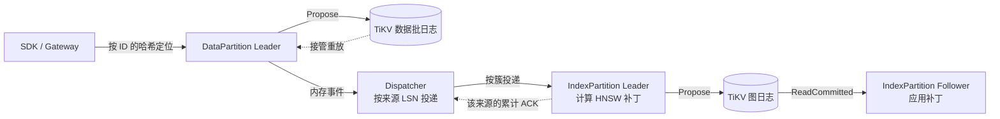

# 数据分片异步投递与聚类索引

状态：已实现固定簇中心路由、数据与索引分区数量独立、来源完成水位、接管恢复和旧位置清理。split/merge、在线重新训练簇中心尚未实现。聚类布局使用带 `-owner-append-v1-data-wal-v1` 后缀的 TxnKV 写入协议。一一映射布局使用独立的 namespace。升级已有 v14 聚类布局时，先停止所有旧进程并等待节点租约过期，再启动新版。已有数据和幂等凭证可继续使用。

## 部署和数据流



一个 DataPartition 对应一个写入 Leader 和一条按事件 LSN 排序的来源日志。普通向量按固定簇中心路由，删除广播给所有目标索引。TxnKV 客户端在数据 WAL 持久化和内存更新后收到 ACK。Dispatcher、构图和 Follower 回放在后台独立推进。

### RawKV 数据写入

在新建的聚类路由 namespace 中，所有角色可设置 `DATA_BACKEND=raw`，并设置 `CONSUMER_RETENTION=0`。后端类型随布局持久化。`DATA_BACKEND=txn` 是默认配置，已有 namespace 继续使用其原有后端。

- 每个数据分片有独立的写队列。队列有数据且槽位可用时立即发出，每批最多 32 条，最多 16 批在途。每个 `RawKV.BatchPut` 把一个逻辑批次的记录、最终版本、连续日志序号和幂等结果打包成一个不可变 KV 值，`request_id` 在该数据分片内判重。
- 按连续持久化前缀返回 `Durable=true`。前面一批的结果不确定时，该 owner 退役，后续在途批次由新 owner 根据持久化前缀恢复。读记录和数据订阅可读取这个前缀。List 页在各数据分片分别取视图。
- owner 在内存中推进连续持久化位点并唤醒投递。健康任期内，写入和发布合计只需一次数据 BatchPut。索引可见性仍异步生效。接管先等旧租约到期，再通过 CAS 隔离旧任期并封存其连续日志。旧任期迟到的写入只落在它自己的日志键范围，持久化且纳入封存前缀的批次可通过原 `request_id` 恢复。
- 当前所有 Raw 数据日志都用于恢复记录及回执，数据 `log-floor` 保持为 0。点查优先从持有租约的 owner 读取已确认的内存视图。owner 不可用时，热缓存从下一批的精确 WAL 键开始点读，随后读取一次分片头校验任期。冷启动和任期变更按封存记录恢复，旧发布头并发推进时可补读。集群控制和图日志仍使用 TxnKV。

RawKV 路径在索引提交后，向对应的数据 owner 回传带源任期、目标索引和累计 LSN 的回执。投递器只在该事件的所有目标都确认后推进连续完成位点。同机回执直接更新内存，跨机回执发给来源 owner。首次投递新写入时直接下发。处理接管前的积压，或已有投递连续 500 ms 未获进展时，从图日志校准。完成位点累计 100 次推进或经过 500 ms 后由投递器写入检查点，长距离稀疏投递可提前写入。删除仍需所有索引确认。

Raw 投递从已确认日志的完整区间按目标筛选记录，并对区间、源任期、目标和记录计算 HMAC。索引使用集群密钥验证投递内容。缺少签名的旧投递通过重读日志验证覆盖范围。

### TxnKV 数据写入

| 时机 | 分片行为 |
|---|---|
| 接管 | 获得任期后，在一个 TiKV 快照中读取批日志尾、逻辑事件尾或已回收位点。对下一个批序号写删除标记，隔离上任在途写，重放未投影的 WAL，恢复记录、回执和待投递窗口，再发布 ready。 |
| 批量写入 | Leader 在内存中给通过幂等和 revision 检查的请求连续编号。每批最多 32 条，一次单键 1PC Insert 追加到 `data/NNNN/wal/<20 位批序号>`。值包含首个事件 LSN，以及每个事件的最终记录、请求 ID 和摘要。后台续租、撤权和到期回调更新内存任期。普通追加只向 TiKV 提交该批次的日志键。 |
| 数据读取和 ACK | WAL 提交成功后更新内存记录、回执和待投递事件，然后返回 ACK。点查可直接读取 owner 的已提交视图。订阅与恢复在同一 MVCC 快照内把 WAL 叠加到历史物理投影，取出逻辑事件和历史版本。 |
| 后台索引 | Dispatcher 从内存窗口投递到 Index Leader。Leader 计算图增量，用一次单键 1PC 同时提交增量、来源任期和累计 ACK，再 apply 到 HNSW。来源在内存中推进完成位点，随既有租约续期上报。 |
| 重试 | 提交结果未知时写入器退役。接管者从 WAL 恢复，使用同一 request_id 重试返回原 revision。一个 request_id 可分别用于两个数据分片。升级前的共享凭证按原记录所属分片识别。 |
| 回收 | 数据 WAL 仍用于恢复记录和回执，保留全部 WAL。历史 `log-floor` 继续有效。 |

例如，批序号 51 可以同时包含事件 LSN 901、902。Dispatcher 从事件 LSN 901 续读会得到 902。批序号用于写入接管，事件 LSN 用于订阅和索引投递，图序号用于副本回放。

## 分片日志接口

`internal/shardlog.Group` 封装本地任期和分片日志。DataPartition 与 IndexPartition 的选举适配器分别执行 Data owner 和 Index Publisher 的持久化选举。底层日志的复制与持久性由 TiKV 提供。

| 接口 | 调用者及语义 |
|---|---|
| `Campaign(ctx, elect)` | 控制循环获取或续租。适配器返回已持久化的任期和有效期，成功后发布本地授权。 |
| `Propose(ctx, term, entry)` | 分片 Leader 提交已编号的批次。写入前后各读一次后台发布的内存任期。TxnKV 适配器在预先取得的 MVCC 快照上对日志槽做单键 1PC Insert。 |
| `ReadCommitted(ctx, window)` | Dispatcher 和图副本使用只读接口。从 `After` 的下一条开始，可固定上界并限制批大小。读取可以与消费位点共用同一个快照；读日志本身不推进位点。 |
| `StepDown()` | 撤销本实例的写权限，迟到的续租回包无法使其复活。新实例从持久日志恢复。 |

TxnKV 写入器先取得 MVCC 快照，再按本地单调时钟确认该快照取得时仍有写权限。这覆盖了进程长暂停、后台到期回调尚未调度的窗口。新 Leader 在恢复时对下一槽位写入删除标记。旧请求若先提交，新 Leader 从 WAL 恢复它；若在恢复之后送达，旧快照与该标记冲突。

TxnKV Dispatcher 接管时以历史 `dispatch-completed` 和 `log-floor` 为起点，从 WAL 恢复待投递事件，并使用各目标图日志的累计 ACK 跳过已经完成的投递。某事件的全部目标确认后才能越过该事件，后续连续事件可一并推进。Follower 独立从本地已应用的图位点回放，落后到日志已回收时从检查点恢复。

## TiKV 元数据访问清单

以下统计适用于聚类布局、DataPartition 单写入 owner 和 Index 图复制。计数单位为代码路径上的逻辑键、事务或反向扫描，一次 BatchGet 在 TiKV 内部可能跨多个 Region。

TxnKV 稳态写入的两次 TiKV 操作是数据 WAL 和目标图增量的单键 1PC。多个请求可以共享一次批次提交。删除广播需要每个目标索引各提交一次。分片租约、路由刷新、接管恢复、图副本回放和检查点各自运行。

| 路径 | 原有操作 | 当前操作 |
|---|---|---|
| 来源窗口 | 从 TiKV 读取来源日志 | Dispatcher 从内存读取已提交事件。接管时从持久 WAL 恢复。 |
| 来源状态 | 单独提交 `dispatch-completed` | 连续完成位点在内存推进，随既有 owner 续租上报。 |
| 来源 ACK | 轮询持久图尾 | 新写入由图提交回执更新内存，回执丢失时重投。接管时从图尾校准已有积压。 |
| 5. 图副本进度 | 每次已就绪心跳后，分别提交副本状态和 `progress/<replica>` | 位置、计划版本或已上报状态变化时合并为 1 个事务，稳定时额外事务数为 0。首次上报、进程重启或上次提交未确认会重新上报。 |
| 6. 集群状态 | 同一次状态请求为 graph_heads 和 log_heads 分别读同一图头及尾记录 | 从一次图头读取同时生成两个字段。 |
| 7. 图订阅 | 一页 N 条成功返回的事件，正常路径反查图尾 N+1 次，还为带载荷事件另开事务 | 每页在同一个 MVCC 快照定位图尾 1 次，再按序号读取条目（旧格式另读分块）、校验哈希。并发 GC 后，新页可用检查点重置。 |
| 8. 图检查点 | 同一事务写图头内的检查点描述和 `index/<id>/manifest` 镜像 | 聚类布局只更新图头内的描述，旧镜像可留存。数据流使用自己的 data manifest。一一映射布局仍写入供数据订阅和清理使用的 manifest。 |

### 接管、回收和进度判断需要的持久状态

| 状态 | 保留依据 |
|---|---|
| `log-floor` | 记录已经回收的连续前缀。整段日志删空后用于恢复下一 LSN，也决定订阅何时需要重置。 |
| `dispatch-completed` | RawKV 持续使用的跨 Index 完成检查点。TxnKV 接管时读取历史值，后续根据各目标累计 ACK 推进内存位点。 |
| `cluster/graph/<index>/head` | 保存图任期、快照、回收边界及其来源覆盖。普通数据增量的最新位置和累计 ACK 来自不可变图条目。尾条目回收后控制头仍提供恢复依据。 |
| 图副本的 `progress/<replica>` | 记录指定 owner 实际应用的图序号、哈希和数据位点，用于跨进程状态观测。图提交成功时 Follower 还可能落后。 |
| 数据 manifest、消费者 lease/ACK、对象登记 | 分别定位恢复对象、保护活跃订阅所需日志、协调对象发布与回收。消费者数量和 ACK 由订阅方决定。 |
| assignment、owner、replica-plan、lease、guard 和迁移任务 | 决定当前服务者及切换边界。可以缓存路由提示，持久化写入仍需与接管或回收在 TiKV 中互斥。 |

每个本地 DataPartition 独立投递，TxnKV 签名窗口最多 2,048 条事件、约 2 MiB，由分片 owner 从内存中的连续已提交事件计算目标投影，并签名绑定租约任期、来源、目标、范围和事件内容。Index 校验签名后可直接接收；缺少签名时校验原始日志。投递已入队后会暂缓重发同一区间，只有持久图日志的回执能推进连续完成位点。

来源与索引复用缓存的 owner 和 Publisher 地址。图日志提交成功才生成累计回执，接收端检查来源任期和 session，通知丢失时重新投递，索引使用已提交位点重发回执。升级时需先停止全部旧版本进程，新版 WAL 可以读取旧版投影和批日志。

## 固定聚类路由

启动参数 `CLUSTER_ROUTING_FILE` 指向 JSON：

```json
{"version":1,"centers":[[-10,0],[0,10],[10,0]]}
```

这个例子有三个二维索引簇：index-0000、index-0001、index-0002。选择 squared-L2 距离最近的中心，平局取较小索引编号。路由版本 1、中心坐标和索引编号持久化在布局中，不随进程故障或副本搬迁变化。此版本由配置提供中心，不自动训练或更新中心。

数据分区数量由 `PARTITIONS` 独立配置，索引数量由 centers 数量决定，两者各支持 1..64。所有角色必须提供相同配置，启动时校验持久化布局。恢复使用原事件向量计算目标，不读取最新记录替代历史事件，也不先持久化逐事件路由计划。

`GET /v1/layout` 中 `routing` 描述簇中心；`bindings` 此模式只枚举索引，`data_partition=-1` 表示没有一一绑定。数据分区集合由 data_partitions 定义。gRPC 同样暴露 routing，中心使用 Center.vector 消息表示。

## 投递窗口与完成水位

- 数据持久化确认后，owner 就地唤醒投递。Index 在图提交成功后通知来源累计 LSN，同一来源对同一索引只保留最新回执。投递失败或丢通知时，来源从图日志校准。
- TxnKV owner 每次向前读取最多 2,048 条、2 MiB 的连续日志，按目标分别投递。单个 RPC 和单次构图最多 512 条；滞后目标的空洞保留在连续完成位点之前。RawKV 和无签名投递的窗口上限为 512 条。
- 索引队列每个来源最多一批，排队编码载荷预算 4 MiB；另有当前正在处理的一批。处理批次按来源轮转。投递接口不等待构图；首次接受更高 epoch 时先写小型控制日志，普通同 epoch 请求校验后入队。
- 入队通过可合并通知唤醒该索引的独立消费者，Leader 连续处理到队列为空再阻塞等待；不再依赖 500 ms 或 10 ms 队列轮询。计划变更、失败重试和启动恢复同样可以触发处理。
- 一轮可合并队列中已经存在的多个来源批次，最多 512 条事件、约 2 MiB 编码输入；不等待凑批，单个合法大批次允许带协议头的有界余量。所有来源的 Index 本地 epoch、完成水位与同一个图引用原子校验和提交，任一来源 epoch 已被更高 epoch 替换则整批不提交。
- 每个图批次串行完成预校验、提交和本地 apply 再处理下一批。批次中同一个 ID 的多个版本折叠为最后的最高版本，再生成可回退图变更。
- 图增量先验证可回放，再去掉向量字节、保存历史数据引用；TiKV 图增量与累计 `GraphEntry.sources` 写在同一条日志中，事务提交即确认持久化。`GraphHead.sources` 从最新尾记录派生，不再逐批写 head。sources 的键是数据分区编号的十进制字符串，值是该来源的数据 LSN；它不是图 sequence。
- 图提交检查 Index Publisher 和每个来源的 Index 本地持久化 epoch，不再锁共享来源 fence。更高 epoch 通过图日志控制条目接受；旧请求在该 Index 接受新 epoch 后被拒绝。
- 同一来源可在多个 Index 独立提交，互不写来源锁。Index 内追加与 epoch 升级由本地追加锁串行化，持久化协议通过不可变图序号和任期切换隔离迟到写入，切主等待 Publisher lease 到期并改变 guard；图 GC 保留检查点和来源水位约束；仅确定写冲突做有限重试，未知结果重新读取图日志恢复。
- 来源水位是持久化确认，不保证 Follower 已经应用，也不等待 Follower。

投递包含 `source`、来源 ownership、`route_version`、`previous`、`through` 和选中的原始事件。previous 是已覆盖边界。带签名的 TxnKV 投递可以使用来源已经收到持久图提交回执的连续前缀。无签名投递跳过目标已有水位时，Index 会校验来源已持久化的 completed_lsn。跳过到尚未完成的位置会被拒绝。目标事件自身必须严格递增，来源 hash 和聚类目标均被校验。网络重试不能改变批次内容；授权的来源处理器负责完整选择范围内应投递的事件。

先校验 epoch；更高 epoch 即使全部事件已完成，也先持久化控制条目，再按提交水位去重。未提交的相同来源批次在有界队列中合并。构图中的重复批次即使重新排队，也会在下一次取出时按最新持久化水位跳过。进程退出丢失队列后，由来源重投，不需要恢复接收端内存。

## 连续完成位置与恢复

例：100 → I0，101 → I1，102 → I0。I0 确认 102 而 I1 尚未确认 101 时，来源 completed_lsn 只能到 100。I1 确认后才能越过空洞。不能取全部索引水位的最大值或最小值；没有收到事件的索引不参与该事件的完成条件。

处理器从窗口头逐条检查，遇到第一条未完成事件就停下。目标图提交后释放已完成的窗口前部。来源在租约保护下合并写入完成检查点，接管可安全重放检查点之后的窗口。读取不同索引的进度不必是同一时刻，因为它们都是同一路由版本内单调的持久化完成事实。

来源进程故障后：

1. Master 分配新处理器，新节点领取递增 epoch。
2. 加载持久化 completed_lsn，查询目标来源水位。
3. 从 completed_lsn + 1 读取一个有界窗口，使用固定路由重算目标。
4. 索引已经完成的事件直接越过；其余重投，继续推进。

不会全量扫描数据，也不会重新构建 HNSW。恢复等待主要取决于租约检测、Master 调度和存储响应；不承诺固定秒数。可以恢复处理后逐步追赶积压，不必先把全部积压放进内存。来源故障不妨碍原始读写；若同一 Worker 还承载索引，索引故障走独立副本接管协议。

## 更新、删除、旧位置清理和查询

向量更新只投递到新向量所属的簇，不保存逐 ID 路由历史。删除事件没有向量，因此投递到全部索引，来源需要等待所有目标确认该删除。

索引 Leader 的后台维护按权威数据的分页扫描检查旧位置，每页最多 128 条返回记录（底层扫描另有界限）。当最新版本更高且已删除或属于其他簇时，用该版本生成本地索引墓碑，再通过图日志复制。它不修改原始数据，也不直接修改 Follower。检查和构图由本地同步锁串行化，版本比较保护重新返回该簇的新版本。扫描游标只在本页处理成功后推进，重启可重新扫描。当前后台维护沿用 30 秒周期，单轮检查一页，不承诺大数据量下的清理时延。

查询读取副本已应用的 HNSW/记录内存视图，不逐候选回查 TiKV。更新、跨簇移动和删除未在该副本应用前，允许返回旧版本/旧位置。Gateway 按返回候选中的最新 revision 去重；未被任何查询分片返回的新版本无法被推断。Raw 的原始 Get 可从 owner 的已确认视图读取，List 对每个分片分别固定读取位置。

Worker 在既有心跳的 `load` 中上报 `live_records` 与 `records_known`。SDK 首次近簇搜索加载轻量 GetSearchRoutes，此后默认每 5 秒刷新一次；相同逻辑分片的副本数量取最大值，不相加。根据查询向量到固定簇中心的距离排序，累计估计记录数达到 K 时停止扩片；实际结果少于 K 时继续添加相邻簇。缺少计数或缓存过期时查询全部分片。数量不计属性过滤，是规划提示而非一致性证明。GetSearchRoutes 在一个快照内批量扫描路由记录，不生成完整运维状态。Gateway 对副本地址缓存至多 2 秒/TTL 的三分之一；错误会触发副本切换和路由刷新。Worker 的查询前后校验使用确认续租后建立的本地单调时钟读租约，地址缓存不提供权限；退休先失效本地租约再释放 ownership。

近簇选片是近似召回，即使最近一片有 K 条记录，也不保证全局最近 K；簇边界附近的记录可能位于其他分片。Python `all_partitions=True`、Go `SearchAll` 和 SDK `exact=True` 使用全片搜索。协议 `index_partitions` 可显式选择分片；未指定时服务端保持全片广播，指定时 Exact 只保证所选索引视图内的精确距离。

图复制模式的 MinVisible 读取 token 对应的记录，等待实际提供查询的目标副本应用该版本。删除要求每个目标都达到该版本。查询不再用权威墓碑逐条过滤；旧簇位置仍可能等待后台清理。持续写入不会不断延长已捕获的等待目标。

## 快照、订阅、清理与状态

图快照保存完整 HNSW、记录/属性/墓碑、图位置，以及捕获时的 sources/source_epochs/log_bytes；每片 30 MB 或 3 分钟触发，上传期间可以继续追加。此模式下 GraphPosition.data_offset 是索引内部的单调构图批次进度，用于副本屏障；来源 LSN 必须读取 sources，不能与该字段比较。副本搬迁屏障取当前图提交位置，不再读取某个绑定的数据日志头。

数据快照单独从一个 TiKV 事务快照读取记录并从日志尾键确定快照 LSN，保存为 `data-records-v1` 的 JSON Record 数组。检查点响应包含 index-NNNN 图快照和 data-NNNN 数据快照。数据订阅 reset 使用自己的数据快照，不再借用某个 HNSW 快照。

- data 流：以 `data-NNNN` 寻址；graph 流：以 `index-NNNN` 寻址。
- 消费租约、ACK、cursor 继续按流独立管理。
- 数据 GC 受数据快照位置、持久化 completed_lsn、各实际目标的 floor_sources 和有效 data 消费者 ACK 限制；先回收图日志，才能回收它引用的数据日志。索引完成证明依赖保留的图日志/图快照恢复链。
- 图 GC 继续受图快照与 graph 消费者约束；已回收日志的副本从图快照恢复。累计来源水位、已接受 epoch 及已退休来源水位保留在图日志头，不随图条目清理而丢失。
- 后台自动运行有界清理；`cluster prune` 也可显式触发；本模式返回 data-NNNN 的 floor。图 floor 在 cluster status 中查看。
- 数据快照暂不回收；历史图快照和永久对象回收标记的既有保留边界不变。

`vectorctl cluster status`、HTTP `/v1/cluster` 和 gRPC GetCluster 提供 `data_progress`：每个数据分区的 head、completed_lsn、floor、处理器 ownership；`graph_heads[*].sources` 展示来源完成水位，`source_epochs` 展示该 Index 已接受的来源 epoch。响应中的来源 owner.offset 取该数据快照的 completed_lsn。owner 续租时同时上报 offset 与最近一次处理错误。状态是观测信息，不是全局原子快照。

## 启动与验收

先启动 TiKV、SeaweedFS 并编译。使用仓库示例 `examples/cluster-routing.json`，或准备自己的 routing JSON，然后用新 namespace：

```bash
CLUSTER_ROUTING_FILE="$PWD/examples/cluster-routing.json" \
INDEX_REPLICATION=graph CONSUMER_RETENTION=1 \
  .tools/vectorctl --socket "$PWD/.state/cluster-routing.sock" \
  cluster start --namespace demo/cluster-routing-v1 \
  --partitions 4 --dimension 2 --workers 3 --replicas 2
```

该文件需要在各进程宿主上可读；集群 token 按 CLI.md 配置。不要在已启动的 namespace 内修改中心、数量或版本；split/merge 的存量迁移与路由切换协议尚未实现。

```bash
bash scripts/acceptance-dispatch.sh
```

覆盖全包 Go race、真实 TiKV Index 来源 epoch 屏障、独立提交及 GC 竞争、2 Gateway + 2 Master + 3 Worker 单进程流水线、真实多进程暂停/终止、业务写入不等待索引、4 个数据分区到 3 个簇、跨簇更新/删除、独立订阅与 GC、清理后接管，以及原一一映射图复制回归。报告见 reports/dispatch-acceptance.status、dispatch-all-tests.log、clustered-onebox-pipeline.json、dispatch-processes.json。所有测试只清理自身实例；未验证真实跨物理机故障和生产容量。

## 代码边界

- `cluster_routing.go`：不可变聚类布局、按向量选簇。
- `dispatch.go` / `source_signals.go`：来源租约、事件唤醒与控制巡检、有界窗口、连续完成前缀、投递。
- `routed_input.go`：有界接收队列、图提交、后台旧位置清理。
- `index_lease.go` / `index_writer.go`：Publisher 租约、迁移等待、内存控制状态、提交 guard 与未知提交恢复；生产图增量使用不可变 Insert 与接管时的下一槽位屏障。
- `index_consumer.go`：每索引独立消费、入队唤醒、连续处理、Follower 追赶、失败退避和退出。
- `index_commit.go`：复用持久化对象，只对确定的 TiKV 写冲突重试事务，每次重新校验 fencing。
- `route_plan.go`：图查询的计划读取超时回退；缓存只用于选副本，不取代 owner/epoch 校验或维护授权。
- `source_epoch.go`：持久化来源 epoch 控制记录、升级授权和旧 epoch 拒绝；协议细节见 [GRAPH_JOURNAL.md](GRAPH_JOURNAL.md)。
- `graph_journal.go`：图引用与来源水位的原子提交。
- `clustered_service.go`：显式同步、查询有效性、独立数据快照及回收。

split/merge 将来需要新旧索引并行准备、存量导入、增量屏障和查询路由切换。后台清理只能消除多余数据，不能替代新位置完整性检查；旧分片不能在新分片准备完成前退出查询。
