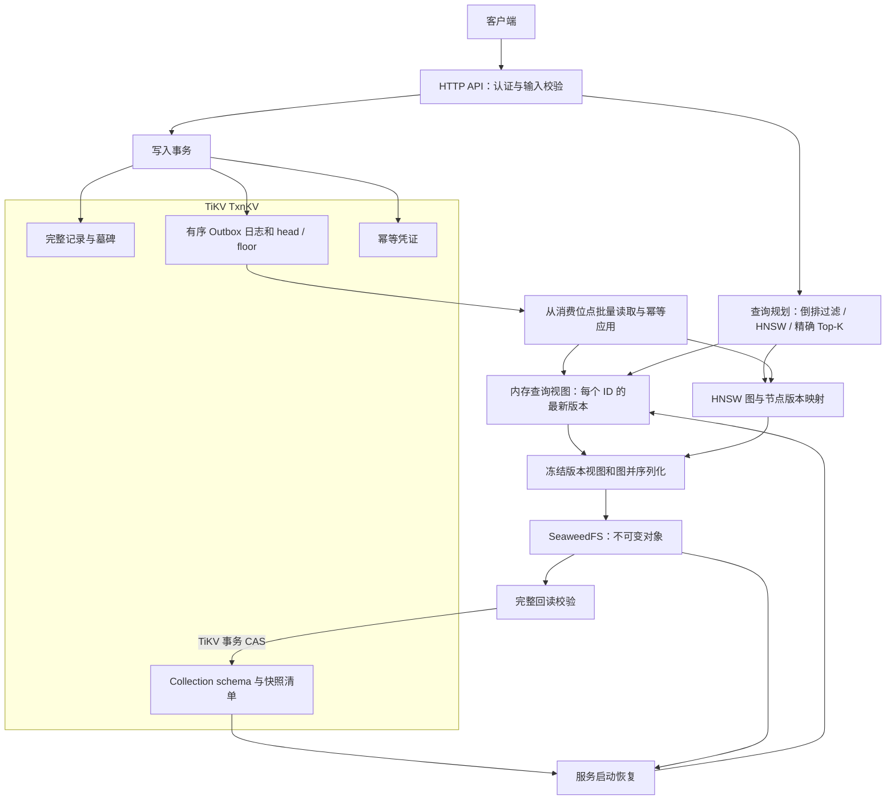
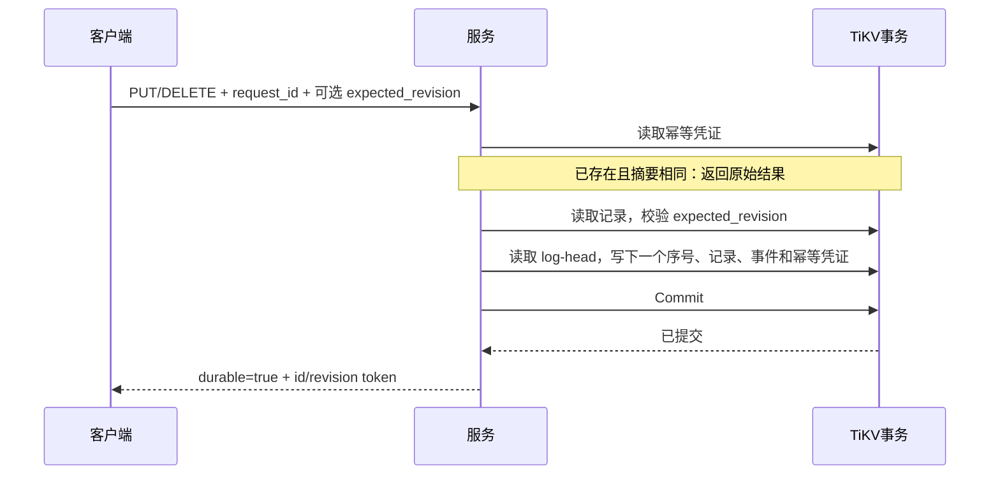
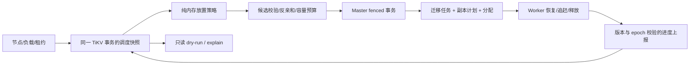
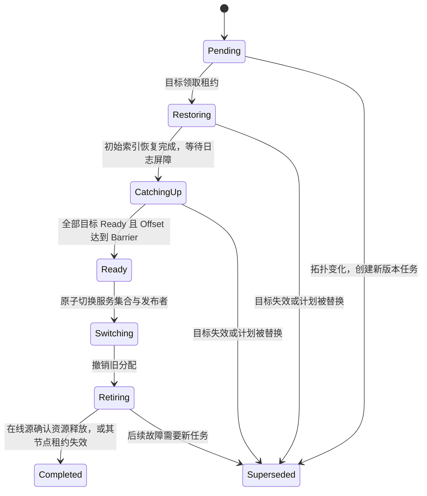
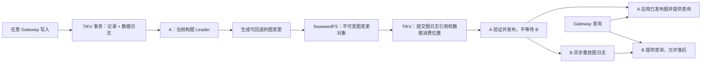

# TiKV + SeaweedFS 向量存储详细设计

状态：v0.5 已实现主备 Master、Gateway/Worker 多进程与故障接管，以及两层分区（一一映射），以及增量日志、位点绑定快照、安全分批清理、并发查询及重建追赶。日期：2026-11-12。查询算法见 [HNSW.md](HNSW.md)，当前日志和并发协议见 [INCREMENTAL.md](INCREMENTAL.md)，两层分区及全局查询协议见 [PARTITIONS.md](PARTITIONS.md)，多进程角色与选主见 [CLUSTER.md](CLUSTER.md)。

## 1. 本轮结论与边界

原始向量、属性、记录版本、幂等凭证、Outbox 和索引清单全部写入真实 TiKV TxnKV。SeaweedFS 保存经过 SHA-256 校验的不可变索引快照。服务进程保存可重建的查询视图。

已经实现：单 namespace / 固定多分区的 HTTP 服务，支持单进程及 Master/Gateway/Worker 多进程模式，新增、条件更新、逻辑删除、按 ID 读取、属性倒排等值过滤、HNSW 与精确 squared-L2 Top-K、可见性 token、快照发布、启动恢复、幂等重放。

尚未完成：向量聚类分区、多租户身份映射、完整生命周期 GC、生产环境 TLS 部署与配额。按负载调度、在线副本迁移、RPC TLS 配置和异步图复制见后续章节。这是进入向量存储开发的基线，不能直接当作商用完成版。

## 2. 当前实现架构

`repository.go` 管理事务与清单；`index.go` 提供精确 Top-K 基准；`hnsw.go`、`payload.go` 管理图和属性倒排；`graph_snapshot.go` 验证图快照；`service.go` 管理同步、对象存储和恢复；`cmd/vector-server` 提供 HTTP。

当前采用同事务递增序号，不把随机事件 ID 当作提交顺序。消费者增量读取；清理位点只能来自已发布图快照。协议与升级条件见 INCREMENTAL.md。

## 3. 数据模型和不变量

namespace 编码为十六进制前缀，避免路径分隔符造成键范围碰撞。namespace 由部署配置确定，客户端不能通过请求切换。

| 键 | 内容 | 约束 |
|---|---|---|
| schema | 格式版本、维度、距离函数 | 首次创建后不可变；配置不一致拒绝启动 |
| record/id | vector、payload、revision、deleted | revision 对同一 ID 严格递增 |
| log/sequence、log-head | 连续序号事件，完整写后镜像或墓碑 | 和 record 同事务；序号键冲突重试 |
| log-floor | 已清理前缀 | 和分批删除同事务；不能超过快照 offset |
| request/request_id | 请求内容摘要、原始成功结果 | 同一个 ID 重试不能改变请求含义 |
| manifest | generation、对象路径、大小、SHA-256、维度 | 读旧代际后条件更新 |

不变量：

1. 任意已提交的记录修改，都有同事务事件和幂等凭证；事件仅在被持久化快照覆盖后允许清理。
2. 重复或旧事件不能覆盖新版本，删除墓碑也是一个版本。
3. 查询看到的向量和属性来自同一条记录版本。
4. 未完成上传和校验的快照不能发布。
5. 清单冲突时不覆盖其他发布者的结果。
6. 恢复失败不能把不完整索引宣布为 ready。

## 4. 写入事务

采用乐观事务。两次并发修改同一条记录都会写同一 record key，因此发生写冲突；不会出现两个成功修改使用同一个版本号。

同一 request_id 携带不同内容返回 409。事务提交结果不明确时返回 503，要求使用同一 request_id 重试，不能由客户端生成新 ID 盲目重发。

重试旧请求返回原始 token，不保证其版本仍是当前版本。例如 v1 写入成功后已有 v2，重试 v1 返回 v1 凭证，但不会覆盖 v2。

## 5. 检索可见性与查询

普通搜索使用当前已应用视图，可能短暂落后于 TiKV。后台每 500 ms 尝试同步；这不是 500 ms 新鲜度 SLA。

请求携带 `min_visible={id,revision}` 时先完成一次有界增量同步，再检查目标记录的应用版本。更新版本或删除版本均可覆盖旧 token。目标未到达时不能悄悄返回旧视图。

每批在同一个 TiKV 事务快照中读取连续事件，完整校验成功后应用并推进 cursor。一轮同步以首次读取的 head 为目标，分批完成；后续批次失败保留已成功应用的前缀。并发同步由服务内互斥锁串行化。

查询在读锁内检查 token，再通过属性倒排获得匹配 ID。显式 exact、小结果集或匹配数不超过 K 时精确评分；其余使用 HNSW 召回，校验最新版本及属性，以 float64 squared-L2 重排。有效候选不足时扩召回，达到预算后精确兜底。最终仅对 K 条结果按 distance、ID 排序并复制属性。字段缺失不等同于空字符串。

精确检索保留为 ANN 真值基准：时间 O(ND + N log K)，Top-K 额外空间 O(K)，不再为每条候选复制向量或属性。HNSW 参数、过滤策略及近似语义见 HNSW.md；不能据此宣称亿级性能。

输入限制：1 MiB HTTP body；维度 1–4096；K 为 1–1000；向量元素必须有限且绝对值不大于 1e15；payload 暂为字符串键值。暂不支持范围过滤、数组字段或跨记录事务。

## 6. 快照发布与恢复

发布顺序：读取旧 manifest → 同步 Outbox → 在读锁下导出图、节点映射、完整版本视图及同一消费位点 → 上传新 UUID 路径 → 完整回读并校验 SHA-256 → TiKV CAS 发布。

快照包含墓碑，否则重放旧事件可能使删除记录复活。对象 ETag 不作为内容校验值。

恢复顺序：读取 TiKV manifest → 读取指定对象并校验 → 校验 schema 和记录 → 装载版本视图和 offset → 重放 offset 之后的日志 → 接受查询。

快照生成之后的新写入保留在 Outbox，恢复时由更高 revision 覆盖快照内容。服务进程在快照生成后宕机不会丢失权威数据。

日志可分批清理到当前已发布快照的 offset；消费者落后于 floor 时从同一 TiKV 快照中的完整记录和 head 重建基线。禁止直接添加日志 TTL。位点是逻辑分片序号，不是 TiKV 全局时间戳。

坏快照采取失败关闭，拒绝启动；后续可增加显式的权威记录全量重建命令。清单 CAS 冲突可能留下孤立对象，暂不回收。

## 7. HTTP 接口

所有接口使用 `Authorization: Bearer <API_TOKEN>`，默认仅绑定 127.0.0.1。一个部署绑定一个 namespace 和一套密钥，这只是开发隔离方式。

| 接口 | 行为 |
|---|---|
| PUT /v1/records/{id} | 创建或更新；request_id 必填；expected_revision 可选 |
| DELETE /v1/records/{id} | 写入新墓碑；request_id 必填 |
| GET /v1/records/{id} | 从 TiKV 读取权威记录；删除记录返回墓碑 |
| POST /v1/search | vector、k、可选 filter 与 min_visible |
| POST /v1/checkpoint | 生成 SeaweedFS 快照并发布 TiKV 清单 |
| GET /healthz | 进程已完成初始化；不是持续依赖健康探针 |

不存在记录返回 404；参数错误 400；幂等或条件版本冲突 409；后端或提交未确认 503。错误响应包含说明。记录分页已实现；批量写入 API 尚未实现。

## 8. 商用演进方案

| 阶段 | 改动 | 完成门槛 |
|---|---|---|
| v0.3 当前 | TxnKV、有序增量日志与清理、HNSW 并发查询、属性倒排、图快照与重建追赶 | 事务、恢复、更新删除和 HTTP 验证通过 |
| v0.4 当前 | Hash 数据分区、独立索引分区及一一绑定、各片日志与快照、全局 Top-K | 单分区兼容、四分区恢复与过滤、失败不返回缺片结果 |
| v2 分段 ANN | 基于当前单图扩展基础段、增量段和分段合并 | 与精确基准对比 Recall@K；更新/删除不退化为错误返回 |
| v0.5 当前 | 主备选举、固定分区分配、双层 fencing、多进程恢复 | 主切换不重建健康分区；旧主/旧 Worker 不能越过新 epoch 提交 |
| 后续分布式演进 | 查询副本、负载调度、在线迁移和聚类路由 | 多主机故障域、迁移限速、召回与容量验证 |
| v4 商用 | 身份映射、TLS、配额、GC、监控、备份与升级 | 可量化的新鲜度、可用性、RPO/RTO 和资源预算 |

v1 的日志 offset 与 TiKV 提交时间分别建模；v3 的路由 epoch 与 snapshot generation 分开管理。绝不使用“已看到的最大事件 ID”表示完整进度。

GC 前提：恢复快照覆盖范围、日志保留范围、活跃副本和重建任务的最低需求共同决定清理位置。独立 TiKV 的 MVCC GC 也必须有专门管理者。当前仅实现快照保护的事件清理；墓碑、幂等凭证、对象和 TiKV MVCC GC 尚未统一管理，不适合直接长期生产运行。

## 9. 验证与实际环境发现

真实环境：PD 8.5.8、TiKV 8.5.8、SeaweedFS 4.53，均为本机单节点。TiKV Go 客户端固定 v2.0.7，S3 SDK 固定 minio-go v7.0.83；使用该 SDK 不意味着部署 MinIO 服务端。

已验证事务回滚三键均不可见、提交后记录与事件一致、幂等重试、并发 expected_revision 只能成功一次、清单 CAS、旧快照叠加后续删除、错误校验和拒绝、HTTP 查询与过滤、服务进程被 kill 后恢复。Go 测试包含 race detector。

实际发现：宿主磁盘余量低于 TiKV 对整盘默认预留比例，导致首次写入触发 disk-full 保护。隔离测试实例改为 4 GiB 容量预算、512 MiB 预留，保留保护机制；这不是生产配置。没有删除用户数据。

报告：`reports/tikv-integration.json`、`reports/go-test.log`、`reports/http-integration.json`。未验证 TiKV 主机故障、多副本仲裁、跨故障域容灾或生产吞吐。

## 10. 参考

- TiKV Go 事务 API：https://tikv.org/docs/7.1/develop/clients/go/
- TiKV 空间保护：https://docs.pingcap.com/tidb/v7.5/tikv-configuration-file/
- SeaweedFS S3：https://github.com/seaweedfs/seaweedfs/wiki/Amazon-S3-API
- Milvus 实时/历史段与后台构建分工：https://milvus.io/docs/architecture_overview.md
- Qdrant 索引与过滤：https://qdrant.tech/documentation/manage-data/indexing/

参考只用于架构取舍；当前实现的能力以代码和测试报告为准。

## 2026-11 代码审查与职责拆分

本轮保留 HTTP/gRPC、SDK、持久化格式、分区映射和调度规则，重点降低集群控制层的耦合与重复计算。

| 边界 | 代码 | 职责 |
|---|---|---|
| 组合与控制循环 | cluster.go | 参数校验、角色装配、心跳、关闭 |
| Worker 运行时 | worker.go、worker_runtime.go、worker_load.go | 遵循分配、加载/退休本地索引、租约续期、采样 |
| Gateway 路由 | gateway_router.go | 定位副本、轮询、超时与重试 |
| 内部 RPC | partition_rpc.go | 鉴权、请求校验、分区执行、执行前后 fencing 检查 |
| 状态查询 | cluster_status.go | 汇总节点、主节点、分区与副本就绪状态 |
| 调度事务 | replicas.go、balance.go、scheduling_view.go | 迁移屏障、发布者选择、冷却时间、事务内状态读取 |
| 放置策略 | placement_policy.go | 成本计算、纯内存迁移选择、hash 排名 |
| 协议准入 | cluster_protocol.go | namespace 模式及调度配置兼容性校验 |

这些仍是同一个 Go package 内的边界；ClusterService 是共享组合入口，尚未把所有角色改成独立包。后续可沿这些边界抽取接口，避免同时改动生命周期和持久化协议。

审查发现与处理：

1. 集群入口混合本地索引生命周期、RPC、客户端重试和状态汇总。按职责拆分文件，保留公开类型、方法及锁的范围。
2. hash 排名在排序比较中重复 SHA256 和十六进制编码。改为每个 Worker 计算一次摘要，直接比较字节。新增 0/1/2/3/32/128 个 Worker、64 个分片的旧算法等价测试。
3. 负载调度和副本收敛重复读取同一计划与租约。新增仅存活于一次调度事务的读取视图，复用成功、缺失和失败结果；不跨事务、不跨 tick 缓存，不用于发布/裁剪。
4. 副本轮询原先复制并拼接候选切片。改为偏移下标遍历，保持仅 search 消耗轮询序号、sync 不轮转、维护仅访问 publisher 且不自动重试。
5. 调度器原先原地排序调用方节点切片。改为排序私有副本，避免隐式输入副作用。

不能删除的“重复写”：主节点 fence、assignment、publisher/retention 的 plan 写入会与并发接管产生事务冲突，是安全协议的一部分。本轮保留全部相关写入和事务边界。

性能证据：本机 64 Worker 排名微基准，旧实现约 293189 ns/op、104248 B/op、1524 allocs/op；预计算实现约 28349 ns/op、16472 B/op、5 allocs/op。仅代表该函数，不代表整体 QPS。复现：`bash scripts/go.sh test -run '^$' -bench BenchmarkRankWorkers -benchmem ./internal/vector`。

保留的限制：负载仍是图内存估算和查询墙钟时间，并非实际 CPU/RSS；状态汇总仍可能读取多个时刻的数据；角色之间仍通过 ClusterService 共享上下文。调整这些行为需要单独定义一致性、观测指标及容量目标，本轮不修改其语义。

验收脚本也修复了一处误报风险：verify_balance.py 的普通断言异常原先可能仅写失败报告后正常退出。现在所有异常在记录报告和清理服务后继续抛出；新增 test_verify_balance.py 注入断言失败，验证流水线能收到失败，且清理与报告仍执行。

本轮验证结果：最终 Go 全包 race、vet、TiKV 集成、2 Gateway + 2 Master + 3 Worker 单进程流水线、HTTP/CLI/跨语言 SDK、双副本故障迁移、32 分片负载调度、SeaweedFS、HNSW 崩溃恢复、1 万/5 万有规律数据和 native TSan 全部通过。执行中因修改正在运行的验收脚本中断过一次，已重新执行修正后的负载阶段及其余扩展阶段；最终 Go race 另行复跑通过。记录见 reports/refactor-review.json。最新负载验收完成 1560 次查询、零错误，测试子进程均清理。

## 分片迁移任务与调度控制面（tasks v1）

副本迁移现在是 TiKV 中的持久化任务。Master 内存只保留运行上下文；更换 Master 后由当前副本计划的 task_id 和 version 继续收敛，不依赖进程内队列。

任务阶段：

Ready、Switching 与进入 Retiring 是一次事务内的事件，不增加几个心跳周期来模拟中间态。任务历史会保存这些事件；外部不会看到已经撤销源副本、却没有提交目标计划的状态。快速恢复时部分阶段可能只出现在历史中。Restoring 包含初始快照/基线恢复；Worker 在基线加载完成、开始增量同步前上报 CatchingUp，后续以 offset 检查本次迁移屏障。进度按阶段及心跳采样，不是每个恢复字节的实时进度。

### 元数据与事务

- replica-plans：新增 version、task_id。成员变化时 version 增长，任务 ID 由逻辑分片及版本确定，重复调度不会重复建任务。
- tasks：源/目标分配、源租约 epoch、屏障、创建/更新时间、阶段开始时间、当前 Master epoch、阻塞原因、最近错误、各副本 offset/lag 和阶段历史。历史最多 64 个事件，额外事件数量由 dropped_events 标记。
- task-fences：每次计划改变都在同一事务写入；Worker 上报也写入这个键，保证迟到上报与切换产生冲突。它与快照发布使用的 plan 写入分离，减少无关冲突。
- retired：按副本 ID 和 epoch 记录本地资源释放确认；任务在切换时重新捕获源 epoch，避免源重新领取租约后误用旧确认。在线节点先取消加载、等待加载线程和在途读者退出、关闭图，再确认；写入失败进入本地待重试队列。节点进程退出时，Master 可在该节点注册租约失效后完成退休。

Master fence、任务阶段、计划、分配及 task-fence 在同一 TiKV 事务提交。Worker 上报验证计划版本、服务集合、节点/session/epoch、租约未过期和 offset 单调性。Completed/Superseded 任务不再持续更新进度。旧任务被替换时从当前 Serving 继续，切换后不重新启用已退出的旧源。

正常负载调度最多一个主动迁移，且上一任务包括资源退休在内全部完成后才继续；故障补副本和 drain 修复仍优先。每阶段超过 120 秒会显示 timed_out 与阻塞原因，不自动回滚或强行删除仍可服务的源。恢复失败由 Worker 在后续心跳周期重新领取并重试；LastError 保留用于排查。

### 策略与只读预览

placementSnapshot 收集输入，planPlacement 只做内存计算并返回建议，不读时钟、不写 KV。Master 负责写冷却时间和提交执行意图；Preview 在同一只读 TiKV 事务读取注册节点、计划、任务、租约与冷却时间，调用相同策略，不抢主、不消费冷却期、不创建任务。

Preview 返回 snapshot_ts、observed_at_ms、节点采样、归一化负载、各分片成本、当前/建议位置、计划版本、当前任务和冷却剩余时间。节点样本由心跳提供，因此快照一致不等于所有物理指标在同一瞬间采集。预览仅说明该快照上的建议，实际提交前仍重新计算。

可设置 WORKER_MEMORY_BUDGET_BYTES（仅 load 调度，默认 0 表示不限制）。放置检查使用本地上报内存、已分配但尚未上报的副本预留，以及新副本 50% 的恢复余量。无样本时每分片暂按至少 1 MiB 预留。预算是估算的准入规则，不是 RSS 硬限制，也不能保证首次大数据恢复不会超内存。预算不足时不会选择该目标；若不能凑齐副本，保留仍在线的旧 Serving，显示 insufficient_eligible_workers_or_capacity。

### 故障行为

| 故障点 | 恢复规则 | 验证方式 |
|---|---|---|
| Pending/Restoring/CatchingUp 更换 Master | 从同一 task_id 续跑，旧 Master 被 fence | 阶段矩阵 UT、七服务主备验收 |
| 切换前目标失效 | 原源继续服务；新版本任务修复，旧任务 Superseded | 阶段矩阵 UT、多进程暂停/杀进程验收 |
| 切换后目标失效 | 基于当前 Serving 补副本，不回滚旧源 | 阶段矩阵 UT |
| 源失效 | 依赖剩余副本与持久数据恢复；原源节点租约过期后无需资源确认 | 阶段矩阵 UT、多进程验收 |
| 旧版本/旧 epoch 上报 | 拒绝；并发变更时事务冲突 | UT、真实 TiKV 冲突测试 |
| 快照加载失败 | 保存错误，释放失败恢复产生的图资源，后续周期重试 | 迁移 UT、Service 错误路径测试 |
| 日志未达到屏障/阶段超时 | 保留源，不强制切换；显示 lag 与 timed_out | 屏障和超时 UT |
| 源图仍被读取或加载 | 等待退出后才确认资源释放 | 读者/加载器退休 UT、七服务验收 |
| 释放确认写入失败 | 保留待写确认并重试，不提前 Completed | 故障注入 UT |
| 目标预算不足 | 跳过目标，保留现有可服务副本 | 纯策略预算 UT |
| Master 事务提交失败 | 不留下部分任务/计划 | 原子失败 UT、TiKV fencing 集成测试 |

阶段矩阵是确定性的存储/租约模拟；真实进程验收覆盖主备、暂停、杀进程、重启和排空，不宣称穷举每个机器指令上的断电时序。

### 升级边界

新双副本 hash 使用 cluster-mode v5-replica-tasks-2 / schema v8，load 使用 v6-load-tasks-2 / schema v9。旧双副本 namespace 会被拒绝，防止旧二进制丢弃任务版本字段。当前应使用新 namespace 验证，不提供自动原地升级；单副本模式及业务 HTTP/gRPC 数据协议保持不变。历史任务和释放确认暂保留，不自动 GC；任务列表分页，调度只读取当前计划引用的任务。

## 异步图复制（INDEX_REPLICATION=graph）

此模式在新 namespace 中启用，保留已有 independent 模式。数据仍按 ID hash 划分，数据分区与 HNSW 分区暂时一一对应。应用层数据分区没有单独的 Leader：Gateway 将记录、幂等凭证与数据日志写入同一个 TiKV 事务，底层副本一致性由 TiKV 负责。

每个 HNSW 分区只有一个构图 Leader。Follower 重放已经算好的节点和邻接表变更，不调用 addPoint，不重复做插入时的距离计算。普通查询允许读到不同副本的不同进度；同一图日志位置的图结构、向量版本和删除状态应相同。

### 提交、发布和接管

- 数据日志 offset 与图日志 sequence 分开计数。一批最多消费 256 条数据事件；图条目包含前序位置、消费到的数据 offset、构图任期、对象校验和及链式 hash。
- 原生构图捕获本批次修改过的节点镜像，并在生成变更后回退；全过程持有索引写锁，查询不能看到推测修改。先上传和校验变更对象，再通过带 fencing 的 TiKV 事务提交图日志引用与消费位置。
- Leader 验证可重放性后推进 visible，再应用到本地可查询图。此处的验证和发布只依赖 Leader，**不等待 Follower ACK**。Follower 直接应用已发布条目。对象上传成功但事务未提交的对象不参与恢复；事务结果不确定时重新读取日志头，不重复追加已提交批次。
- 主备过期的是租约。Master 更换 Publisher，接任者领取递增的图任期；每次提交和发布均检查副本 ownership 与当前 Publisher，并写入 fencing 键，与主权切换产生事务冲突。
- B 接管时先追平已发布图，再完成已提交但尚未发布的批次，然后从 committed.data_offset 继续消费数据日志。无需重新计算已提交的图变更，也无需等持续写入的数据全部追平才允许旧版本查询。
- 正常查询不等待图日志的网络读取；图状态交换期间短暂互斥。带 MinVisible 的查询要求相应记录版本已可见。已有 HTTP/gRPC MinVisible 流程先同步有限的数据日志头，无法满足时返回不可见/不可用，不返回伪造的最新结果。

### 快照、维护与观测

快照保存原生图、节点映射、记录、两个构图随机数引擎状态，以及图 sequence/hash 和数据 offset。补齐 RNG 状态使从快照恢复的副本可以继续接任构图。只有 Leader 执行重建，重建结果作为 reset 图日志条目发布，Follower 加载结果。检查点与原始数据日志清理仍受 Publisher fencing 保护。

`/v1/cluster`、vectorctl cluster status 和 gRPC GetCluster 增加 index_replication、graph_heads、graph_positions。graph_heads 展示 committed/visible/term/checkpoint；graph_positions 是各副本通过心跳上报的已应用位置，可能比真实进度稍旧。

第一版保留全部图日志及对象，尚未实现图日志 GC 和孤儿对象回收。原始数据日志仍支持已有的 checkpoint/prune。跨分片查询不是全局时间点快照。二进制图格式固定为 hnswlib 0.8.0 的 64 位小端格式，不承诺跨版本/架构导入。测试中的跨 host 标签在一台机器上模拟，不代表已完成真实多机器或 TiKV/SeaweedFS 自身高可用验收。

## 对外订阅边界

`subscription.go` 提供按绑定分区读取 data/graph 流的只读接口，`subscription_handler.go` 与 RPC ReadChanges 负责协议适配。Gateway 直接读取持久化日志，订阅不依赖 Worker 当前在线或当前 Leader 所在机器。图流读取开始时固定 visible 上界；对象引用经过日志 hash 校验，载荷由消费者从 S3 读取并验证校验和。原生图变更额外导出 links 投影，不触发距离计算，不改变副本应用路径。

当前交付是无服务端消费状态的分页拉取订阅；持久化消费 ACK、保留租约、图日志 GC 和孤儿对象回收仍待完成。详细字段、reset 和断点语义见 RPC.md。
