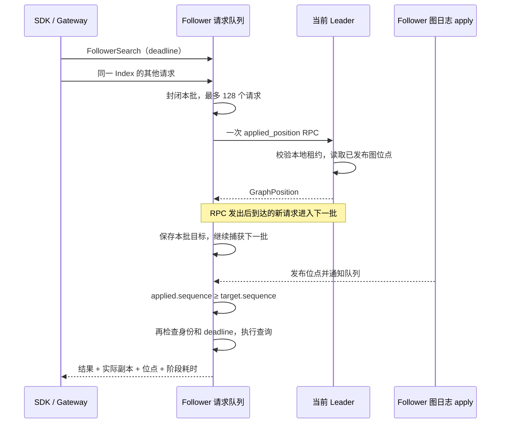

# Follower Read：Follower 合批取位点，再等待本地 apply

请求先进入 Follower，SDK 不预先查询 Leader。每个 IndexPartition 的查询图版本至少达到本批请求从有效 Leader 捕获的已应用图版本。当前要求启用租约读的聚类路由、图日志复制和至少两个副本。普通 Search 保持原语义；没有可用 Follower 时返回错误，不回退 Leader。



## 队列与超时

每个本地 Index 副本一个队列，首次 Follower Read 时创建。未捕获请求按 FIFO 出批，不为凑批额外等待。一次只进行一个 Leader RPC；已经取得目标、等待 apply 的批次不阻塞后续捕获。新请求不能复用已经发起的 RPC 或上一次 LSN。

| 约束 | 当前行为 |
|---|---|
| 等待上限 | 每副本 1,024 个请求，包含捕获中和等待 apply |
| 捕获批次 | 最多 128 个请求共享一次 Leader RPC |
| Leader RPC | 最长 1 秒，失败后整批返回错误 |
| FollowerSearch | 最长 5 秒，客户端更短 deadline 优先 |
| 取消/过期 | 立即从等待集合和 FIFO 移除，不等队首或下一次 apply |
| 批内部分过期 | 只清理过期者，其他请求继续 |
| 整批取消 | 取消无人需要的 Leader RPC |
| 满队列 | gRPC RESOURCE_EXHAUSTED / HTTP 429 |
| 超时 | gRPC DEADLINE_EXCEEDED / HTTP 504，无成功结果 |
| 副本退休 | 关闭队列，唤醒等待者，取消并收回捕获任务，再释放图内存 |

等待不持有图锁、Service.syncMu 或副本生命周期锁。apply 发布后通过内存通知唤醒，不轮询 TiKV，也不调用 Sync 干预追平。真正的查询在请求执行路径运行，查询前后检查 deadline 和 Follower 身份。已进入原生 HNSW 的计算遵循现有接口限制，不能保证在 deadline 同一瞬间中断，但超时结果不会作为成功返回。

## 位点与故障

Leader 返回 `graphReplica.position`，与内存图由同一把锁保护。持久化位点 `GraphHead.Committed/Visible` 可能早于本地 apply，不能代替它。租约和身份用本地缓存及单调时钟检查；Follower 使用控制面缓存的 Publisher 地址和 session，不为每批捕获查询 TiKV。Gateway 仍使用现有计划/owner 路由，查询仍执行现有权威记录校验。

同一 namespace、Index 的图日志在换主后不清零。相同 sequence 必须匹配完整 GraphPosition；更大的 sequence 属于经校验历史的后续版本。等待期间晋升为 Leader、租约失效或服务退休，不能继续返回 Follower Read 成功。Gateway 可有限次重新路由到当前 Follower，重新捕获位点，整个调用共享原 deadline。

多 Index 并发执行，全部成功才合并 Top-K，不返回部分结果。各 Index 捕获时刻可以不同，不提供跨分片同一时刻快照。结果可以比目标更新，不提供恰好某 LSN 的历史查询。不能与 `min_visible` 组合，后者会主动 Sync 数据输入。

## 接口与 SDK

gRPC：`VectorStore.FollowerSearch(SearchRequest) -> SearchResponse`。
HTTP：`POST /v1/follower-search`，字段同 Search，不接受 min_visible。

```python
with Client("127.0.0.1:18250", api_token) as client:
    result = client.follower_search([1, 2, 3], k=10, timeout=0.8)
    for read in result.follower_reads:
        print(read.replica, read.target.sequence, read.applied.sequence,
              read.wait_apply_ms, read.query_ms)
```

Go SDK Client 提供生成的同名 RPC，不做额外 Leader 请求：

```go
ctx, cancel := context.WithTimeout(context.Background(), 800*time.Millisecond)
defer cancel()
result, err := client.FollowerSearch(ctx, &pb.SearchRequest{
    Vector: []float64{1, 2, 3}, K: 10,
})
```

```bash
.tools/vectorctl search --follower --vector '[1,2,3]' --k 10
```

各 Index 返回 index_partition、replica、node、session、owner_epoch、target、applied，以及本地单调时钟耗时：

| 字段 | 含义 |
|---|---|
| queue_ms | 入队到本批 RPC 发起，包含等待前一批 RPC |
| leader_capture_ms | Leader 捕获 RPC 及返回处理 |
| wait_apply_ms | 取得目标后等待本地 apply，直到获准查询 |
| query_ms | 查询图及权威记录校验 |

并行分片时长不能相加当成整个调用时间。SDK 总时间还包含路由、网络、合并和序列化。捕获期间已经追平时，wait_apply_ms 可接近零。

## 可观测与验收

Worker `/metrics?scope=local` 无需 TiKV，提供以下指标：

- `vecdb_follower_read_pending`、`vecdb_follower_read_capture_pending`、`vecdb_follower_read_apply_pending`：等待请求数。
- `vecdb_follower_read_oldest_seconds`、`vecdb_follower_read_target_lag_entries`：最旧请求年龄、最大目标差距。
- `vecdb_follower_read_{ready,timeout,canceled,rejected,failed}_total`：队列结果，ready 仅表示获准查询。
- `vecdb_pipeline_stage_seconds` 的 follower_queue、follower_leader_capture、follower_wait_apply、follower_query、follower_read 阶段。完整 follower_read 包含其他阶段，不可重复相加。
- `vecdb_pipeline_batch_items{stage="follower_capture"}`：每次 Leader RPC 批量大小。

UT 覆盖合批边界、不同目标、连续超时、取消、满队列、捕获失败、hash 不匹配、退休、晋升拒绝、实际 apply 与 durable head 区别和禁止回退。RPC/HTTP/SDK 验证 deadline、错误码、认证和大 uint64。真实七服务流水线在两个 Gateway 查询，并在两轮全 Worker 故障及 checkpoint/GC 恢复后比较完整结果。

本接口测量 Follower 追上捕获的 Leader，不证明 Leader 已处理停写前的全部 Data 日志。停写验收须先确定 Leader 已应用覆盖最终数据位点的图变更，再测 Follower 追平；全量正确性扫描单独计时，不能把探针总耗时当成追平时间。

## 测量停写到副本追平的时间

在仓库根目录运行下面的命令。测试使用独立 namespace，启动 2 个 Gateway、2 个 Master、3 个 Worker 和本地 PD、TiKV、SeaweedFS，并在结束后清理本轮进程和数据。

```bash
.venv/bin/python scripts/capacity_explore.py --follower-probe \
  --series follower-stop-write --records 10000 --dimension 64 \
  --seed-rate 40 --rate 40 --load-seconds 8 --rounds 5 \
  --burst-writes 32 --max-seconds 720 --base-port 28240
```

探针以客户端收到最后一次逻辑写入的 durable ACK 为零点，用预热过的 Python gRPC 连接连续发送 `FollowerSearch(k=1)`。同一个 RPC 会访问全部 Index。原始样本在各轮的 `*-follower.json`，包含发出和返回时间、命中的记录、每个分片的副本身份、目标位点、查询位点和四段服务端耗时。

写入停止后，探针按 ID 哈希和最终 revision 计算每个数据分片预期的日志头，核对实际 head 和连续完成位点，再读取各 Index 的持久图头。它回看已经记录的响应，找出第一个在全部 Index 上同时满足 Leader 捕获位点和 Follower 查询位点都覆盖最终图头的请求。元数据核对及后续召回校验的耗时不计入这个响应时间。若同时产生额外的图控制日志，等待覆盖该图头会给出保守的结果。

| 报告字段 | 解释 |
|---|---|
| `first_confirmed_ms` | 最后 ACK 到首个满足条件的完整 FollowerSearch 响应，是客户端确认时间 |
| `applied_lower_ms` | 同一副本身份上最后一次确认落后的时间下界。查询位点仍落后时，从请求发出时间加上该副本排队、捕获和等待 apply 的耗时；仅 Leader 捕获位点落后时，只加排队。首次即达标时下界为零 |
| `applied_upper_ms` | 针对达标响应，从收到响应的时间扣除每个分片自己的查询耗时，取各上界的最大值。剩余时间仍含调度与网络 |
| `wait_apply_ms` | 对应分片本次 RPC 获取 Leader 位点后实际等了多久 |

以上范围覆盖每个 Index 本次选中的一个 Follower，以及对应 Leader 的已应用位点。对单轮结果的解读应同时看 `first_probe_ms`、覆盖的副本与 `confirming_attempt`。
