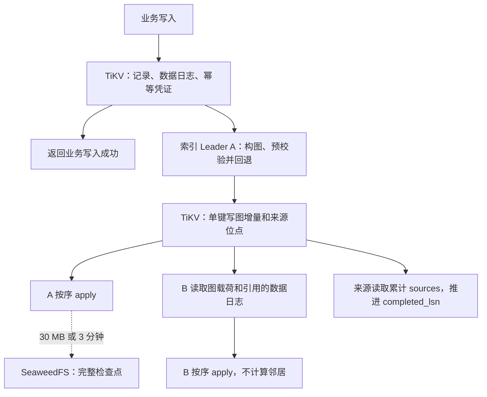
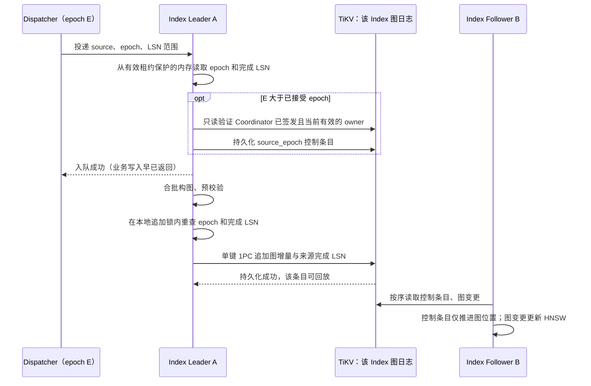
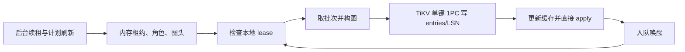

# 图日志、数据引用与检查点

`INDEX_REPLICATION=graph` 使用 reference 图日志；固定簇路由已升级到 v14 Publisher lease 协议（包含来源 epoch），一一映射模式仍为 v12。**TiKV 图日志提交成功就允许回放**，不等待下一条日志、不等待 Follower，也没有额外的 commit_lsn 发布事务。普通图变更不访问 SeaweedFS。

## 一批数据怎样完成

数据分片按 ID hash 划分；索引按固定簇划分，两者独立。TxnKV 业务写入等待数据分片批日志提交并更新内存视图。A 生成和预校验可逆补丁后，去掉其中的向量字节和属性，留下精确的图结构变化与数据引用。旧节点向量从本地不可变 label 读取，新节点向量从引用的数据日志读取。更新会创建新 label，旧 label 不因记录更新而改变。Follower 不重新选择邻居，同一图位置的邻接表、记录版本、墓碑、节点映射和 RNG 状态应完全相同。

## 图日志实际保存什么

| 位置 | 内容 |
|---|---|
| TiKV data/wal/batch | 包含对应逻辑 LSN 的完整历史记录：向量、属性、revision、墓碑。旧版的物理 `data/log/LSN` 仍可读取。 |
| TiKV graph/entries/sequence | previous、position、term、kind、累计 sources/source_epochs、累计 log_bytes、created_ms，以及内联的图增量正文、大小和 SHA-256 |
| 旧版 TiKV graph/payload/sequence/chunk | 升级前的外置图增量，按原描述读取，在对应条目 GC 时回收 |
| SeaweedFS checkpoint | 完整的可恢复状态，见下一节 |

原生补丁的 before/after 节点镜像也已去掉向量，不只是删除 JSON 的 records 字段。逻辑删除和后台旧位置清理用小型内联墓碑，无需捏造数据日志引用。

每个新图增量只写一个 `entries/<sequence>` 键。TiKV 值依次包含四字节标记 `VGE1`、小端 uint32 的 JSON 头长度、JSON 头，以及 Snappy block 压缩的增量正文。头里的 `payload.chunks=0` 表示正文内联，`size` 和 SHA-256 均针对解压后的原文。检查点使用的 `log_bytes` 继续按原文累计。读取图尾仍会从 TiKV 取回整条压缩记录，但读取来源位点只解析头部。Follower 回放和订阅读取才解压正文，并核对原始长度与摘要。HTTP、gRPC 订阅返回原有 `payload_data`。控制条目沿用 JSON；历史 JSON 内联和历史多键分块都可回放、订阅和清理。原始正文上限为 32 MiB，本地和 CI 的 Raft entry 限额为 64 MiB。升级须先停旧版本，再启动新版全部角色。

Follower 按固定目标位点分批回放，在同一个 TiKV 快照中检查回收边界和日志哈希链，按原始载荷大小限制每批解压量。已完成检查点所覆盖的图日志在独立的回收锁下删除，采集订阅水位、校验检查点以及 TiKV 事务中的 fencing 仍然生效。

TxnKV 数据 WAL 保留用于恢复记录和回执，也供 Follower 解析历史图引用。已有图检查点覆盖的图增量继续按图日志回收规则清理。

`head` 只在领取任期、检查点发布、清理时更新；最新位置、sources 和 source_epochs 从尾条目派生。`Committed == Visible`，Visible 是兼容别名，不代表每个副本已应用。B 可以先于 A 应用最后一条持久化日志。

## 每个 Index 独立接受来源 epoch

每个 Index 保存两张累计表：`source_epochs[source]` 是已接受的 Dispatcher epoch；`sources[source]` 是已持久化的数据完成 LSN。新 epoch 不清零或推进完成 LSN。

- 小于已接受 epoch：拒绝，并返回当前 epoch 和 `commit_lsn`。等于时沿用 LSN 去重、连续覆盖和精确数据日志校验。
- 更大 epoch：必须匹配 Coordinator 当前有效 owner；只读授权不写共享来源 fence。随后在该 Index 的图日志中提交控制条目。即使请求已经完全去重，也要先持久化 epoch 升级。
- 控制条目与正常图提交共用本地追加锁，按同一串不可变图序号落盘。新屏障提交后，队列中的旧 epoch 会被拒绝。TiKV 在提交时检查旧 Leader 的租约时间上界，恢复操作还会隔离同一任期内悬而未决的追加。
- Index 尚未看到新 epoch 时，允许已验证的旧 epoch 处理不可变数据日志。不同 Index 可在不同时刻接受新 epoch，不要求全局同步屏障。数据 `completed_lsn` 和数据 GC 仍由来源租约 fencing 保护。
- `source_epoch` 没有图载荷和对象，保持 `data_offset`、sources、HNSW 不变，只增加图 sequence/hash。订阅者需要识别并推进游标。Follower、接管 Leader 和检查点恢复均保留该屏障；新 Leader 从持久化图头读取接受状态。

控制记录进入图链、完整检查点和 GC 后保留的 head。检查点发布校验对应位置的 epoch map；较早检查点不能覆盖最新接受状态。升级不能混跑旧写入协议：v13 尚不遵守 Publisher lease，v12 及更早版本也不识别来源 epoch 控制条目。

移除来源锁后的 GC 依据：入队校验固定路由及 `(previous, through]` 内的完整目标事件；新图引用必须高于该 Index 的已完成来源位点；只有已退休图条目覆盖的 `floor_sources` 才允许删除数据日志。有效租约内只有一个本地追加器，维护操作与追加共享同步边界；已确认来源水位只增不减，重复批次不会再次引用旧数据。未知提交恢复通过 guard 事务建立串行化屏障，切主改变 guard，缓存不能跨这些边界复用。GC 不推进当前 committed，仅清理已被检查点覆盖的前缀；检查点仍校验持久化位置和覆盖表。epoch 只负责隔离旧投递，不替代引用保留协议；未来 split/merge 必须重新证明这些约束。

## 租约保护的内存处理路径

正常 Leader 构图批次使用内存中的 owner、Publisher 角色、图 term/head、来源 epoch/完成 LSN。取队列之前不再查询这些 TiKV key，也不重复 Claim。精确数据日志校验仍在入队时执行，首次或更高来源 epoch 仍需只读验证来源 owner 并持久化控制条目。

- Publisher lease 与副本存活租约分开保存，期限不超过当前副本租约。控制循环按 TTL 的三分之一巡检。当本地租约剩余有效时间降至半个 TTL 时申请续租。Worker 在请求前记录单调时钟，扣除 `max(50 ms, 剩余期限的 10%)` 安全余量；响应延迟和失败都不能延长租约。
- Master 在已发放 lease 到期前固定 Publisher。主动迁移先发布 `lease_draining=true`、停止续租、保留旧 Publisher，等待到期后切换。显式 release 或节点失联也不能提前撤销已发放 lease。
- 普通图增量和已取得租约的来源 epoch 屏障使用 TiKV 单阶段提交（1PC）。每个 Index Leader 顺序对 `entries/<LSN>` 执行一次 MVCC Insert，已存在的序号无法覆盖。增量与累计来源位点在同一个值中。后台续租、到期回调和主动退位更新内存状态。`Propose` 在写入前后读取本地任期。TiKV 在一次写 RPC 中选择提交时间戳并持久化，普通日志不会把应用租约写入 `MaxCommitTs`。成功持久化的条目即可回放。调用期间失去任期时返回结果未确认，由恢复流程判定这批数据是否已落盘。客户端在写入前仍向 PD 获取时间戳。
- TiKV 若退回普通预写，客户端阻止第二阶段提交，回滚预写锁，该次追加没有 ACK。若响应丢失，Leader 先恢复持久化图尾，再决定是否重放。引用对象的 reset、检查点和接管继续使用各自的元数据事务。
- 图增量、来源 epoch 控制条目、重建和清理的追加在本地串行化；相同来源 epoch 的普通入队校验不持有追加锁，不等构图或提交。已提交控制条目直接推进本地图位置，不重新构图。
- 初次成为 Publisher、新 lease generation、未知提交或维护追加后，先在 guard 事务中 Claim/读取持久化图头，再追平并安装缓存。恢复事务写 guard，并在原生路径对下一条尚未使用的图序号写删除标记。标记使同任期未决的旧追加与恢复发生写冲突。失败时缓存不可用，消费循环重试恢复。
- Follower 从后台缓存获得角色与本地租约，但仍读取持久化图日志，有进展时连续追赶，空闲轮询从 100 ms 逐步退避至 1 秒。Follower 查询捕获到更新的目标位点时会唤醒消费线程。查询 RPC 继续校验副本 owner；本次优化针对接收与构图热路径。

租约不让图日志变成内存日志，也不保证任意负载下排队都小于 1 ms。前一批提交、CPU 调度、重建/快照捕获和过载仍可能产生等待。`index_queue_wait` 与 `index_queue_to_build` 同时记录；本地 lease 剩余时间、缓存可用状态和 Master 等待 lease 状态可观测。

## 检查点覆盖什么

每个 IndexPartition 独立触发：自上次检查点以来累计 **30,000,000 字节图日志载荷**，或最早一条未覆盖日志等待 **3 分钟**，任一满足即可。无未覆盖日志就不生成新检查点。重启、切主后从持久化计数和日志时间恢复判断。维护每秒检查一次条件，此定时器不参与正常队列消费。配置为 `GRAPH_CHECKPOINT_BYTES`、`GRAPH_CHECKPOINT_AGE`，默认分别为 `30000000`、`3m`。

这里的大小统计包括图载荷（reset 计入对象编码大小，source_epoch 控制条目计入 epoch map 编码大小），不含 TiKV key、MVCC 和副本放大；30 MB 是触发阈值，不是快照大小上限。

完整图检查点包括：当前记录和属性、墓碑、原生 HNSW（包含尚未重建移除的旧节点向量）、节点映射、索引参数、RNG、graph sequence/hash、data_offset、**捕获时的 sources、source_epochs 和 log_bytes**。属性倒排可从快照记录恢复。它能够独立恢复该图位置，不依赖已清理的数据日志。

捕获时在同步锁内导出位置 S 的完整状态，然后释放锁，上传和读回校验在锁外执行。成功后通过 fencing 事务发布清单，允许此时图已经推进到 S+N；检查点覆盖仍是 S，后续日志字节不会被清零或误算进快照。上传失败不推进检查点或清理水位。登记意图和发布清单与持续构图竞争 fencing 时，只对明确的 TiKV 写冲突做有限重试，复用同一个对象；结果未知不盲目重试。重复请求若没有新日志，验证 Publisher 权限后复用已发布检查点。导出本身仍需短时阻塞该分片构图，当前不是分层/增量快照。

聚类模式的 DataPartition 另存 `data-records-v1`：从同一个 TiKV 快照读取当前记录并从数据日志尾键确定快照 LSN，再持久化对象并发布清单。自动维护在存在可清理前缀、且旧数据检查点未覆盖它时生成数据检查点；一次捕获当前数据头，可以覆盖后续多轮有界 GC。

**检查点保存状态，不保存所有历史事件。** 它不包含请求幂等凭证、所有旧记录版本、订阅历史、Master 租约等完整 TiKV 内容，不能替代 TiKV 备份。数据检查点与图检查点也不是全局原子时间点快照。

## 清理顺序与恢复

1. 图清理最多处理 256 条：不能超过图检查点或活跃 graph 消费者 ACK；同一事务删除条目、清理旧格式的外置块，并推进 floor 与 `floor_sources`。
2. 数据清理按实际路由逐条计算连续安全前缀。所有目标索引的 `floor_sources[source]` 都覆盖该事件，才证明引用它的图日志已退休；不能直接取所有索引水位的 min/max。
3. 再受数据检查点、completed_lsn 和活跃 data 消费者 ACK 限制，最多删除 256 条。数据清理仍校验来源租约；图追加不再锁共享来源 fence。安全性依赖下述单调引用约束。

`completed_lsn` 代表构图已持久化，**不是数据日志立即可删除**。即使已有新检查点，旧图日志若被订阅者保留，其引用的数据日志也仍被保护。

落后副本低于 graph floor 时加载完整检查点，再按序读取剩余图载荷及历史数据引用。缺块、hash 不符、历史版本不符都拒绝应用；不越过失败条目。切主先回放已持久化图日志，再从 sources 继续处理未完成数据。原始记录读写不依赖构图 Leader 在线。

对象意图协议继续用于检查点和显式重建 reset：上传前 staged，发布时 live，未采用对象到期回收。历史检查点仍保留，尚未实现历史快照淘汰和 TiKV MVCC GC 管理。

## 订阅与观测

普通 graph 条目提供 `payload` 描述符与 `payload_data`（gRPC bytes；HTTP base64 JSON）。内容格式为 `hnsw-data-reference-v1`，包含 links 邻接投影与数据引用，消费者可以订阅 data 流解析引用。payload_data 是传输字段，不参与条目 hash；载荷本身由 payload.sha256 校验。单页按 8 MiB 预算截断，单个更大载荷单独返回。reset 仍通过 object manifest 读取完整快照。HNSW 导航边并非精确 Top-K 关系。

`graph_heads` 显示 `log_bytes`、`checkpoint_bytes`、`checkpoint_sources`、`floor_sources`、`source_epochs`、`checkpoint_source_epochs`。Prometheus 增加 checkpoint_pending_bytes、checkpoint_sequence、source_checkpoint_lsn、source_retired_lsn；阶段耗时/错误覆盖 graph_checkpoint、graph_gc、data_checkpoint_gc。消费保留租约仍由 `CONSUMER_RETENTION=1` 开启；自动检查点和有界清理在 graph 模式默认运行，未注册租约的订阅可能需要从快照 reset。

## 升级与验证

新 namespace 协议为 `v12-graph-reference-*` / `v14-cluster-routing-lease-*`。固定簇模式不与 v13 或更早版本混跑；一一映射模式不与 v11 或更早版本混跑、不自动迁移旧 namespace；旧数据保留，验证使用新 namespace。independent 模式保持原行为。

实现入口：index_lease.go、index_writer.go、source_epoch.go、graph_reference.go、graph_payload.go、graph_append.go、graph_journal.go、graph_maintenance.go、graph_gc.go，以及 internal/ann/patch_compact.go。UT 覆盖原生补丁逐字节恢复、无 S3 的历史版本回放、引用/载荷损坏、上传期间继续追加、阈值/空闲、订阅保留与恢复。完整 smoke 继续验证真实 TiKV/SeaweedFS、七服务、进程故障、迁移和 SDK。
