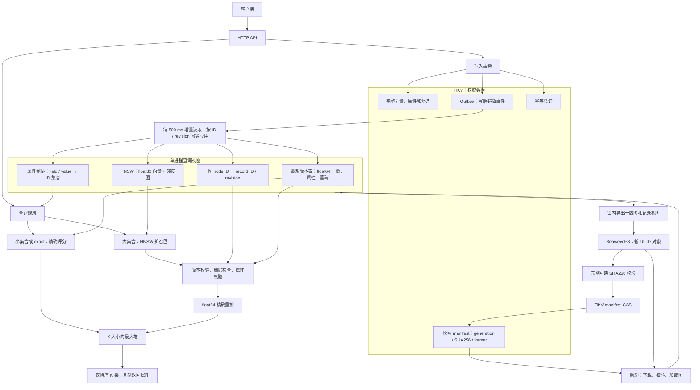

# 查询索引、图快照与重建

v0.3 的日志、并发与重建更新见 [INCREMENTAL.md](INCREMENTAL.md)。下文性能表保留 v0.2 测量，当前容量数据以 reports/capacity.json 为准。

本轮按三个步骤落地：先移除精确搜索的全量排序和候选复制，再接 HNSW 与属性倒排，最后持久化图并支持重建。TiKV 仍保存完整记录和事务 Outbox，SeaweedFS 保存不可变快照，内存索引可以恢复。这里的“重建”是清理旧图节点，不会重置记录 revision 或丢弃墓碑。

## 架构与数据流

内存读锁覆盖一次搜索，写锁覆盖一次应用。向量、属性和可见版本来自一致视图。v0.3 将 ef 和诊断计数改为请求局部变量，原生查询使用共享读锁，支持并行查询。

## 1. 精确搜索的改动

旧路径为每个匹配候选复制向量和属性，保存全部命中，再全量排序。新路径直接读取锁内不可变记录，计算距离后只维护大小为 K 的最大堆，最终排序 K 条并复制返回属性。

- 时间从 O(ND + N log N) 改为 O(ND + N log K)。
- Top-K 辅助空间为 O(K)，不包含长期保留的记录、属性索引和最终返回属性大小。
- 显式 `exact:true` 保留严格精确结果；距离相同按 ID 排序。
- 精确路径仍计算所选集合每条向量的距离，减少这部分 CPU 工作依靠 ANN 或属性索引缩小集合。

## 2. HNSW 与属性索引

采用固定版本 [hnswlib 0.8.0](https://github.com/nmslib/hnswlib/tree/v0.8.0)，源码及许可证在 `internal/ann/`。Go 管理记录、版本和属性，C++ 图完成候选搜索。候选使用 float32 距离，最终用原始 float64 向量计算 squared-L2，返回距离与精确接口一致。float64 重排只能校正已召回候选，不能补回 ANN 漏掉的近邻。

| 配置 | 默认值 | 作用 |
|---|---:|---|
| M | 16 | 图邻接规模 |
| ef_construction | 200 | 建图候选预算 |
| ef_search | 256 | 默认查询预算，可通过请求覆盖 |
| exact_threshold | 128 | 匹配数不超过该值直接精确搜索 |
| max_candidates | 4096 | 过滤/失效版本导致结果不足时的扩召回上限 |

属性结构为 `field → value → ID set`，只登记当前存活版本。多个条件取交集，从最小倒排集合开始；字段不存在与字段值为空字符串不同。更新和删除同步移除旧倒排项。

查询策略：

1. 验证维度、K、ef_search、可见性 token；必要时 HTTP 层先同步 Outbox。
2. 根据过滤条件求候选 ID 集合。显式 exact、集合不超过 128，或匹配数不超过 K，采用精确搜索。
3. 其他情况使用 HNSW，初始候选数为 `max(4*K, ef_search)`，受图大小及候选上限约束。
4. 去除墓碑、旧 revision 和不匹配属性的候选，float64 重排后维护 Top-K。
5. 不足 K 则逐次扩大候选；到达上限仍不足时，对匹配集合精确兜底。

“大过滤集”仍可能有近似召回误差：拿到 K 条合格记录不代表它们是过滤集内严格最近的 K 条。精确兜底保障数量和过滤正确性，不保证每次 ANN 都达到固定召回率。倒排求交集当前仍分配 ID 集合，尚未采用 bitmap；已消除的是每条向量和属性的候选复制。

新增 live 版本分配新的图 node ID。旧节点留在图中参与导航，但返回结果必须通过 `node revision == latest revision` 校验。删除写墓碑并移除属性倒排，不在查询期间修改图拓扑。重放旧版本不新增节点、不覆盖新版本。

## 3. 图快照与恢复

快照包含格式、维度、建图参数、完整记录及墓碑、节点版本映射、下一个 node ID，以及原生图字节。属性倒排从快照记录重建。格式固定为 `hnswlib-0.8.0-le64-v1`，依赖 64 位小端布局；跨架构或库版本升级需要显式迁移重建。

发布顺序为：读旧 manifest → 同步 Outbox → 锁内导出一致快照 → 上传新对象 → 完整回读校验 SHA256 → manifest CAS。竞争失败的对象不会成为当前版本，孤立对象清理尚未实现。

启动先验证大小、摘要、格式和维度，再检查图头部、分配边界、邻接引用、层级、节点映射及当前向量一致性，验证成功后才交给原生加载器。随后重放保留的 Outbox，补齐快照之后的更新和删除。旧版“仅记录”快照仍兼容，加载后重新建图；不认识的图格式和损坏快照拒绝启动，不静默提供不完整结果。

512 MiB 是序列化对象上限，不是进程内存上限。图字节在 JSON 中使用 base64，导出、回读和恢复期间会产生额外完整副本。尚未实现流式快照、分段加载或快照版本迁移工具。

## 4. 重建

`POST /v1/rebuild` 先同步，复制记录及索引 epoch，对基线记录做固定种子的顺序打散后，在锁外用当前存活记录构建新图，保留所有墓碑。v0.3 先追赶建图期间的写入增量，短暂持有写锁处理至多 256 条尾部更新并交换图和映射，及时释放旧图原生内存；构建失败或冲突也释放未发布的新图。随后执行 checkpoint，把新状态写到 SeaweedFS 并发布 manifest。

v0.3 普通并发更新由增量追赶处理；同时发起多个重建时返回 409。持续高写入速度仍可能使追赶超时。checkpoint 失败时新内存图已经生效，但旧快照仍可恢复并重放 Outbox，不承诺“重建和持久化”单一事务。

后台每 30 秒检查一次：图节点至少 256 且过期节点占比至少 30% 时尝试内存重建。后台重建不自动上传快照，由后续 checkpoint 持久化。重建会同时保留新旧图和记录副本，需要峰值内存余量。

## 5. 验收与性能

测试入口、案例及模块 UT 见 [ACCEPTANCE.md](ACCEPTANCE.md)。完整脚本覆盖 Go 单元测试和 race、ANN 召回门禁、真实 TiKV 事务、SeaweedFS 图快照、HTTP 重建与进程强杀恢复、Python S3 验证。

召回测试使用固定种子的 10,000 条 128 维高斯向量、50 个独立查询、K=10，以精确搜索为真值。默认参数下 Recall@10 为 **97.8%**，验收门槛为 95%。工作量诊断计数约 7,261/查询，低于精确扫描的 10,000；该原生计数包含邻接访问估计，不能视作精确 CPU 指令数。此结果只代表该数据集，生产 embedding、过滤分布、更新比例需要重新标定。

微基准见 `reports/ann-benchmark.log`，查询使用库内某条向量，因此不能和独立查询召回测试的耗时混为一谈。Go B/op 不包含 C++ 分配和常驻图内存。当前记录仍保留 float64 向量，图另存 float32 向量及邻接关系，不能据查询分配下降推断总内存下降。

v0.3 已将 Outbox 改为有序增量日志，绑定快照位点并支持清理，详见 INCREMENTAL.md。

2026-11-12 本机基准（macOS Apple Silicon / darwin-amd64 Rosetta，10,000 × 128，K=10，单次查询循环）：

| 路径 | 平均耗时 | Go 分配 / 查询 |
|---|---:|---:|
| 旧全排序及候选复制 | 4.371 ms | 15,442,969 B |
| 精确最大堆 | 0.781 ms | 4,544 B |
| HNSW | 0.140 ms | 7,120 B |
| 倒排筛选 10 条后精确评分 | 0.0052 ms | 5,048 B |

独立查询召回测试的平均耗时为精确 0.882 ms、HNSW 0.380 ms；它与上表属于不同查询工作负载。当前完整验收通过，Go 总语句覆盖率 86.3%（vector 90.6%、ann 包装层 82.0%、HTTP/main 69.5%）；`go vet` 通过。原始报告位于 reports/ann-acceptance.json、reports/ann-benchmark.log、reports/coverage.txt、reports/acceptance.status。
