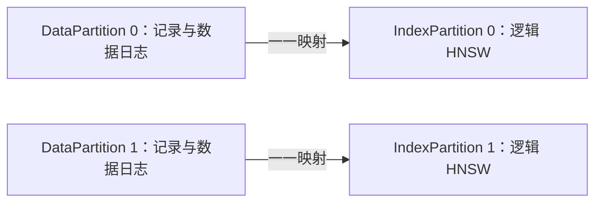

# 两层分区第一版：Hash 数据分区 + 一一对应的索引分区

本版把数据分区和索引分区建模为两个独立概念，暂时采用一一对应的索引放置策略。单进程模式仍支持全部分区同进程运行；新增多进程 Master/Gateway/Worker 模式见 [CLUSTER.md](CLUSTER.md)。向量聚类尚未实现；负载调度和在线索引副本迁移已经实现，见 [BALANCING.md](BALANCING.md) 和 [REPLICAS.md](REPLICAS.md)。当前架构、简化分区图与保留 DataPartition 的设计决策见 [ARCHITECTURE.md](ARCHITECTURE.md)。

## 路由与数据流



此图仅表达逻辑映射。数据分区存入 TiKV，没有应用层主备；索引副本部署与主备传递单独见 [架构说明](ARCHITECTURE.md)。向量查询当前访问全部索引分区，再合并局部 Top-K。

第一层通过记录 ID 的原始 UTF-8 字节做稳定 hash，与向量和属性无关。第二层读取 layout 中的映射，不再次计算 hash。目前数据分区 0 对应 index-0000，数据分区 1 对应 index-0001，依此类推；两类 ID 使用不同类型。

`PartitionRouter` 明确区分三项决策：

- `DataForID(id)`：定位权威数据所在分区。
- `IndexForRecord(dataPartition, record)`：决定索引归属；当前忽略向量并读取一一映射。由于整条来源日志都属于同一个索引，当前在建立日志消费者绑定时解析一次。
- `QueryIndexes(query)`：确定搜索目标；当前访问全部索引分区。

未来基于向量选簇时，第一层可以不变，第二层需要新的策略及事件分发协议。不是仅替换一个路由函数就能安全上线：多来源日志位点、跨簇更新、路由 epoch 切换、边界召回和迁移仍需实现。

## 持久化布局

以内部 namespace 前缀 P 和 4 个分区为例：

| 路径 | 内容 |
|---|---|
| `P/schema` | 维度、距离函数、分区 schema 标记 |
| `P/partition-layout` | version、epoch、hash 算法、分区数、data→index 绑定 |
| `P/request/<request_id>` | namespace 级幂等凭证 |
| `P/data/0000/record/...` | 数据分区 0 的完整记录和墓碑 |
| `P/data/0000/log/...`、`log-head`、`log-floor` | 数据分区 0 的有序日志及保留范围 |
| `P/index/index-0000/manifest` | 索引分区 0 的图快照清单 |
| SeaweedFS 的 `P/index/index-0000/snapshots/...` | 索引分区 0 的不可变快照对象 |

记录、来源日志、来源 head 和 namespace 级凭证仍在一个 TiKV 事务内提交。不同数据分区不竞争同一个 head。请求 ID 仍在整个 namespace 内唯一，不能通过换一个 hash 分区绕过幂等冲突检查。

索引服务通过绑定的来源读取日志，图快照和 manifest 使用独立索引路径。发布快照仍校验来源 head/floor；清理通过该绑定读取持久化快照位点。当前一对一关系保证每个索引仍只需要一个来源 offset。

## 查询与可见性

各索引并行查询，每片最多返回 K 条，然后全局按 squared-L2、ID 排序取 K。精确模式与同一组分区结果视图的全量精确搜索等价；ANN 模式仍有近似误差。逻辑分区只有唯一数据归属，因此当前没有跨片副本去重问题。

`min_visible` 只在该 ID 对应的索引分区检查，不要求其他分区存在这个 ID。HTTP 层携带 token 时仍先同步；普通查询仍是最终一致性。不同分区不共享同一 TiKV 读时间戳，不承诺跨分区原子读快照。

任一分区不可用时，接口返回 503，不把缺片结果标为完整成功。跨片查询响应受请求 context 限制；已经进入原生 HNSW 的计算不能中途抢占，取消后可能短暂继续运行，但不会再返回部分结果。全部候选合并最多处理分区数 × K 条命中，不重新扫描全部向量。

## 运维接口

- `GET /v1/layout`：返回持久化两层映射，需原有 Bearer token。
- `POST /v1/checkpoint`：多分区响应为 `format=partition-set-v1` 和 `partitions` 映射，分别给出每片 manifest。响应 generation 只标识此次聚合结果，不是可恢复的全局原子快照。
- `POST /v1/log/prune`：多分区返回 `partitions: {index-0000: floor, ...}`，不同分区的 offset 不能相互比较。
- `POST /v1/rebuild`：各索引重建后发布各自快照。

Checkpoint、清理和重建均按分区独立生效。中途失败会报错，但已完成分区不会回滚；重试即可继续。单进程非集群模式启动时恢复全部索引后才监听 HTTP；集群模式由 Worker 按分配异步加载并上报 Ready，Gateway 只向可服务副本路由。

## 配置与兼容

```bash
PARTITIONS=4 NAMESPACE=demo/partitioned-v1 \
  API_TOKEN=local-vector-test-token .tools/vector-server
```

分区数允许 1..64，默认 1，首次持久化后不可修改。再次启动配置不一致时拒绝启动，不能通过改环境变量“直接扩容”。

已有单分区 namespace 只允许以 PARTITIONS=1 打开，保留原记录路径、manifest、对象路径，以及 checkpoint/prune 响应格式；没有重新搬运原数据。创建多分区请用新 namespace。测试没有迁移现有 demo。

多分区根 schema 使用 v3 标记，layout 与标记同事务建立；旧二进制不能重新打开该 namespace。升级时仍必须停止旧写者，因为 schema 不能撤销已经运行的旧进程。多进程归属、租约和 fencing 已在集群模式实现，使用独立 v5 schema 与 Master 协议，详见 CLUSTER.md。

## 验收

`partitions_test.go` 覆盖 hash 固定样例、映射持久化、配置冲突、全局 Top-K、属性过滤、token、跨数据分区的幂等冲突、快照恢复、失败和截止时间，以及原有单分区兼容。

`python3 scripts/verify_partitions.py` 使用真实 TiKV/SeaweedFS，创建 4 个分区、写入 800 条 16 维向量。记录分布为 195 / 198 / 206 / 201；验证独立索引对象路径、各片日志位点与清理、精确 Top-K 和过滤、强杀进程后重放更新删除、重建，以及错误分区数启动失败。ANN 的本次单查询 Recall@20 为 100%，不作为通用召回保证。

脚本已加入 `scripts/acceptance.sh`。报告在 `reports/partitions-http.json`，测试服务使用独立端口 18093 和随机 namespace，只停止自身子进程。完整扩展验收仍包含已有单分区图字节一致恢复、结构化召回、容量、Go race 和原生 TSan 测试。
