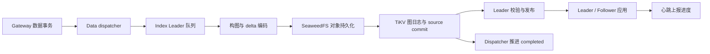

# 写入到索引可见的时延

原始写入的成功条件仍是 TiKV 数据事务提交。返回成功不表示 HNSW 已经构建、两个副本已经应用，或 source completed 已经推进。onebox 的 `catchup_seconds` 从并发读写线程全部退出开始，直到所有 DataPartition 完成且两个图副本的**上报位点**都等于已发布版本；它不是单条写请求延迟，也不是每条向量的可见延迟。

## 2026-11-16 真实进程复测

运行 `20261116T203254-ddffa441`：1 PD、1 TiKV、1 SeaweedFS、2 Master、2 Gateway、3 Worker；16 个 DataPartition、8 个 IndexPartition、双副本，768 条结构化 16 维向量。并发负载 600.232 秒，业务 API 的失败尝试为 0；停写后 7.317 秒全部追平，完整记录、双入口 HTTP/gRPC 查询和 ANN recall 核验通过。

原先 7.175 秒的运行没有阶段计时，不能精确回溯它的组成。本次保持相同拓扑和负载方式，重现了约 7 秒的追平现象，得到以下可核验结果。

| 停写后的里程碑 | 首次观测时间 |
|---|---:|
| 全部目标 source commit 到达最终值 | 6.788 s |
| 全部图版本已发布 | 6.788 s |
| 两份副本实时内存均已应用 | 6.965 s |
| 全部 source completed 与副本上报进度均达标 | 7.317 s |

停写后的首个采样仍有 128 条来源事件未完成。共采样 42 次，最大相邻采样间隔 205 ms；表中小数是观测值，不能理解为微秒精度。最后追平的是 `index-0003`：首个采样还有 9 个来源批次排队，图 committed sequence 从 1093 推进到 1108，轨迹中多次相邻提交间隔约 0.5 秒。图 sequence 还包括后台维护条目，不能直接当作数据批次数。

负载前至追平及完整核验后，按进程 Histogram 做差分得到：

| 阶段 | 平均每次耗时 |
|---|---:|
| 入队到取出批次 | **1,566 ms** |
| 取出批次到提交（含校验、构图、对象保存等） | **7.38 ms** |
| HNSW 生成 delta | 0.132 ms |
| 对象保存（含 intent、PUT、GET 校验） | 4.11 ms |
| 图日志及 source commit 事务 | 2.79 ms |
| Leader prepare（含读取、校验、ACK） | 3.33 ms |
| 发布事务 | 1.90 ms |
| 图对象读取与解码 | 0.942 ms |
| 图内存应用 | 0.113 ms |
| 查询各 Index 的 source commit | 4.12 ms |

排队 P95 落在 **4–8 秒**的桶区间；5 秒周期采样观察到最老排队 7.895 秒、来源 pending 峰值 284。仅统计 3 个 Worker，整轮 SyncOwned 平均 45.58 ms，但相邻轮开始平均相隔 500.00 ms。它描述墙钟调度时间，不是 CPU 使用率；说明当前同步工作在多数周期内很快结束，然后等待下一轮。

结论：当前小向量数据集的追平尾延迟主要来自**每轮一个来源批次的周期调度，以及来源窗口推进后的后续投递**。实际构图和存储事务为毫秒级。副本同步、完成位点轮询、心跳上报继续贡献尾部等待；本次图发布到全部状态达标相隔约 0.53 秒，不能再把整个 7 秒归因于 Follower。

API 零错误不等于内部零重试：同一统计区间有 8,535 次目标 admission 拒绝/投递重试和 24 次图提交失败。接收端与发送端分别计数，不能相加当作独立故障数。服务日志中的图提交失败为 TiKV source fencing key 的乐观写冲突，之后重试成功；这一现象没有被 API 的成功率掩盖。队列等待统计包含失败和过期/重复批次的取出，不是逐向量的端到端时延。

证据文件在 `reports/onebox-e2e/20261116T203254-ddffa441/`：`report.json`、`steady_concurrent_read_write-drain.jsonl`、`steady_concurrent_read_write-latency.json`、两份 `steady-metrics-*.json`、`latency-analysis.json` 和各服务日志。专项复测只运行启动、初始化和 10 分钟常稳，未重跑完整故障矩阵。最终代码通过全部 Go `-race` UT、`go vet` 和 26 个 Python harness UT；新增 UT 覆盖并发直方图、失败归属、重复入队年龄、队列清空、实时内存位点及存储失效时局部指标读取。

下一步优化应先让队列入队唤醒构图，并在每轮记录数/字节/时间预算内持续处理多个批次，保留周期轮询作恢复兜底；同时减少未变化批次的重复投递。之后再优化位点上报节奏。应沿用本次指标和业务 oracle 做前后对比，保留单 Leader、来源顺序、fencing、持久化 ACK 与发布协议。

## 时间花在哪里



存在三种独立的周期等待：

- Data dispatcher 每 500 ms 扫描自己的有界来源窗口，查询目标分片的 source commit 并投递；每个来源窗口最多 32 条、2 MiB。
- 每个 IndexPartition 每次 `Sync` 最多取**一个来源批次**。后台每 500 ms 调用 `SyncOwned`，同一 Worker 上各副本顺序执行。队列按来源轮转，16 个来源都排队时，仅一个批次/轮的调度就可能造成数秒等待。查询、重建等路径也可能调用同步，因此 2 批/秒只是后台周期的近似能力。
- 副本实际应用进度由 reconcile 心跳写入 TiKV；间隔为 `LEASE_TTL / 3`，当前 onebox TTL 为 6 秒，因此上报间隔约 2 秒。还要加上本轮 reconcile 耗时。全局状态的落后不一定都是图副本真正落后。

这些环节可以并行、重叠。不能把所有阶段的平均值相加，声称得到端到端 P99；也不能直接把累计秒数除以追平秒数当作单请求占比。

## 指标入口和口径

`GET /metrics` 保留原有全局状态指标，并附带当前进程的局部指标。新增 `GET /metrics?scope=local` 只读进程内数据，不访问 TiKV，用于存储故障时诊断。两者都需要 `API_TOKEN`。全局状态建议只选一个 Gateway 采集；局部指标必须采集**每个 Worker 和 Gateway**，只抓 Gateway 看不到构图时延。

```bash
source .state/onebox-e2e.env
# 默认 onebox Worker 端口为 25503、25504、25505；实际地址以 local-status 为准。
curl -fsS -H "Authorization: Bearer $API_TOKEN" \
  'http://127.0.0.1:25503/metrics?scope=local'
```

`vecdb_pipeline_stage_seconds` 是标准 Prometheus Histogram，包含 `_bucket`、`_count`、`_sum`。标签只有 `stage`、`partition`、`outcome`：stage 为代码中固定的阶段；partition 为逻辑 data/index 分片或空串；outcome 为 success/error。它不以请求 ID、向量 ID、epoch 或错误文本建时间序列。计数随进程重启归零，使用 `rate`/`increase`；首次尚未执行的阶段可以没有样本。

| stage | 计时边界 |
|---|---|
| `data_mutate` | Gateway 调用原始数据 Mutate，含内部重试和幂等回放 |
| `dispatch_tick` | 本进程一轮来源调度，含获取/更新 owner 及等待投递 goroutine；此阶段无返回错误，错误看子阶段 |
| `dispatch_source` | 一个来源的读完成位点、读日志、查目标、推进完成及投递全过程，含空闲轮次 |
| `dispatch_read_log` | 有界来源日志读取 |
| `dispatch_poll_commits` | 逐个查询 IndexPartition 的 source commit |
| `dispatch_advance_completed` | 完成前缀的 fencing 校验及 TiKV 事务提交 |
| `dispatch_deliver` | 查目标 Leader、HTTP 投递到 admission 返回；含重试尝试，不等待构图 |
| `index_admission` | 目标验证路由、日志证明、去重及入队；重复请求也计入 |
| `index_queue_wait` | 成功入队到取出批次；重复投递不重置原入队时间；不含正在处理的批次 |
| `routed_commit` | 一个取出的来源批次从再次校验到图日志提交；包含下面构图、编码、对象保存和提交阶段 |
| `graph_build` / `graph_encode` | HNSW 生成 delta / JSON 编码 |
| `graph_object_save` | 对象保存全过程：retention intent（若开启）、S3 PUT、GET 回读及校验 |
| `graph_object_intent` | 对象 intent 的 TiKV 事务，是 object_save 的子阶段 |
| `graph_commit` | 图日志引用与 source commit 同事务提交 |
| `graph_prepare` | Leader 读取未发布图对象、验证 delta、持久化 ACK；不等待 Follower |
| `graph_load` / `graph_apply` | 图对象读取与解码 / 内存应用，包括查询视图锁等待；主从均可记录 |
| `graph_publish` | 推进统一可查询版本的 TiKV 事务 |
| `graph_catchup` | 对齐已发布版本，包含 load/apply；已经追平的空调用也计入 |
| `graph_sync_lock_wait` / `graph_sync` | 等待 Service 同步互斥锁 / 拿锁后一次图同步 |
| `worker_sync` / `worker_sync_interval` | 本进程整轮 SyncOwned / 相邻轮开始的间隔，后者首轮不采样；观察 Worker 时筛选 Worker 实例 |
| `graph_progress_report` | 将当前内存应用位点上报到 TiKV |

图阶段当前针对聚类投递模式，初始化恢复阶段尚未安装 routedInput 时不计入这些图阶段。`graph_object_save` 尚未拆分 S3 PUT 和验证 GET，若此项成为瓶颈，再下钻对象客户端。以上是本地单调时钟计时，没有用跨机器墙钟相减。

另外提供：

- `vecdb_index_batch_records` Histogram：取出批次的原始事件数，含失败尝试，合并同 ID 多版本之前；不等于新增向量数。
- `vecdb_index_queue_batches` / `queue_bytes` / `queue_oldest_seconds`：当前队列数量、字节、最老批次年龄。年龄空队列为 0、进程重启清零；排除正在构建的批次。已出队后失败的批次等待再次投递，不计为持续留在队列。
- `vecdb_graph_local_applied_sequence{index_partition,replica}`：实时内存应用位点，可与全局 `vecdb_graph_replica_applied_sequence`（心跳上报位点）区分。
- 原有 source head/completed、graph committed/visible、source commit、replica lag 和错误计数保留。删除广播到全部 IndexPartition，会增加处理批次数。

PromQL 示例（假设采集配置使用 `job="vecdb-worker"` 区分 Worker）：

```promql
# 各阶段 P95（直方图估算），不同阶段分别看，不相加。
histogram_quantile(0.95,
  sum by (le, stage) (rate(vecdb_pipeline_stage_seconds_bucket{job="vecdb-worker",outcome="success"}[5m])))

# 实际处理耗时与调度间隔对比。
sum by (stage) (rate(vecdb_pipeline_stage_seconds_sum{job="vecdb-worker",stage=~"worker_sync|worker_sync_interval"}[5m]))
/
sum by (stage) (rate(vecdb_pipeline_stage_seconds_count{job="vecdb-worker",stage=~"worker_sync|worker_sync_interval"}[5m]))

# 找出队列最老的副本；不要把各分片的年龄求和。
topk(5, vecdb_index_queue_oldest_seconds)

# 错误尝试速率，不能等同于业务 API 请求错误率。
sum by (stage) (rate(vecdb_pipeline_stage_seconds_count{outcome="error"}[5m]))
```

## 自动化定位

```bash
# 完整真实进程、10 分钟并发读写 + 追平定位；跳过故障矩阵。
bash scripts/acceptance-onebox-e2e.sh --latency-only --steady-seconds 600 --keep-running

# 不加 --latency-only 则继续执行完整故障矩阵。
```

onebox 独占自己的端口/目录；若已有 onebox，先通过其 control socket 停止。`--keep-running` 验收完成后保留健康集群。运行说明见 [ONEBOX_E2E.md](ONEBOX_E2E.md)。

报告位于 `reports/onebox-e2e/<run-id>/`：

- `steady-metrics-before.json` / `steady-metrics-after.json`：按进程保存开始负载前与完整核验后的直方图快照；区间包含负载、追平和核验，避免混入 seed 的历史计数。
- `observations.jsonl`：每 5 秒记录全部服务进程状态、RSS/CPU、全局指标和各 Worker/Gateway 局部指标。
- `<case>-drain.jsonl`：停写后按约 100 ms 间隔（另加采集耗时）并行采集全局状态与局部指标。
- `<case>-latency.json`：以最终完成的固定 frontier 回看轨迹，分别给出 source commit、graph visible、实时内存应用、心跳上报、source completed 首次观测达标时间。附最大观测间隔和初始积压。
- `report.json` 中 `pipeline_stages`：先逐进程做 counter 差分，再聚合阶段；`mean` 是区间精确均值，`p95_upper_bound` 是覆盖 95% 样本的**桶上界**，不是精确 P95。进程集合变化、计数回退或采集失败会拒绝生成可信差分。

采集时间由测试进程单调时钟记录。状态读取不构成跨进程原子快照，给出的是首次观测时间上界；不能将小于采样间隔的先后差解释为精确因果。原有最终核验仍比较完整 GraphPosition 和全量业务结果，不以观测指标替代正确性验收。
