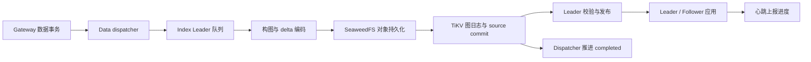

# 写入到索引可见的时延

原始写入的成功条件仍是 TiKV 数据事务提交。返回成功不表示 HNSW 已经构建、两个副本已经应用，或 source completed 已经推进。onebox 的 `catchup_seconds` 从并发读写线程全部退出开始，直到所有 DataPartition 完成且两个图副本的**上报位点**都等于已发布版本；它不是单条写请求延迟，也不是每条向量的可见延迟。

## 当前实现：入队唤醒，连续消费

聚类投递模式的 Index Leader 已改成事件消费：每个本地 IndexPartition 副本有一个消费 goroutine，由分片加载启动，随 owner context 取消而退出。成功入队通过容量为 1 的 channel 通知消费者；有积压就连续处理下一批，空队列阻塞等待通知。正常 Leader 队列不再使用 500 ms 或 10 ms 定时轮询。


每批仍执行同一套 source/replica fencing、对象持久化、图引用与 source commit 事务、Leader 校验及发布流程。批次之间释放 Service 同步锁和本地分片读锁，因此持续写入不会一直占着这些锁。不同 IndexPartition 独立消费，一个分片的对象 IO 不会串行挡住同 Worker 上其他分片。

通知只表示“重新检查队列”，不表示一条消息，也不持久化 ACK。重复通知合并；消费者开始一次检查前取走旧通知，在检查到空队列后到进入等待之前到达的新通知会留在 channel 中，避免丢失唤醒。队列按来源轮转，每来源最多一个排队批次，事件载荷由持久化来源日志恢复。每轮只合并已有输入，不等待凑批；限制 128 条记录、约 2 MiB 编码输入，所有涉及的来源水位与图引用同事务提交。这样可减少稀疏路由产生的小图对象。

另外有三类恢复触发：

- 分片加载后主动执行一次同步，完成崩溃前已经提交但未发布的图版本，不要求新数据到达。
- Master 的计划版本或 Publisher 改变时唤醒消费者；每批使用当前权威计划和 fencing，通知本身不授予 Leader 权限。
- 构图/提交/发布失败时，按 10 ms 起、上限 1 秒退避重试；显式同步或后台维护出现不确定提交也会通知消费者。失败重试不属于正常空队列轮询。

多个 Index 同时处理同一来源时会竞争 source fencing key。图对象上传后，确定的 TiKV 乐观写冲突可在本批内部最多尝试 16 次事务，带短暂随机退避，复用同一份对象；每次重新读取图基线、source owner 和 replica fence。业务冲突、fencing 失败及提交结果不确定的错误不走这条重试路径，继续使用原来的持久化图恢复协议。新增 `vecdb_graph_commit_conflict_retries_total` 和 `graph_commit_attempt` 直方图，区分底层冲突尝试与整批最终失败。

原生 TiKV 图提交在 prewrite 前，对涉及的来源 fencing key 排序、去重后批量获取悲观锁，减少共享来源竞争时失败事务留下 secondary 锁的机会。采用 NOWAIT：锁被占用即失败、回滚已获得的锁并短暂随机退避，避免跨 Region 的等待环，也避免逐来源 RPC 增大陈旧快照窗口。该失败发生在任何图元数据 prewrite 之前，和确定写冲突一样可在最多 16 次尝试内复用对象重试；不计入乐观写冲突 counter，单独体现在 `graph_source_lock/error`。构图和对象保存均在持锁之前完成。锁的 forUpdateTS 使用当前事务原始快照：若来源 fence 在该快照之后已更新，必须冲突并重开事务，不能拿到新锁后继续读旧 owner。获取锁后仍执行完整的来源和副本 fencing；它没有替代 epoch 检查。

图日志事务启用 TiKV 的单 Region 原子提交快速路径，降低冲突时 prewrite 锁对后续读取的影响；跨 Region 时客户端自动回退到 2PC。持久化 ACK、fencing 和不确定结果的恢复条件不变。真实 TiKV 测试分别启用快速路径和强制 2PC，在提交前撤销来源 owner，确认两者均不能提交图或来源水位；这不等于已经完成多 Region 容量压测。

跨 Region 的图提交还可能让 ReplicaPlan 读取等待 2PC 锁。Gateway 的图查询在已有最近成功计划时，将新计划读取预算设为 100 ms；仅该读取超时时，才把最后一次成功读取的计划作为选副本的提示。地址提示不承担权限有效期；每次请求仍重新 Resolve 当前 owner，Worker 仍在查询前后校验租约和 epoch。计划年龄不能替代这些权威检查，也不能因为计划读取锁等待跨过一个任意缓存 TTL 就停止尝试仍然有效的副本。缓存不能用于 sync/checkpoint/prune/rebuild，不能授予构图或发布权限；不存在、损坏、空计划及调用者取消都不能被缓存掩盖。`vecdb_route_plan_fallback_total` 记录此回退，`route_plan/error` 继续保留底层超时证据。

DataDispatcher 也使用事件提示：原始数据提交后，Gateway 在本机有界集合中标记来源，再由独立 goroutine 解析 owner、发送经过集群鉴权的 `wake_source`。业务 ACK 不等待这次网络调用。图提交尝试结束后同样通知来源重新读取持久化水位；包括结果不确定的事务，通知本身永远不能推进 completed。整个窗口完成后立即调度下一窗口。各来源提示合并、总空间受 DataPartition 数量约束；失败退避有上限。

Follower 没有来源输入事件，当前仍以 100 ms 间隔追赶远端持久化图日志，转为 Leader 后关闭该轮询等待。DataDispatcher 保留 500 ms 控制巡检，用于租约管理、故障恢复和漏通知兜底；健康路径不等待它。旧的一一对应 pull 模式仍使用旧同步器。

原生对象适配器在启动时完成一次独立 probe 对象的 PUT、GET、校验和 DELETE，成功后本进程的副本才宣布加载就绪。只检查 bucket 存在不足以证明 SeaweedFS 的 volume/filer lock ring 已可写。并发副本共用一次成功检查；失败不缓存，取消或清理失败不能标记就绪。该检查不构图、不等待业务日志，也不是持续健康缓存。

新增观测：`vecdb_index_consumer_cycles_total{index_partition,reason}` 区分 `start`、`notification`、`continue`、`follower_poll`、`retry`；`vecdb_index_consumer_waiting` 表示当前阻塞等待；阶段直方图新增 `index_consumer_work` / `index_consumer_idle`。原有队列年龄、构图/存储耗时、实时应用位点全部保留。onebox 每次采样也记录消费者触发原因和等待状态。事件模式不再产生后台 `worker_sync_interval` 样本，不能把缺失该阶段当成服务故障。

单测覆盖空队列不主动轮询、连续消费、空检查与等待之间的并发入队、通知合并、无需新数据的失败重试、Follower 旧队列不忙转、计划切换、持续输入取消、慢分片隔离、等待中的分片退出和不确定图提交后的发布恢复。七服务聚类流水线停用了旧的定时 SyncOwned 驱动，直接验收这套消费者。

### 验证中发现并处理的查询长尾

事件消费提高了并行度，也暴露了元数据锁竞争。两轮失败记录保留在仓库本地 reports 中，没有放宽客户端 3 秒超时或“常稳零请求错误”断言：

| 运行 | 结果 |
|---|---|
| `20261116T211041-e18dc334` | 已使用事件消费与事务重试；600 秒内 8 次请求超时，判定失败；最终数据 oracle 正确、2.867 秒追平 |
| `20261116T212706-286b06b2` | 加入单 Region 原子提交；TiKV 自动分裂 Region 后仍有跨 Region 锁等待，600 秒内 4 次请求超时，判定失败 |
| `20261116T214007-539ce48b` | 路由提示设置 5 秒 TTL 后，仍出现 3 次 HTTP 503；诊断运行提前结束并保留失败报告。随后移除与 owner 权限无关的固定提示 TTL |

第二轮新增计时捕获 5 次 `route_plan/error`，每次约 3 秒；`replica_rpc_search` 没有错误。这定位到 Gateway 读取 ReplicaPlan 的等待，而不是 HNSW 计算。一次业务搜索并行访问多个索引，因此路由错误计数与业务失败次数不能一一对应。原子提交快速路径不足以解决跨 Region 的长尾，随后补充上述由当前租约校验的路由提示回退；底层锁等待仍通过阶段指标和回退计数暴露。

`TestRoutePlanPrewriteLockTiKV` 使用 TiKV 的测试 probe 制造“secondary 已 prewrite、primary 尚未写入”的真实锁状态，断言确实触发一次计划读取超时回退，再清理锁并验证可以读取新计划。它用于确定性复现跨 Region prewrite 冲突后的读取长尾，生产代码没有依赖这些 probe。

### 一秒可见性探针与失败对照

`bash scripts/acceptance-onebox-freshness.sh` 默认检查初始化批量和 20 轮常稳停写。t0 为最后一次业务数据 durable ACK 的单调时间；线程收尾、目标日志读取、探针准备和观测开销均包含在结果内。两项条件取较晚完成时间：各 Index 的目标来源 LSN 已提交并发布、所有当前在役副本实际应用；各副本和两个 Gateway 的普通查询返回完整正确的 ID、revision、属性和距离，删除项消失。查询不带 `min_visible`，不调用 sync/checkpoint/rebuild，也不依赖心跳进度。迁移期间可能有多于两份在役副本，必须全部检查，不能等待退休心跳来定义“可见”。

以下失败记录保留，不能用后续成功覆盖：

| 运行 | 初始批量 / 常稳停写结果 | 发现 |
|---|---|---|
| `20261116T220819-8b00b0c1` | 6.372 s / 3 轮最大 1.242 s | 已等来源 owner 就绪；仅取消 Index 500 ms 调度仍不足 |
| `20261116T221334-eea70f4c` | 2.163 s / 3 轮 0.301–0.313 s | 增加来源通知后常稳改善，冷启动批量仍失败 |
| `20261116T221632-d15c3265` | 2.225 s / 3 轮 0.309–0.324 s | 合批后依然遇到 SeaweedFS `no lock server found`；bucket 元数据先于数据路径就绪 |
| `20261116T222051-d1dfc8f2` | 0.975 s / 3 轮 0.308–0.317 s | 增加生产适配器启动 PUT/GET/校验/DELETE 检查；小样本通过，不代表稳定 SLA |
| `20261116T222158-04e62691` | 20 轮长运行仍有失败，详见本地报告 | 同时发现探针误等临时第三副本退出，以及真实图提交/查询长尾；二者分开处理 |
| `20261116T222959-b86cfc2a` | 初始批量 2.856 s；常稳 20/20 ≤ 1 s，P50 0.371 s、P95 0.501 s、最大 0.689 s | 悲观来源锁压低常稳长尾；初始化轨迹显示三个 Index 在 t0 后仍未 Claim 图 Leader，不应与构图角色已就绪的批量混为一类 |

第三副本探针修正没有降低完整性要求：新增 UT 验证额外副本缺指标、epoch 不匹配或应用落后都不能通过，并确保真正查询该额外副本。原报告保留原始失败，修正后必须重新运行。对象就绪检查延长的是集群启动阶段，没有移动业务写入的 t0，也没有预先同步业务索引。

后续初始批量明确以“构图角色就绪”为前提：除了存储、来源 owner 和查询副本，还检查各图 Head 的 Leader 与当前 Publisher、owner epoch/node/session 一致。启动等待另记在 boot case；不执行预热业务写入或 Sync。此前只等查询副本 ready 的冷启动样本继续保留，不能把不同启动条件的结果当成同条件优化倍数。常稳轮次的条件和一秒门槛保持相同。

### 一秒门禁正式结果

`20261116T223954-201993cf`：初始化批量和 20 轮常稳全部通过，本次测试启动的进程全部清理。每轮并发负载 15 秒，再追加插入/更新/删除，统一从最后 durable ACK 计时。

| 类别 | N | ≤ 1 s | P50 | P95 | P99 | 最大 |
|---|---:|---:|---:|---:|---:|---:|
| 已就绪集群，640 条初始批量 | 1 | 1 | 583 ms | 583 ms | 583 ms | 583 ms |
| 常稳停写，全部在役副本应用且真实查询正确 | 20 | 20 | 365 ms | 418 ms | 471 ms | 471 ms |

条件：Apple M4 Pro、14 逻辑核、48 GiB，macOS 15.7.3；vector-server 为 x86_64，TiKV 和 SeaweedFS 为 arm64。16 Data / 8 Index / 2 副本、3 Worker、2 Gateway、2 Master，16 维结构化向量；总记录 ID 从 640 增长到 660，存活数随删除变化。每轮 4 写线程、2 读线程，实际约 19.1–19.5 次数据变更/秒；停写后的首次采样 pending 为 0–3，初始批量为 151。首次观测不等于 t0 的精确队列长度。构图 Publisher 启动等待单独耗时 1.789 秒，总 boot 14.378 秒。

常稳业务请求错误为 0；直接副本探针另记有 10 次瞬时传输错误（包含迁移时的旧 owner），全部达标前均重新验证当前在役副本和两个 Gateway，不能把这些探针错误写成“所有内部请求零错误”。探针准备最长 46 ms，已计入结果。N=20 的 P99 是小样本经验分位数，不能外推为大规模数据或生产负载的 SLA。故障恢复结果需看独立的完整 onebox，不能与本表合并统计。

原始证据：同名 `reports/onebox-e2e/<run_id>/report.json`、各轮 `*-visibility.jsonl/json`、目标记录/LSN、负载前后指标、服务日志；硬件补充记录在 `reports/event-consumer-hardware.json`。二进制 SHA-256 为 `2236d8c60afddc333b723dabdc24badd112f6be2c3f1f1634edbc8c3f00e81ef`。

### 相同常稳负载下的复测

`20261116T224624-a0ac0ab9` 的 768 条结构化向量、600.257 秒并发读写通过，业务请求错误为 0。本轮使用上述同一二进制和原有 4 写 / 2 读线程配置；没有放宽请求超时或零错误断言。

| 阶段 | 优化前均值 | 本轮均值 |
|---|---:|---:|
| 入队到取出批次 | 1,566 ms | **13.30 ms** |
| HNSW 生成 delta | 0.132 ms | 0.084 ms |
| 对象保存 | 4.11 ms | 4.67 ms |
| 图日志及 source commit 事务，含本批内重试 | 2.79 ms | 9.13 ms |

排队 P95 的直方图桶上界为 50 ms，P99 桶上界为 100 ms。并行消费增加了共享来源的事务竞争，因此图提交均值增加；本轮有 13,512 次来源锁获取失败（包含 NOWAIT 占用拒绝和快照冲突），有限重试后没有整批 graph_commit 失败，不能把内部重试说成零错误。Gateway 计划读取没有 error 样本，搜索 P95 为 32.58 ms、P99 为 47.27 ms、最大 104.05 ms。5 秒周期采样观察到来源 pending 峰值 4、最老队列年龄峰值 53 ms；它们只是采样峰值。

按旧 onebox 的“写线程退出后开始观察”口径，第一次采样在 108 ms 时已经看到 source commit、图发布、全部副本实时应用和 source completed 达标，pending 为 0；等副本心跳上报达标共耗时 982 ms。最大采样间隔为 224 ms。这与上面从最后 durable ACK 开始、还必须通过真实查询的独立一秒探针是两种口径，不能混合计算分位数。对象保存仍在异步索引的关键路径上，业务原始写 ACK 不等待它。

本次完整 onebox 的 12 组 case 全部通过，包括存储暂停、旧 owner 恢复、全 Worker 丢失、6 轮连续故障和原目录全栈冷恢复；启动的进程已全部停止。故障阶段保留 193 次请求尝试失败，与常稳零错误分开统计。详细恢复时间见 [ONEBOX_E2E.md](ONEBOX_E2E.md)。

## 优化前基线：2026-11-16 真实进程复测

运行 `20261116T203254-ddffa441`：1 PD、1 TiKV、1 SeaweedFS、2 Master、2 Gateway、3 Worker；16 个 DataPartition、8 个 IndexPartition、双副本，768 条结构化 16 维向量。并发负载 600.232 秒，业务 API 的失败尝试为 0；停写后 7.317 秒全部追平，完整记录、双入口 HTTP/gRPC 查询和 ANN recall 核验通过。

原先 7.175 秒的运行没有阶段计时，不能精确回溯它的组成。本次保持相同拓扑和负载方式，重现了约 7 秒的追平现象，得到以下可核验结果。

| 停写后的里程碑 | 首次观测时间 |
|---|---:|
| 全部目标 source commit 到达最终值 | 6.788 s |
| 全部图版本已发布 | 6.788 s |
| 两份副本实时内存均已应用 | 6.965 s |
| 全部 source completed 与副本上报进度均达标 | 7.317 s |

停写后的首个采样仍有 128 条来源事件未完成。共采样 42 次，最大相邻采样间隔 205 ms；表中小数是观测值，不能理解为微秒精度。最后追平的是 `index-0003`：首个采样还有 9 个来源批次排队，图 committed sequence 从 1093 推进到 1108，轨迹中多次相邻提交间隔约 0.5 秒。图 sequence 还包括后台维护条目，不能直接当作数据批次数。

负载前至追平及完整核验后，按进程 Histogram 做差分得到：

| 阶段 | 平均每次耗时 |
|---|---:|
| 入队到取出批次 | **1,566 ms** |
| 取出批次到提交（含校验、构图、对象保存等） | **7.38 ms** |
| HNSW 生成 delta | 0.132 ms |
| 对象保存（含 intent、PUT、GET 校验） | 4.11 ms |
| 图日志及 source commit 事务 | 2.79 ms |
| Leader prepare（含读取、校验、ACK） | 3.33 ms |
| 发布事务 | 1.90 ms |
| 图对象读取与解码 | 0.942 ms |
| 图内存应用 | 0.113 ms |
| 查询各 Index 的 source commit | 4.12 ms |

排队 P95 落在 **4–8 秒**的桶区间；5 秒周期采样观察到最老排队 7.895 秒、来源 pending 峰值 284。仅统计 3 个 Worker，整轮 SyncOwned 平均 45.58 ms，但相邻轮开始平均相隔 500.00 ms。它描述墙钟调度时间，不是 CPU 使用率；说明当前同步工作在多数周期内很快结束，然后等待下一轮。

结论：当前小向量数据集的追平尾延迟主要来自**每轮一个来源批次的周期调度，以及来源窗口推进后的后续投递**。实际构图和存储事务为毫秒级。副本同步、完成位点轮询、心跳上报继续贡献尾部等待；本次图发布到全部状态达标相隔约 0.53 秒，不能再把整个 7 秒归因于 Follower。

API 零错误不等于内部零重试：同一统计区间有 8,535 次目标 admission 拒绝/投递重试和 24 次图提交失败。接收端与发送端分别计数，不能相加当作独立故障数。服务日志中的图提交失败为 TiKV source fencing key 的乐观写冲突，之后重试成功；这一现象没有被 API 的成功率掩盖。队列等待统计包含失败和过期/重复批次的取出，不是逐向量的端到端时延。

证据文件在 `reports/onebox-e2e/20261116T203254-ddffa441/`：`report.json`、`steady_concurrent_read_write-drain.jsonl`、`steady_concurrent_read_write-latency.json`、两份 `steady-metrics-*.json`、`latency-analysis.json` 和各服务日志。专项复测只运行启动、初始化和 10 分钟常稳，未重跑完整故障矩阵。最终代码通过全部 Go `-race` UT、`go vet` 和 26 个 Python harness UT；新增 UT 覆盖并发直方图、失败归属、重复入队年龄、队列清空、实时内存位点及存储失效时局部指标读取。

基于这次基线，已按用户确认改成上文的入队通知、连续消费、空队列等待。后续仍可减少未变化批次的重复投递，并优化完成位点和副本进度上报节奏；用相同指标和业务 oracle 对比效果。

## 优化前的等待机制



优化前存在三种独立的周期等待；以下保留为上述基线的解释：

- Data dispatcher 每 500 ms 扫描自己的有界来源窗口，查询目标分片的 source commit 并投递；每个来源窗口最多 32 条、2 MiB。
- 每个 IndexPartition 每次 `Sync` 最多取**一个来源批次**。后台每 500 ms 调用 `SyncOwned`，同一 Worker 上各副本顺序执行。队列按来源轮转，16 个来源都排队时，仅一个批次/轮的调度就可能造成数秒等待。查询、重建等路径也可能调用同步，因此 2 批/秒只是后台周期的近似能力。
- 副本实际应用进度由 reconcile 心跳写入 TiKV；间隔为 `LEASE_TTL / 3`，当前 onebox TTL 为 6 秒，因此上报间隔约 2 秒。还要加上本轮 reconcile 耗时。全局状态的落后不一定都是图副本真正落后。

这些环节可以并行、重叠。不能把所有阶段的平均值相加，声称得到端到端 P99；也不能直接把累计秒数除以追平秒数当作单请求占比。

## 指标入口和口径

`GET /metrics` 保留原有全局状态指标，并附带当前进程的局部指标。新增 `GET /metrics?scope=local` 只读进程内数据，不访问 TiKV，用于存储故障时诊断。两者都需要 `API_TOKEN`。全局状态建议只选一个 Gateway 采集；局部指标必须采集**每个 Worker 和 Gateway**，只抓 Gateway 看不到构图时延。

```bash
source .state/onebox-e2e.env
# 默认 onebox Worker 端口为 25503、25504、25505；实际地址以 local-status 为准。
curl -fsS -H "Authorization: Bearer $API_TOKEN" \
  'http://127.0.0.1:25503/metrics?scope=local'
```

`vecdb_pipeline_stage_seconds` 是标准 Prometheus Histogram，包含 `_bucket`、`_count`、`_sum`。标签只有 `stage`、`partition`、`outcome`：stage 为代码中固定的阶段；partition 为逻辑 data/index 分片或空串；outcome 为 success/error。它不以请求 ID、向量 ID、epoch 或错误文本建时间序列。计数随进程重启归零，使用 `rate`/`increase`；首次尚未执行的阶段可以没有样本。

| stage | 计时边界 |
|---|---|
| `data_mutate` | Gateway 调用原始数据 Mutate，含内部重试和幂等回放 |
| `dispatch_tick` | 本进程一轮来源调度，含获取/更新 owner 及等待投递 goroutine；此阶段无返回错误，错误看子阶段 |
| `dispatch_source` | 一个来源的读完成位点、读日志、查目标、推进完成及投递全过程，含空闲轮次 |
| `dispatch_read_log` | 有界来源日志读取 |
| `dispatch_poll_commits` | 逐个查询 IndexPartition 的 source commit |
| `dispatch_advance_completed` | 完成前缀的 fencing 校验及 TiKV 事务提交 |
| `dispatch_deliver` | 查目标 Leader、HTTP 投递到 admission 返回；含重试尝试，不等待构图 |
| `dispatch_notify` | 异步来源提示的 owner 解析与网络发送，不在业务写 ACK 路径上 |
| `index_admission` | 目标验证路由、日志证明、去重及入队；重复请求也计入 |
| `index_queue_wait` | 成功入队到取出批次；重复投递不重置原入队时间；不含正在处理的批次 |
| `routed_commit` | 一轮取出的有界来源批次集合从再次校验到单个图日志提交；包含下面构图、编码、对象保存和提交阶段 |
| `index_consumer_work` / `index_consumer_idle` | 消费者一次处理 / 阻塞等待通知或 Follower 轮询的时间 |
| `graph_build` / `graph_encode` | HNSW 生成 delta / JSON 编码 |
| `graph_object_save` | 对象保存全过程：retention intent（若开启）、S3 PUT、GET 回读及校验 |
| `graph_object_intent` | 对象 intent 的 TiKV 事务，是 object_save 的子阶段 |
| `graph_commit` / `graph_commit_attempt` | 图日志引用与 source commit 同事务提交全过程（含有限冲突重试）/ 单次事务尝试 |
| `graph_source_lock` | 单次图事务在 prewrite 前获取来源 fencing 锁的耗时；NOWAIT 占用拒绝计为 error |
| `graph_prepare` | Leader 读取未发布图对象、验证 delta、持久化 ACK；不等待 Follower |
| `graph_load` / `graph_apply` | 图对象读取与解码 / 内存应用，包括查询视图锁等待；主从均可记录 |
| `graph_publish` | 推进统一可查询版本的 TiKV 事务 |
| `graph_catchup` | 对齐已发布版本，包含 load/apply；已经追平的空调用也计入 |
| `graph_sync_lock_wait` / `graph_sync` | 等待 Service 同步互斥锁 / 拿锁后一次图同步 |
| `worker_sync` / `worker_sync_interval` | 本进程整轮 SyncOwned / 相邻轮开始的间隔，后者首轮不采样；观察 Worker 时筛选 Worker 实例 |
| `graph_progress_report` | 将当前内存应用位点上报到 TiKV |
| `route_plan` / `route_owner` | Gateway 读取副本计划 / 解析 owner，用于区分元数据锁等待与 Worker 执行慢 |
| `replica_rpc_search` / `replica_rpc_sync` 等 | Gateway 单次副本 RPC，包含通信及 Worker 执行，不包含获取计划与解析 owner |

图阶段当前针对聚类投递模式，初始化恢复阶段尚未安装 routedInput 时不计入这些图阶段。`graph_object_save` 尚未拆分 S3 PUT 和验证 GET，若此项成为瓶颈，再下钻对象客户端。以上是本地单调时钟计时，没有用跨机器墙钟相减。

另外提供：

- `vecdb_index_batch_records` Histogram：取出批次的原始事件数，含失败尝试，合并同 ID 多版本之前；不等于新增向量数。
- `vecdb_index_queue_batches` / `queue_bytes` / `queue_oldest_seconds`：当前队列数量、字节、最老批次年龄。年龄空队列为 0、进程重启清零；排除正在构建的批次。已出队后失败的批次等待再次投递，不计为持续留在队列。
- `vecdb_graph_local_applied_sequence{index_partition,replica}`：实时内存应用位点，可与全局 `vecdb_graph_replica_applied_sequence`（心跳上报位点）区分。
- 原有 source head/completed、graph committed/visible、source commit、replica lag 和错误计数保留。删除广播到全部 IndexPartition，会增加处理批次数。

PromQL 示例（假设采集配置使用 `job="vecdb-worker"` 区分 Worker）：

```promql
# 各阶段 P95（直方图估算），不同阶段分别看，不相加。
histogram_quantile(0.95,
  sum by (le, stage) (rate(vecdb_pipeline_stage_seconds_bucket{job="vecdb-worker",outcome="success"}[5m])))

# 实际处理耗时与调度间隔对比。
sum by (stage) (rate(vecdb_pipeline_stage_seconds_sum{job="vecdb-worker",stage=~"worker_sync|worker_sync_interval"}[5m]))
/
sum by (stage) (rate(vecdb_pipeline_stage_seconds_count{job="vecdb-worker",stage=~"worker_sync|worker_sync_interval"}[5m]))

# 找出队列最老的副本；不要把各分片的年龄求和。
topk(5, vecdb_index_queue_oldest_seconds)

# 错误尝试速率，不能等同于业务 API 请求错误率。
sum by (stage) (rate(vecdb_pipeline_stage_seconds_count{outcome="error"}[5m]))
```

## 自动化定位

```bash
# 完整真实进程、10 分钟并发读写 + 追平定位；跳过故障矩阵。
bash scripts/acceptance-onebox-e2e.sh --latency-only --steady-seconds 600 --keep-running

# 不加 --latency-only 则继续执行完整故障矩阵。
```

onebox 独占自己的端口/目录；若已有 onebox，先通过其 control socket 停止。`--keep-running` 验收完成后保留健康集群。运行说明见 [ONEBOX_E2E.md](ONEBOX_E2E.md)。

报告位于 `reports/onebox-e2e/<run-id>/`：

- `steady-metrics-before.json` / `steady-metrics-after.json`：按进程保存开始负载前与完整核验后的直方图快照；区间包含负载、追平和核验，避免混入 seed 的历史计数。
- `observations.jsonl`：每 5 秒记录全部服务进程状态、RSS/CPU、全局指标和各 Worker/Gateway 局部指标。
- `<case>-drain.jsonl`：停写后按约 100 ms 间隔（另加采集耗时）并行采集全局状态与局部指标。
- `<case>-latency.json`：以最终完成的固定 frontier 回看轨迹，分别给出 source commit、graph visible、实时内存应用、心跳上报、source completed 首次观测达标时间。附最大观测间隔和初始积压。
- `report.json` 中 `pipeline_stages`：先逐进程做 counter 差分，再聚合阶段；`mean` 是区间精确均值，`p95_upper_bound` 是覆盖 95% 样本的**桶上界**，不是精确 P95。进程集合变化、计数回退或采集失败会拒绝生成可信差分。

采集时间由测试进程单调时钟记录。状态读取不构成跨进程原子快照，给出的是首次观测时间上界；不能将小于采样间隔的先后差解释为精确因果。原有最终核验仍比较完整 GraphPosition 和全量业务结果，不以观测指标替代正确性验收。
