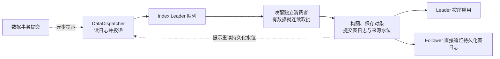
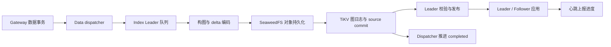

# 写入到索引可见的时延

当前 v12 的普通图变更只写 TiKV 图结构与数据引用，不再上传 S3 增量对象；每片 30 MB / 3 分钟检查点及引用保护 GC 见 [GRAPH_JOURNAL.md](GRAPH_JOURNAL.md)。下文带日期的对象保存耗时是当时版本的历史测量。
原始写入的成功条件仍是 TiKV 数据事务提交。返回成功不表示 HNSW 已经构建、两个副本已经应用，或 source completed 已经推进。onebox 的 `catchup_seconds` 从并发读写线程全部退出开始，直到所有 DataPartition 完成且两个图副本的**上报位点**都等于持久化图版本；它不是单条写请求延迟，也不是每条向量的可见延迟。

## 当前实现：入队唤醒，连续消费

聚类投递模式的 Index Leader 已改成事件消费：每个本地 IndexPartition 副本有一个消费 goroutine，由分片加载启动，随 owner context 取消而退出。成功入队通过容量为 1 的 channel 通知消费者；有积压就连续处理下一批，空队列阻塞等待通知。正常 Leader 队列不再使用 500 ms 或 10 ms 定时轮询。

Follower 成功回放后如果图位点前进，立即开始下一轮 tail，重新读取持久化图头，追赶上一轮读取期间追加的日志；直到一次 tail 没有推进位点，才等待 100 ms 后重试。每轮之间释放锁、重新检查 owner 和计划，错误沿用退避重试。Follower 的继续条件只看本轮回放进度，不看降级后可能残留的 Leader 输入队列。`vecdb_index_consumer_cycles_total{reason="follower_continue"}` 记录这种立即重读，`reason="follower_poll"` 记录空闲后的轮询。空闲时新日志的发现仍可能等待这 100 ms，本次没有增加跨节点推送通知。



每批执行 Index 本地来源 epoch 校验、replica fencing、图增量预校验和 TiKV 图载荷与累计来源水位的原子追加。SeaweedFS 用于检查点和重建。批次之间释放 Service 同步锁和本地分片读锁，因此持续写入不会一直占着这些锁。不同 IndexPartition 独立消费，一个分片的对象 IO 不会串行挡住同 Worker 上其他分片。

通知只表示“重新检查队列”，不表示一条消息，也不持久化 ACK。重复通知合并；消费者开始一次检查前取走旧通知，在检查到空队列后到进入等待之前到达的新通知会留在 channel 中，避免丢失唤醒。队列按来源轮转，每来源最多一个排队批次，事件载荷由持久化来源日志恢复。每轮只合并已有输入，不等待凑批；限制 128 条记录、约 2 MiB 编码输入，所有涉及的来源水位与图引用同事务提交。这样可减少稀疏路由产生的小图日志。

另外有三类恢复触发：

- 分片加载后主动执行一次同步，完成崩溃前已经提交但未应用的图版本，不要求新数据到达。
- Master 的计划版本或 Publisher 改变时唤醒消费者；每批使用当前权威计划和 fencing，通知本身不授予 Leader 权限。
- 构图/提交/应用失败时，按 10 ms 起、上限 1 秒退避重试；显式同步或后台维护出现不确定提交也会通知消费者。失败重试不属于正常空队列轮询。

v13 聚类协议移除了图提交中的共享来源 fencing key 和 NOWAIT 悲观锁。每个 Index 独立持久化 `source_epochs`；更高 epoch 写入同一图日志中的控制条目，普通图提交在本 Index 事务中再次校验。数据 completed_lsn 与数据 GC 仍校验来源租约。协议和恢复顺序见 [GRAPH_JOURNAL.md](GRAPH_JOURNAL.md)。本文后面的 v12 历史测量保留原始锁竞争数据，不能套用于当前实现。

确定的 TiKV 乐观写冲突仍最多尝试 16 次，带短暂随机退避、复用载荷，每次重读图基线、Index 来源 epoch 和 replica fence。业务冲突、fencing 失败和未知提交结果不直接重试；没有 source NOWAIT 重试分支。`vecdb_graph_commit_conflict_retries_total`、`graph_commit_attempt` 保留，新增 `source_epoch_admission` 与来源 epoch 升级/拒绝计数。1PC 快速路径保留，跨 Region 自动回退 2PC；真实 TiKV 测试验证两种路径与新的来源隔离语义，不代表多 Region 容量验收。

跨 Region 的图提交还可能让 ReplicaPlan 读取等待 2PC 锁。Gateway 的图查询在已有最近成功计划时，将新计划读取预算设为 100 ms；仅该读取超时时，才把最后一次成功读取的计划作为选副本的提示。地址提示不承担权限有效期；每次请求仍重新 Resolve 当前 owner，Worker 仍在查询前后校验租约和 epoch。计划年龄不能替代这些权威检查，也不能因为计划读取锁等待跨过一个任意缓存 TTL 就停止尝试仍然有效的副本。缓存不能用于 sync/checkpoint/prune/rebuild，不能授予构图或发布权限；不存在、损坏、空计划及调用者取消都不能被缓存掩盖。`vecdb_route_plan_fallback_total` 记录此回退，`route_plan/error` 继续保留底层超时证据。

DataDispatcher 也使用事件提示：原始数据提交后，Gateway 在本机有界集合中标记来源，再由独立 goroutine 解析 owner、发送经过集群鉴权的 `wake_source`。业务 ACK 不等待这次网络调用。图提交尝试结束后同样通知来源重新读取持久化水位；包括结果不确定的事务，通知本身永远不能推进 completed。整个窗口完成后立即调度下一窗口。各来源提示合并、总空间受 DataPartition 数量约束；失败退避有上限。

Follower 没有来源输入事件，当前仍以 100 ms 间隔追赶远端持久化图日志，转为 Leader 后关闭该轮询等待。DataDispatcher 保留 500 ms 控制巡检，用于租约管理、故障恢复和漏通知兜底；健康路径不等待它。旧的一一对应 pull 模式仍使用旧同步器。

原生对象适配器在启动时完成一次独立 probe 对象的 PUT、GET、校验和 DELETE，成功后本进程的副本才宣布加载就绪。只检查 bucket 存在不足以证明 SeaweedFS 的 volume/filer lock ring 已可写。并发副本共用一次成功检查；失败不缓存，取消或清理失败不能标记就绪。该检查不构图、不等待业务日志，也不是持续健康缓存。

新增观测：`vecdb_index_consumer_cycles_total{index_partition,reason}` 区分 `start`、`notification`、`continue`、`follower_continue`、`follower_poll`、`retry`；`vecdb_index_consumer_waiting` 表示当前阻塞等待；阶段直方图新增 `index_consumer_work` / `index_consumer_idle`。原有队列年龄、构图/存储耗时、实时应用位点全部保留。onebox 每次采样也记录消费者触发原因和等待状态。事件模式不再产生后台 `worker_sync_interval` 样本，不能把缺失该阶段当成服务故障。

单测覆盖空队列不主动轮询、连续消费、空检查与等待之间的并发入队、通知合并、无需新数据的失败重试、Follower 旧队列不忙转、计划切换、持续输入取消、慢分片隔离、等待中的分片退出和不确定图提交后的日志恢复。七服务聚类流水线停用了旧的定时 SyncOwned 驱动，直接验收这套消费者。

### 持久化即回放协议的复测（2026-11-17）

当前图协议见 [GRAPH_JOURNAL.md](GRAPH_JOURNAL.md)：图增量先校验，日志持久化即允许 A/B 独立按序应用；删除额外 ACK/Visible 发布事务。图 head 与来源水位从有界尾读派生，`graph_head_read` 单独记录显式头部读取耗时。

原生 onebox `20261117T195451-9da8e28d`：16 个 DataPartition、8 个 IndexPartition、双副本、2 Master / 2 Gateway / 3 Worker，独立 PD/TiKV/SeaweedFS。固定种子的 2,000 条 64 维簇向量，初始化 40 条/秒，三轮各 8 秒、20 次写/秒并发读写；每轮含同一来源的 32 请求并发突发及插入/更新/删除尾部操作。使用原有 3 秒请求超时和最后 durable ACK 起一秒门槛。

| 检查 | 完整可见性耗时 | 结果 |
|---|---:|---|
| 初始化 | 605 ms | 通过 |
| 常稳第 1 轮 | 908 ms | 通过 |
| 常稳第 2 轮 | 962 ms | 通过 |
| 常稳第 3 轮 | 564 ms | 通过 |

业务请求、可见性查询及元数据探针均零错误；全部桶、在役副本及两个 Gateway 的 ID/revision/属性/距离和删除结果正确。每次额外 16 个 ANN 查询的最小召回率为 1.0。三次同分片突发的写入、读回及原有幂等重试总耗时为 31/85/37 ms，不能当作单请求延迟。

与前一合批版本的同参数历史样本相比，常稳完整可见性 P50 由 860 ms 变为 908 ms，不能宣称整体可见延迟改善。旧 `graph_publish` 平均约 2.45 ms 的独立事务已消失，但来源水位读取平均从 0.71 ms 增至 4.59 ms，因为现在需要各索引的尾读；新 `graph_head_read` 平均约 1.06 ms。新对象保存平均 4.50 ms、图提交平均 7.88 ms。阶段有嵌套，不能相加推导端到端延迟；三轮样本也不能推断生产 P99。

内部重试仍存在：常稳阶段 `graph_source_lock/error` 与 `graph_commit_attempt/error` 各 287 次，属于同一批冲突链，不能相加当作 574 次业务失败；另外保留来源推进、投递和入队等重试证据。本轮没有整批 `graph_commit/error`，没有将内部错误表述为零。

所有本轮进程已停止、临时数据已清理；资源守卫没有触发，峰值 owned RSS 约 1.40 GiB，数据/日志约 320 MiB。报告：`reports/capacity-explore/durable-graph-20261117/20261117T195451-9da8e28d/report.json`，汇总与二进制/source hash：`reports/durable-graph-20261117/summary.json`。完整 smoke `20261117T115000Z-2a8015f7` 的 10 个阶段通过，包含真实存储、四种七服务模式和两个多进程故障验收；本轮没有重跑十分钟常稳或跨物理机容灾。

### 日志合批与并发回放（2026-11-17）

| 路径 | 当前处理方式 | 顺序和提交边界 |
|---|---|---|
| 业务数据写入 | 每个 Gateway 内、每个 DataPartition 一个临时 drainer；立即处理第一批，后续合并已经排队的请求；每批最多 32 个请求、2 MiB 编码请求 | 同批预读记录、幂等凭证和 log head，按入队顺序分配 revision/连续 LSN；记录、数据日志、凭证一起提交，成功后才返回 durable ACK |
| 来源完成进度读取 | 一次事务快照批量读取各 Index 控制锚点，再逐 Index 有界反向读取尾记录 | 仍按实际目标计算连续完成前缀，不把所有 Index commit 简单取最小值 |
| Leader 图日志写入 | 保留已有的跨来源合批，最多 128 条记录/约 2 MiB；不同 Index 独立并发 | 图增量先预校验，图对象持久化并校验后，追加含引用和所有来源水位的日志；成功即允许回放 |
| Leader 应用 | 确认追加成功后复用刚构建且预校验过的 delta | 无独立发布事务；未知提交结果先读持久化日志；Follower 可先于 Leader 应用 |
| Follower/恢复回放 | 每次批读最多 16 条图日志元数据；最多 4 个对象并发下载/解码；一个窗口的对象编码量不超过 8 MiB | 先检查连续 hash 链，再严格按序 apply；下载可与前面日志的 apply 重叠，同一 HNSW 不并发修改，查询可以在完整图版本之间进入 |

数据合批队列最多保留下一批 32 个请求/2 MiB，满时调用者可取消地等待；一个超过合批字节预算、但符合原单请求校验的请求单独处理，不改变旧接口限制。已在执行的事务与排队窗口分别计入内存。没有凑批定时器，空闲时 drainer 退出。数据层依旧允许多个 Gateway 写同一 DataPartition，跨进程冲突由 TiKV 事务解决，没有新增数据 Leader。

批内相同 ID 按顺序读取前一操作的结果；重复 request_id 返回原 revision、不新增日志；CAS 或 request_id 语义冲突只拒绝该请求。底层存储错误使整个事务失败；只重试确定的写冲突，提交结果未知时仍要求使用原 request_id 重试。单个调用者取消不取消同批其他请求，集群关闭会取消并等待本机 drainer；结果未知也提示来源重新检查持久化日志。

图回放的 8 MiB 是对象编码大小预算，不是 Go/native 总内存承诺。超过预算的合法单对象（例如 reset 快照）独占窗口，沿用原 512 MiB 单对象上限。下载失败或取消必须取消并 join 本批所有 loader；只保留连续成功 apply 的前缀。遇到 GC 超过本地位点时，仍按持久化 checkpoint 恢复。prefetch 不推进应用位点，也不允许跳过丢失或损坏的日志。

源码分别位于 `mutation_group.go`、`transaction_batch.go`、`graph_replay.go`、`graph_journal.go`。新增 `--burst-writes 32` 性能场景：选择同一数据 hash 分片的 32 个不同 ID，通过两个 Gateway 并发更新，仍执行立即读取、幂等检查及全部副本可见性验证。默认不启用突发，不改变原常稳场景。`hot_source_burst.seconds` 包含写入、立即读取和既有幂等重试，不能称作单条写延迟。

本轮完整 smoke 首次运行 `20261117T102526Z-728c5df7` 在 graph 模式的 32 分片 Worker drain 阶段失败：Master 与 Worker 同为两秒心跳，日志连续出现 task-fence 写冲突，90 秒内未完成 drain；其余三种七服务模式通过。失败报告和清理证明保留。Master 的副本调度现在对确定 TiKV 写冲突最多尝试 4 次、间隔 5–20 ms 随机退避，每次新建事务并重读节点/计划/fence，避免只等下一个同相位心跳。未知提交结果、业务冲突和 fencing 失败不重试，`master_schedule_attempt` 保留各次尝试的结果与耗时；没有放宽 drain 超时。

### 合批版本的性能与验收结果

以下是本次 durable 协议变更前的历史合批对照，不代表新协议性能。

2026-11-17 真实进程对照：同一台机器、16 DataPartition、8 IndexPartition、双副本、2 Master/2 Gateway/3 Worker、独立 PD/TiKV/SeaweedFS。数据为固定种子的 2,000 条 64 维簇向量；初始化 40 条/秒，三轮各 8 秒、20 次写/秒并发读写，每轮追加同一数据分片的 32 个不同 ID 并发写，以及原有 12 条插入/更新/删除尾部操作。两版使用相同脚本、3 秒请求超时及最后 durable ACK 起一秒的完整可见性门槛。

| 测量项 | 改动前 | 合批/并发版本 |
|---|---:|---:|
| 32 请求突发写及立即读回，三轮耗时 | 204 / 185 / 180 ms | 115 / 106 / 110 ms |
| 突发写及读回中位耗时 | 185 ms | 110 ms，减少约 40% |
| 三轮 `data_mutate` 平均耗时（含背景写/尾部/幂等） | 16.60 ms | 9.98 ms |
| `dispatch_poll_commits` 平均耗时 | 3.81 ms | 0.707 ms |
| 初始化的 `graph_load` 次数 | 4,000 | 2,000 |
| 初始化完整可见性检查 | 655 ms | 630 ms |
| 常稳完整可见性检查，三轮 | 617 / 550 / **1,035 ms** | 860 / 935 / 562 ms |
| 常稳完整可见性 P50 / 最大值 | 617 / **1,035 ms** | 860 / 935 ms |
| 原一秒门禁 | 第三轮失败，保留失败报告 | 三轮全部通过 |

`graph_load` 只统计 Leader/Follower 的图加载；对象保存后的校验 GET 仍保留，不能据此声称全部对象 GET 减半。新版本三轮 632 次成功业务调用进入 557 个数据提交组，Histogram 表明至少一个组含 17–32 个请求。组数不等于 TiKV commit 数：纯幂等组不提交，底层确定冲突可能重试。这档较低背景写入率下多数组只有一条请求，没有人为等待凑批。

**完整可见性 P50 本轮没有改善。** 新版本前两轮的第一轮查询确实读到了落后图视图；即使随后采到的位点已追平，也必须重新执行完整的 108 次查询，不能用后采位点替代早先错误的查询。因此前两轮各执行 216 次查询，第三轮 108 次。没有延迟探针启动、放宽门槛或跨轮复用成功桶。三个样本不足以推断长期 P95/P99 或生产 SLA。`hot_source_burst.seconds` 只包含 32 请求及立即读取/原有幂等重放；同名 phase 的请求分位统计还包含紧随其后的 12 条尾部操作，二者不要混淆。

两版业务请求、查询传输和元数据探针错误均为零；全量 ID/revision/属性/距离/删除 oracle，以及每轮 16 次 ANN 查询通过，最小召回率 1.0。内部重试继续如实记录：新版本三轮 `graph_source_lock/error` 与 `graph_commit_attempt/error` 各 297 次，属于同一失败链，不能相加；还有 completed 推进、投递/入队等重试，汇总见报告。主对照没有整批 `graph_commit/error`；640 条小档有一次整批提交失败后恢复，仍计入 error，不能称作零内部错误。

回放微基准使用相同的 32 个真实 native HNSW patch、校验/解码/apply，模拟每次对象 GET 延迟 1 ms。串行三组为 51.62 / 62.58 / 58.25 ms，批读和 4 路预取为 13.87 / 14.09 / 13.74 ms，中位数约快 4.2 倍，每组 10 次回放。这是回放并行性的专项证据，不是真实 SeaweedFS 恢复时延或跨机接管 SLA。

完整 smoke `20261117T103038Z-b5a3b23c` **10/10 通过**：全项目 UT/race/coverage、vet、61 个 Python harness UT、5 个 Python SDK UT、真实 TiKV/SeaweedFS 集成、四种七服务模式、server/vectorctl 构建、独立进程投递故障与订阅/GC 故障。真实 TiKV 新用例验证两个写入组并发 CAS 恰好一个成功、重复 request_id 只产生一个 LSN，以及批量日志连续。新增队列条数/字节背压、取消、重新唤醒测试随后单独 `-race -count=10` 通过，生产代码未再修改。

| 本地证据 | 路径 |
|---|---|
| 旧版本对照（失败） | `reports/capacity-explore/batching-burst-baseline-20261117/20261117T182236-bfa0060b/report.json` |
| 新版本 640 条小档（通过，初始化 244 ms、常稳 692 ms） | `reports/capacity-explore/batching-smoke-20261117/20261117T183531-3a9c6897/report.json` |
| 新版本 2,000 条对照（通过） | `reports/capacity-explore/batching-burst-optimized-20261117/20261117T183708-5bf4cfb4/report.json` |
| 汇总、微基准及源码快照 | `reports/batching-20261117/summary.json`、`replay-benchmark.txt`、`service-source/` |
| 完整质量报告 | `reports/quality/20261117T103038Z-b5a3b23c/report.json` |

旧二进制 SHA-256：`bfd49186688d93327f2f47558324b2bdd947874c9ee5bf9f53289e9e2d905464`；新二进制：`f3acc0e7f43988d07c3c1ff3f56dfef3594f362dd99947a83d4bebb8e083706d`。新版本主对照峰值自有 RSS 约 1.41 GiB，自有数据和本系列日志约 360 MiB，资源守卫未触发。所有对照的自有进程和临时数据均清理完成，原有三个存储服务保留。

更早的 80 次/秒尝试 `batching-baseline-20261117/20261117T181557-8ac4f926` 被整机 CPU 守卫停止，期间还有本机编译，不能作为完成的容量档位或有效对照。本轮没有测试 2,000 条以上、跨机器部署或重新跑十分钟常稳。

### 验证中发现并处理的查询长尾

事件消费提高了并行度，也暴露了元数据锁竞争。两轮失败记录保留在仓库本地 reports 中，没有放宽客户端 3 秒超时或“常稳零请求错误”断言：

| 运行 | 结果 |
|---|---|
| `20261116T211041-e18dc334` | 已使用事件消费与事务重试；600 秒内 8 次请求超时，判定失败；最终数据 oracle 正确、2.867 秒追平 |
| `20261116T212706-286b06b2` | 加入单 Region 原子提交；TiKV 自动分裂 Region 后仍有跨 Region 锁等待，600 秒内 4 次请求超时，判定失败 |
| `20261116T214007-539ce48b` | 路由提示设置 5 秒 TTL 后，仍出现 3 次 HTTP 503；诊断运行提前结束并保留失败报告。随后移除与 owner 权限无关的固定提示 TTL |

第二轮新增计时捕获 5 次 `route_plan/error`，每次约 3 秒；`replica_rpc_search` 没有错误。这定位到 Gateway 读取 ReplicaPlan 的等待，而不是 HNSW 计算。一次业务搜索并行访问多个索引，因此路由错误计数与业务失败次数不能一一对应。原子提交快速路径不足以解决跨 Region 的长尾，随后补充上述由当前租约校验的路由提示回退；底层锁等待仍通过阶段指标和回退计数暴露。

`TestRoutePlanPrewriteLockTiKV` 使用 TiKV 的测试 probe 制造“secondary 已 prewrite、primary 尚未写入”的真实锁状态，断言确实触发一次计划读取超时回退，再清理锁并验证可以读取新计划。它用于确定性复现跨 Region prewrite 冲突后的读取长尾，生产代码没有依赖这些 probe。

### 一秒可见性探针与失败对照

`bash scripts/acceptance-onebox-freshness.sh` 默认检查初始化批量和 20 轮常稳停写。t0 为最后一次业务数据 durable ACK 的单调时间；线程收尾、目标日志读取、探针准备和观测开销均包含在结果内。两项条件取较晚完成时间：各 Index 的目标来源 LSN 已提交并发布、所有当前在役副本实际应用；各副本和两个 Gateway 的普通查询返回完整正确的 ID、revision、属性和距离，删除项消失。查询不带 `min_visible`，不调用 sync/checkpoint/rebuild，也不依赖心跳进度。迁移期间可能有多于两份在役副本，必须全部检查，不能等待退休心跳来定义“可见”。

以下失败记录保留，不能用后续成功覆盖：

| 运行 | 初始批量 / 常稳停写结果 | 发现 |
|---|---|---|
| `20261116T220819-8b00b0c1` | 6.372 s / 3 轮最大 1.242 s | 已等来源 owner 就绪；仅取消 Index 500 ms 调度仍不足 |
| `20261116T221334-eea70f4c` | 2.163 s / 3 轮 0.301–0.313 s | 增加来源通知后常稳改善，冷启动批量仍失败 |
| `20261116T221632-d15c3265` | 2.225 s / 3 轮 0.309–0.324 s | 合批后依然遇到 SeaweedFS `no lock server found`；bucket 元数据先于数据路径就绪 |
| `20261116T222051-d1dfc8f2` | 0.975 s / 3 轮 0.308–0.317 s | 增加生产适配器启动 PUT/GET/校验/DELETE 检查；小样本通过，不代表稳定 SLA |
| `20261116T222158-04e62691` | 20 轮长运行仍有失败，详见本地报告 | 同时发现探针误等临时第三副本退出，以及真实图提交/查询长尾；二者分开处理 |
| `20261116T222959-b86cfc2a` | 初始批量 2.856 s；常稳 20/20 ≤ 1 s，P50 0.371 s、P95 0.501 s、最大 0.689 s | 悲观来源锁压低常稳长尾；初始化轨迹显示三个 Index 在 t0 后仍未 Claim 图 Leader，不应与构图角色已就绪的批量混为一类 |

第三副本探针修正没有降低完整性要求：新增 UT 验证额外副本缺指标、epoch 不匹配或应用落后都不能通过，并确保真正查询该额外副本。原报告保留原始失败，修正后必须重新运行。对象就绪检查延长的是集群启动阶段，没有移动业务写入的 t0，也没有预先同步业务索引。

后续初始批量明确以“构图角色就绪”为前提：除了存储、来源 owner 和查询副本，还检查各图 Head 的 Leader 与当前 Publisher、owner epoch/node/session 一致。启动等待另记在 boot case；不执行预热业务写入或 Sync。此前只等查询副本 ready 的冷启动样本继续保留，不能把不同启动条件的结果当成同条件优化倍数。常稳轮次的条件和一秒门槛保持相同。

### 一秒门禁正式结果

`20261116T223954-201993cf`：初始化批量和 20 轮常稳全部通过，本次测试启动的进程全部清理。每轮并发负载 15 秒，再追加插入/更新/删除，统一从最后 durable ACK 计时。

| 类别 | N | ≤ 1 s | P50 | P95 | P99 | 最大 |
|---|---:|---:|---:|---:|---:|---:|
| 已就绪集群，640 条初始批量 | 1 | 1 | 583 ms | 583 ms | 583 ms | 583 ms |
| 常稳停写，全部在役副本应用且真实查询正确 | 20 | 20 | 365 ms | 418 ms | 471 ms | 471 ms |

条件：Apple M4 Pro、14 逻辑核、48 GiB，macOS 15.7.3；vector-server 为 x86_64，TiKV 和 SeaweedFS 为 arm64。16 Data / 8 Index / 2 副本、3 Worker、2 Gateway、2 Master，16 维结构化向量；总记录 ID 从 640 增长到 660，存活数随删除变化。每轮 4 写线程、2 读线程，实际约 19.1–19.5 次数据变更/秒；停写后的首次采样 pending 为 0–3，初始批量为 151。首次观测不等于 t0 的精确队列长度。构图 Publisher 启动等待单独耗时 1.789 秒，总 boot 14.378 秒。

常稳业务请求错误为 0；直接副本探针另记有 10 次瞬时传输错误（包含迁移时的旧 owner），全部达标前均重新验证当前在役副本和两个 Gateway，不能把这些探针错误写成“所有内部请求零错误”。探针准备最长 46 ms，已计入结果。N=20 的 P99 是小样本经验分位数，不能外推为大规模数据或生产负载的 SLA。故障恢复结果需看独立的完整 onebox，不能与本表合并统计。

原始证据：同名 `reports/onebox-e2e/<run_id>/report.json`、各轮 `*-visibility.jsonl/json`、目标记录/LSN、负载前后指标、服务日志；硬件补充记录在 `reports/event-consumer-hardware.json`。二进制 SHA-256 为 `2236d8c60afddc333b723dabdc24badd112f6be2c3f1f1634edbc8c3f00e81ef`。

### 相同常稳负载下的复测

`20261116T224624-a0ac0ab9` 的 768 条结构化向量、600.257 秒并发读写通过，业务请求错误为 0。本轮使用上述同一二进制和原有 4 写 / 2 读线程配置；没有放宽请求超时或零错误断言。

| 阶段 | 优化前均值 | 本轮均值 |
|---|---:|---:|
| 入队到取出批次 | 1,566 ms | **13.30 ms** |
| HNSW 生成 delta | 0.132 ms | 0.084 ms |
| 对象保存 | 4.11 ms | 4.67 ms |
| 图日志及 source commit 事务，含本批内重试 | 2.79 ms | 9.13 ms |

排队 P95 的直方图桶上界为 50 ms，P99 桶上界为 100 ms。并行消费增加了共享来源的事务竞争，因此图提交均值增加；本轮有 13,512 次来源锁获取失败（包含 NOWAIT 占用拒绝和快照冲突），有限重试后没有整批 graph_commit 失败，不能把内部重试说成零错误。Gateway 计划读取没有 error 样本，搜索 P95 为 32.58 ms、P99 为 47.27 ms、最大 104.05 ms。5 秒周期采样观察到来源 pending 峰值 4、最老队列年龄峰值 53 ms；它们只是采样峰值。

按旧 onebox 的“写线程退出后开始观察”口径，第一次采样在 108 ms 时已经看到 source commit、图发布、全部副本实时应用和 source completed 达标，pending 为 0；等副本心跳上报达标共耗时 982 ms。最大采样间隔为 224 ms。这与上面从最后 durable ACK 开始、还必须通过真实查询的独立一秒探针是两种口径，不能混合计算分位数。对象保存仍在异步索引的关键路径上，业务原始写 ACK 不等待它。

本次完整 onebox 的 12 组 case 全部通过，包括存储暂停、旧 owner 恢复、全 Worker 丢失、6 轮连续故障和原目录全栈冷恢复；启动的进程已全部停止。故障阶段保留 193 次请求尝试失败，与常稳零错误分开统计。详细恢复时间见 [ONEBOX_E2E.md](ONEBOX_E2E.md)。

## 2026-11-17 受限扩档：健康路径

本轮保持生产二进制不变，仅增加资源守卫和参数化验收工具。先跑 640 条短冒烟，再依次改变记录数、维度、写入速率；每档独立启动十个原生进程、使用新目录/端口/namespace，结束后停止自己的进程并删除本轮可再生成的数据目录。已有 PD/TiKV/SeaweedFS 和历史报告未改动。

硬件仍为 Apple M4 Pro / 14 逻辑核 / 48 GiB、macOS 15.7.3；服务二进制 SHA-256 仍为 `2236d8c60afddc333b723dabdc24badd112f6be2c3f1f1634edbc8c3f00e81ef`。开始时磁盘可用约 19.7 GiB，内存压力正常、swap 为 0，但压缩内存较多，因此不运行大容量长压测。拓扑仍为 16 Data / 8 Index / 双副本、2 Gateway / 2 Master / 3 Worker。

### 数据和计时

固定种子 `20261117`，8 个分布在全部维度上的簇，每簇 4 个子簇，加固定 ID 噪声和随 revision 变化的扰动；每三次 revision 跨簇移动。四个写线程按目标总速率节流，每次变更后 GET 核验、每七次 revision 做幂等重放；另有两个读线程，每轮 GET + ANN 查询后等待 0.4 秒。因此“20/40/80 次/秒”指持久化数据变更，不是全部 HTTP 请求数。

每个正式档位跑 5 轮、每轮 8 秒，末尾追加插入、更新和删除；每轮新增一个 ID，最终记录数比表中初始值多 5。尾部删除使用同一个 ID：首轮删除活跃记录，后续验证墓碑版本继续推进；本轮并非高删除比例压测。变更比例按 data log 的真实事件统计，幂等重放不计入变更吞吐。正式档位实际插入/更新/删除数量依次为 `5/812/5`、`5/819/5`、`5/820/5`、`5/1615/5`、`5/3206/5`，更新占多数。

沿用最后 durable ACK 的同一个单调时间 t0：目标来源 LSN 已发布、全部当前在役副本在对应 owner epoch 下实际应用，且每份副本和两个 Gateway 的普通精确查询都返回正确 ID/revision/属性/距离和删除结果。没有 min_visible、隐式同步或漏查额外在役副本。ANN 召回在计时探针完成后另行核验：每个簇取扰动查询，两个 Gateway 共 16 次查询，与 Python 全量精确距离 oracle 比较 recall@10；每轮均为 1.0。该召回核验不计入下表的一秒完成时间。

| 初始记录 / 维度 / 目标变更速率 | 实际负载变更/秒，不含尾部三次 | 初始批量，N=1 | 稳态 N | 较晚者 P50 | P95 / P99 / 最大 |
|---|---:|---:|---:|---:|---:|
| 640 / 16 / 20 | 19.96–20.47 | 455 ms | 5 | 339 ms | 376 ms |
| 960 / 16 / 20 | 19.98–20.46 | 572 ms | 5 | 397 ms | 431 ms |
| 960 / 64 / 20 | 19.99–20.48 | 524 ms | 5 | 461 ms | 497 ms |
| 960 / 64 / 40 | 39.99–40.44 | 451 ms | 5 | 454 ms | 664 ms |
| 960 / 64 / 80 | 79.73–80.07 | 500 ms | 5 | 523 ms | 627 ms |

5 个初始批量、25 次正式稳态检查全部通过。另有两轮 640 条短冒烟通过，不混入正式统计。N=5 时经验 P95、P99 都等于最大值；40 档最大值高于 80 档不是性能改善证明。各档有其他桌面进程活动，样本小、时间短，不能推导生产 SLA 或容量极限。

| 初始记录 / 维度 / 目标速率 | 位点追平最大 | 实际查询正确最大 | 首次采样 pending 范围 | 负载期间服务 CPU 均值 / 峰值 | 服务 RSS 峰值 | 当前数据 + 累积报告磁盘峰值 |
|---|---:|---:|---:|---:|---:|---:|
| 640 / 16 / 20 | 372 ms | 376 ms | 2–5 | 211% / 281% | 1.30 GiB | 229 MiB |
| 960 / 16 / 20 | 431 ms | 426 ms | 0–4 | 209% / 334% | 1.31 GiB | 244 MiB |
| 960 / 64 / 20 | 478 ms | 497 ms | 0 | 225% / 413% | 1.33 GiB | 270 MiB |
| 960 / 64 / 40 | 540 ms | 664 ms | 0 | 331% / 378% | 1.39 GiB | 345 MiB |
| 960 / 64 / 80 | 548 ms | 627 ms | 0 | 623% / 818% | 1.55 GiB | 480 MiB |

CPU 是 `ps` 采样汇总，100% 约一颗逻辑核，服务范围为本轮十个原生进程；测试 Python 和其他应用包含在另存的系统总 CPU 中。RSS/磁盘峰值含启动、核验和清理阶段；CPU 表只取 load 阶段。约每两秒采样，峰值并非连续监测的绝对最大值。首次 pending 也不是 t0 的精确积压。

业务请求失败为 0，直接副本探针另记录 12 次 HTTP 错误；达标前仍重新验证当时所有在役副本，不能称为所有内部请求零错误。80 档的稳态指标包含 294 次来源锁获取失败重试，没有整批 graph_commit 失败。其入队等待均值 3.47 ms、构图 0.119 ms、对象保存 4.31 ms、图提交 3.72 ms；没有出现持续队列增长。服务 CPU 的采样均值中，Worker 合计约 264%、TiKV 226%、PD 67%、SeaweedFS 37%、Gateway 29%；尚未做 CPU profile，不能据此断定 Worker 的 CPU 都用于 HNSW。

本轮没有测到一秒或资源极限，按预设保守档位在 80 次/秒结束。较大的观测时间也包含探针准备（最长 104 ms）、目标日志发现（从 t0 到完成最长 314 ms）以及多副本查询，不能把 627 ms 全算作 HNSW 构建时间。超过 1,000 条的完整查询 oracle 及错误诊断已在下文补充；尚未完成 TiKV 元数据/Worker CPU profile，不宜直接由此跳到百万级数据。

### 资源守卫与复现

```bash
# macOS 受限单档，不自动升级下一档；已有同端口进程则拒绝启动。
.venv/bin/python scripts/capacity_explore.py --series my-bounded-run \
  --records 960 --dimension 64 --rate 80 --rounds 5 --load-seconds 8
```

守卫约每两秒只读采样。新增数据/日志硬预算约 2 GiB，达到 1.5 GiB 软停止线即终止自己的服务，给退出和存储清理留余量；可用磁盘 ≤15 GiB、macOS 内存压力非正常、十个服务 RSS ≥3 GiB、单档超过 240 秒、连续三次系统 CPU >80% 或采样耗时 >3 秒，也会停止。资源读取失败按失败处理。清理要求全部子进程已停止、目录名/父目录/本轮标记都匹配，拒绝符号链接或其他目录。失败、超过一秒、清理失败都返回非零，不以最终追平覆盖失败。

本轮所有守卫均未触发；最少可用磁盘约 18.96 GiB，全部本轮进程已停止、数据目录已删除。保留约 61 MiB 原始报告、目标/ACK、阶段指标、资源采样和日志。没有注入新的故障，本节仅报告健康路径；此前故障验收仍单独见 [ONEBOX_E2E.md](ONEBOX_E2E.md)。

报告根目录 `reports/capacity-explore/bounded-20261117/`，`summary.json` 为本轮汇总，原始运行 ID：

- 短冒烟：`20261117T013907-6581c14a`。
- 640 / 16 / 20：`20261117T014035-6d3a514e`。
- 960 / 16 / 20：`20261117T014222-42c99c81`。
- 960 / 64 / 20：`20261117T014357-6dfd8245`。
- 960 / 64 / 40：`20261117T014537-f7586172`。
- 960 / 64 / 80：`20261117T014736-325cd6ec`。

### 探针错误审计与分桶核验

上述五档中的 12 次 HTTP 错误不能事后确认具体状态码或原因。旧探针把 HTTPError 归为传输异常，只保存类型和耗时，没有保存状态码、响应体或请求关联 ID；服务端也没有对应的失败访问日志。逐条审计发现，12 个被查询的副本均存在于负载前快照，且均已不在失败轮次最新成员快照内。旧探针一边刷新状态，一边沿用负载前的成员发请求，因此证据与“向已退休副本发送查询”的竞态一致，但**不能据此断定历史响应一定是 503/fenced**。请求时间区间没有能确切对应的服务日志；清理阶段的 TSO 关闭日志不算查询失败证据。逐条时序、成员和日志校验信息保存于 `reports/capacity-explore/bounded-20261117/probe-error-audit.json`，缺失的状态码和响应体明确记录为 null。

新版探针每轮先读取当前成员，再查询全部在役副本及两个 Gateway；所有查询完成后重新读取成员、owner epoch 和本机应用位点。成员发生变化则重新执行完整一轮，新增的第三副本也不能漏查。每次 HTTP 请求记录关联 ID、发出时间、线程池等待、耗时、状态码；失败还保存最多 8 KiB 响应体。内部搜索携带有效 `X-Vecdb-Probe-ID` 时，Worker 的失败日志记录相同 ID、分片、epoch 和错误码，不记录 token、向量或属性。只有同时证明目标已退休且实际收到 503/fenced，才分类为退休副本拒绝；协议错误、当前副本错误、Gateway 或元数据错误即使随后重试成功也不能让健康验收通过。

超过 1,000 条时使用固定 ID 范围生成互斥且穷尽的 `acceptance_bucket` 属性，每桶最多 500 个可能的 ID；增加一个永远不分配 ID 的空桶。ID 的桶不随 revision、删除或恢复变化。Oracle 独立按 ID 分桶并校验属性，查询包括所有桶、空桶和删除后为空的桶；每份在役副本按其簇路由核验全部 ID/revision/属性/距离，两个 Gateway 核验全局结果。每个请求仍使用 `k=1000, exact=true`，没有扩大服务 K 限制、截取期望结果或减少副本。

计时仍从最后 durable ACK 的同一个 t0 开始，包含 Oracle 准备、目标日志发现、查询、结果验证以及查询后的成员和 epoch 检查；不使用 min_visible、sync 或预先追平。每轮必须完整通过，不能把前一轮成功的桶与后一轮结果拼接。`positions_seconds` 在新版中是最终查询轮之后的位点验证完成时间，不能解释为副本真正首次应用的时刻，也不能与旧版最早观测位点直接对比。`*-visibility.jsonl` 分别记录前后元数据读取、查询扫描、局部指标和成员变化；`*-requests.jsonl` 保存逐请求证据。ANN 召回与原始数据全量列表仍在计时窗口之后独立核验。

容量脚本初始写入新增显式 `--seed-rate`（默认 20 次/秒），并在报告中记录；因此初始化结果不能与上文旧的不限速初始批量作同条件对比。每轮尾部现在包含 4 个新 ID、4 个更新及 4 个此前仍存活的 ID 删除，增加插入和删除传播覆盖。`--diagnose-retirement` 在健康轮次之外执行单独的排空诊断：等待计划移除及 Worker 本地副本退出，再持旧 epoch 查询，要求响应与服务日志按关联 ID 一一对应；该主动制造的拒绝不混入常稳错误率或一秒统计。

`20261117T080303-0d31abe9` 的 640 条 / 64 维小档初始化与两轮停写核验分别为 641、606、611 ms，均通过；但后续退休诊断失败，整次运行保留为 failed。诊断当时只等计划移除，旧副本仍持有效租约，实际查询返回 HTTP 200，耗时 15.86 ms。代码复核显示 `replicaTick` 在后续 reconcile 才释放 owner 并移除本地副本；计划移除并不等于租约立即失效。诊断已增加本地退出证据及相应 UT，没有修改服务查询或 fencing 语义，也没有把 200 解释成预期的 503。该反例进一步说明不能只凭成员快照推断历史 HTTPError 的具体原因。

修正后的小档 `20261117T080516-563d889e` 通过：初始化 626 ms、一次常稳停写 665 ms，健康查询无 HTTP 错误，ANN recall@10 为 1.0。独立诊断先等待计划移除 6.778 s，再等本地退出 0.885 s；于 `2026-11-17T08:06:16.563696+08:00` 向旧 epoch 发请求，1.264 ms 收到 HTTP 503，响应为 `code=fenced`、`error=partition ownership expired or superseded`。关联 ID `3219d439452b416bbf2ee3d96f556031` 同时存在于响应头和 `services/7354a3cb18-worker-3-5.log` 的 `partition_rpc_probe` 行。这证明本次复现的拒绝来自已退休副本，不能倒推为历史 12 次错误的确证。

### 2,000 条分桶短冒烟：触及一秒验收边界

`20261117T080654-5920495f` 使用 2,000 条 / 64 维、固定种子 8 簇 × 4 子簇数据；四个写线程合计以 20 次/秒初始化，耗时 99.809 s。查询 K 限制不变，6 个桶（4 个满桶、未来插入桶及独立空桶）分别查询 16 份在役副本和 2 个 Gateway，共 108 个查询。首次完整核验结果正确、成员稳定，但从最后 durable ACK 到最终通过为 **1.191 s**，因此该运行失败并停止，**没有执行后续两轮并发读写/更新删除，也没有继续扩档**。

| 观测阶段 | 时间 | 口径 |
|---|---:|---|
| 探针准备 | 176 ms | 包含目标记录落盘和独立 Oracle 准备，位于 t0 之后 |
| 目标来源日志发现完成 | t0 + 405 ms | 读取 2,000 条事件，和下列查询过程重叠 |
| 查询前元数据 HTTP | 43 ms | 当前成员与图状态 |
| 108 个查询及结果核验 | 732 ms | 含线程池排队、HTTP、解析及验证 |
| 单个查询线程池等待最大值 | 612 ms | 已包含在上一行，不能再次相加 |
| 单个查询 HTTP 平均 / 最大 | 22 / 82 ms | 不包含执行线程分配前的排队 |
| 结果比较累计 | 6.4 ms | 已包含在查询阶段 |
| 查询后元数据与局部指标核验 | 93 ms | 并行采集，包含成员/epoch 最终校验 |
| 其余未细分时间 | 147 ms | 调度、证据记录等控制路径，尚未用 profile 进一步拆分 |

本轮业务请求、查询探针和元数据探针错误均为 0，原始数据全量列表正确，独立的 16 次 ANN 查询 recall@10 均为 1.0。最终观测 pending=0；期间入队等待均值 3.17 ms、HNSW 构图 0.113 ms、对象保存 4.18 ms、图提交 2.86 ms。另记录 135 次来源锁/图事务尝试失败，属于同一批重试的两种阶段记录，不能相加为 270 次故障；无整批图提交失败。来源完成位点推进另有 1 次错误，对应 dispatch_source/error，同样不能重复相加。

上述阶段均值涵盖初始化和核验区间，不能相加得出单条写入时延。最终位点只在查询之后完成核验，当前证据无法确定全部副本真正首次追平的时刻；不能把 1.191 s 都归因于索引，也不能反过来声称服务已经在 1 s 内追平。这次明确触及的是**包含完整查询与成员校验的验收边界**。后续应先对探针线程调度、逐请求证据写入和元数据采集做 profile，降低测量开销，再在保持全桶、全副本及同一 t0 的前提下重新测试；不能通过扩大 K、延后 t0、减少副本或放宽超时来通过。

本轮测试服务峰值 RSS 1.36 GiB，数据与本系列日志峰值约 325 MiB，磁盘最低余量 20.81 GiB，内存压力正常，没有触发资源守卫。三次运行的临时进程及数据均已清理，原有 PD/TiKV/SeaweedFS 与历史报告保留；本系列原始证据和汇总位于 `reports/capacity-explore/bucketed-20261117/`。服务二进制 SHA-256 为 `bfd49186688d93327f2f47558324b2bdd947874c9ee5bf9f53289e9e2d905464`，本次生产改动仅增加可选的内部查询诊断信息，未改变消费、搜索、发布或 fencing 协议。

### 探针 profile 与测量开销优化

继续分析上述失败样本：实际 HTTP 请求最多同时有 24 个在执行，108 次搜索 HTTP 累计约 2.39 s；后段请求却每隔约 5 ms 才开始一个。对原始 126 条请求记录做离线复测（不访问服务），cProfile 将主要耗时定位到持锁的 `Path.open('a')`：每条请求重新打开文件，使已完成 HTTP 的线程仍排队写证据，不能立即处理下一个请求。包含打开、刷新和关闭的 24 线程对照中，原写法耗时 610 ms，复用句柄耗时 8.8 ms；输出记录数均为 126。累计等锁时间可超过墙钟时间，不能相加成端到端耗时。微基准只定位探针瓶颈，不能用它从旧的 1.191 s 中直接扣除并宣称索引达标。证据在 `reports/capacity-explore/probe-profile-20261117/offline-profile-inclusive.json` 及对应 `.prof` / 文本 profile。

当前优化保持所有查询与校验条件：

- 每轮探针共用一个 64 KiB 缓冲文件句柄，JSON 编码在短写锁外完成。每条请求仍有独立记录；成功结束前刷新记录，并把刷新计入同一个 t0 窗口。写入或刷新失败使验收失败，不把日志改成无界后台队列。
- 目标发现稍晚于查询完成时，等待本次目标证明，再执行最终成员/位点检查；等待仍计入 t0。不会仅因为目标 Future 尚未完成就丢弃本次全部有效查询，但成员变化或任何桶不正确仍必须重查完整一轮，不跨轮拼接结果。
- `/metrics?scope=local` 仍从所有 Worker 和两个 Gateway 采集；计时窗口内只解析实际应用位点和 owner epoch，完整 Histogram 继续在每轮负载前后采集并差分校验。位点使用十进制整数解析，保留完整 uint64，避免经 float 舍入。没有减少在役副本或 Gateway 的业务查询。
- 请求记录增加请求准备、等待 HTTP 响应、读取响应体、JSON 解析耗时；每个局部指标采集增加 HTTP、解析及响应字节数；请求日志记录编码、锁等待、写入与刷新耗时。HTTP 时间是客户端观测墙钟，包含进程调度，不能等同于纯服务端执行时间。

新增的 `first_frontier_observed_seconds` 仅作诊断：利用查询期间的一次局部位点采样，待目标发现后与最终同一目标、同一成员集合比对。最终完成仍必须通过全部桶、全部当前在役副本、两个 Gateway 的实际结果，以及查询后的成员/epoch/应用位点检查和证据刷新。早期位点达标不意味着查询已正确，也不是准确的物理应用时刻；时间仍统一从最后 durable ACK 开始。`positions_seconds` 保持最终查询轮后的验证时间，`both_seconds` 包含全部必要工作。

即使早期诊断指标随后恢复，采集错误仍保留在 `control_errors`，容量验收不能按成功处理。指标 HTTP 错误保存状态、耗时和有界响应体。后续正式复测还保存早期观测对应的 `graph_heads`、查询成员、局部位点及采样时段，以便复核，而不只保存计算出的布尔值；`harness-source/` 和 `harness_sha256` 标识该轮实际运行的主要验收脚本，避免仅靠 dirty worktree 的 commit ID 无法区分脚本版本。

仅先应用日志优化的 640 条 / 64 维回归 `20261117T082131-ab5e8437` 通过，初始化及两轮停写分别为 368、346、648 ms。最后一轮实际捕获两个旧视图：Index 1 返回图版本 101，而目标为 102；Index 4 返回 99，而目标为 100。第一次查询不通过，即使 366 ms 时位点已经达标仍不放行；第二轮完整查询包含新增的在役副本，合计执行 111 次查询后才通过。该运行证明探针仍会拒绝实际的异步副本滞后，而非把所有等待都归类为工具开销。

本机线程 CPU 时钟校准发现异常：单线程纯计算约 83–105 ms，进程 CPU 时间与之接近，但 `time.thread_time()` 仅给出约 2.0–2.5 ms。未推断操作系统原因，也未作经验倍率修正；已撤下相关线程 CPU 字段。上述 `20261117T082131-ab5e8437` 原报告中的 `cpu_seconds`、`query_plan_cpu_seconds`、`routing_cpu_seconds`、`parse_cpu_seconds` 不用于结论，原始报告保留，审计见 `profile-clock-audit.json`。所有验收门槛始终使用 `time.monotonic()`，墙钟结果不受这项诊断字段影响。

### 优化后的真实进程复测

服务二进制仍为上述 `bfd491...`；本阶段仅调整验收探针与证据采集，没有修改构图、复制、发布或查询协议。继续使用 16 Data / 8 Index / 双副本、2 Gateway / 2 Master / 3 Worker，以及独立 PD/TiKV/SeaweedFS。各轮初始写入均为 20 次/秒；实际常稳变更速率另外记录，不把尾部追加的 4 插入 + 4 更新 + 4 删除算成稳态速率。

| 运行 | 数据 / 每轮负载 | 初始化完整核验 | 常稳 N | 常稳 P50 | 常稳最大 | 结果 |
|---|---|---:|---:|---:|---:|---|
| `20261117T082622-4928a4f7` | 640 × 64 / 3 s | 248 ms | 2 | 256 ms | 286 ms | 通过，含一次 17 份在役副本核验 |
| `20261117T082752-ddb130cd` | 2,000 × 64 / 3 s | 637 ms | 2 | 508 ms | 509 ms | 短冒烟通过 |
| `20261117T083454-d7d12b3b` | 2,000 × 64 / 8 s | 598 ms | 5 | 553 ms | 601 ms | 同容量五轮复测通过 |

五轮原值为 549、601、541、599、553 ms，实际稳态速率 19.99–20.46 次/秒。每轮 6 个桶 ×（16 份在役副本 + 2 Gateway）共 108 次普通精确查询；仍使用 K=1000，目标发现、所有查询、Oracle 比较、最终成员/epoch/位点核验及请求证据刷新共用最后 durable ACK 的 t0。五轮新增 20 个 ID、删除 20 个此前存活的 ID，最终共 2,020 个历史 ID、2,000 个存活向量。每轮还完成原始数据全量列表核对和独立 ANN recall@10 检查，后者仍在计时探针之外，均为 1.0。

初始化同条件对照（以下均为单次样本，不据此推导生产性能倍数）：

| 阶段 | 优化前 2,000 条失败样本 | 五轮复测的初始化样本 |
|---|---:|---:|
| 完整验收完成 | 1,191 ms | 598 ms |
| 探针准备 | 176 ms | 174 ms |
| 目标发现完成时刻 | t0 + 405 ms | t0 + 327 ms |
| 108 个查询及核验 | 732 ms | 315 ms |
| 单个查询线程池排队最大值 | 612 ms | 231 ms |
| 最终局部指标采集 | 93 ms | 5.5 ms |
| 查询后元数据 HTTP | 86 ms | 27 ms |

目标发现与查询重叠，不能逐行相加。新版该轮 126 条请求记录的编码累计 2.39 ms、写锁等待累计 0.086 ms、写入累计 0.189 ms、刷新约 0.086 ms，文件仅打开一次。已消除逐请求反复打开日志文件造成的主要排队；仍有约 93 ms 的独立 Oracle 路由计算和数百毫秒的多端点查询观测开销。

正式复测的初始化在 t0 + 255 ms 留下了已满足目标位点的早期观测，全部实际查询及最终检查在 598 ms 完成。保存的查询前图 Head、来源目标、内存位点与成员身份可以重放该判定；五轮中的第 1、5 轮也有较早达标的原始观测。其余轮次的早期采样不满足目标，只能给出最终观测上界，不能推断它们何时真正首次应用。这将“位点已被观察到达标”和“全部查询已验证正确”区分开，但验收仍取后者及所有最终检查完成的总时间，未拆开门槛。

业务请求、HTTP 查询探针和元数据探针错误均为 0，但内部阶段不是零错误：正式复测初始化及五轮共记录 408 次来源锁/图事务尝试错误、13 次完成位点推进错误，以及少量 owner 解析、admission/投递和消费者阶段错误；没有整批图提交失败。同一操作可被上下游阶段重复计数，完整计数保存在汇总中，不能相加当作独立故障数，也没有根据后续成功给缺少逐条日志的错误补造原因。

资源守卫均未触发。正式复测峰值测试服务 RSS 1.44 GiB，数据与本系列日志约 439 MiB，磁盘最低余量 19.67 GiB。四次本阶段运行的临时进程和数据均已清理，原有存储服务和所有旧失败报告保留。报告根目录为 `reports/capacity-explore/probe-profile-20261117/`，含 `summary.json`、微基准 profile、时钟校准、逐请求/逐轮轨迹、服务日志、脚本快照及其哈希。

本阶段 59 个 Python harness UT 通过；Go 服务二进制没有重建。N=5 时经验 P95/P99 等于最大值，不能视为生产 SLA；本次没有扩大到 2,000 条以上，没有重跑完整故障矩阵、跨机器网络故障或长时间大容量压测。后续性能工作应继续区分 Oracle/查询调度成本与服务端索引阶段，在现有覆盖和时钟边界下扩充样本，而非依据本次数字直接外推容量。

## 优化前基线：2026-11-16 真实进程复测

运行 `20261116T203254-ddffa441`：1 PD、1 TiKV、1 SeaweedFS、2 Master、2 Gateway、3 Worker；16 个 DataPartition、8 个 IndexPartition、双副本，768 条结构化 16 维向量。并发负载 600.232 秒，业务 API 的失败尝试为 0；停写后 7.317 秒全部追平，完整记录、双入口 HTTP/gRPC 查询和 ANN recall 核验通过。

原先 7.175 秒的运行没有阶段计时，不能精确回溯它的组成。本次保持相同拓扑和负载方式，重现了约 7 秒的追平现象，得到以下可核验结果。

| 停写后的里程碑 | 首次观测时间 |
|---|---:|
| 全部目标 source commit 到达最终值 | 6.788 s |
| 全部图版本已发布 | 6.788 s |
| 两份副本实时内存均已应用 | 6.965 s |
| 全部 source completed 与副本上报进度均达标 | 7.317 s |

停写后的首个采样仍有 128 条来源事件未完成。共采样 42 次，最大相邻采样间隔 205 ms；表中小数是观测值，不能理解为微秒精度。最后追平的是 `index-0003`：首个采样还有 9 个来源批次排队，图 committed sequence 从 1093 推进到 1108，轨迹中多次相邻提交间隔约 0.5 秒。图 sequence 还包括后台维护条目，不能直接当作数据批次数。

负载前至追平及完整核验后，按进程 Histogram 做差分得到：

| 阶段 | 平均每次耗时 |
|---|---:|
| 入队到取出批次 | **1,566 ms** |
| 取出批次到提交（含校验、构图、对象保存等） | **7.38 ms** |
| HNSW 生成 delta | 0.132 ms |
| 对象保存（含 intent、PUT、GET 校验） | 4.11 ms |
| 图日志及 source commit 事务 | 2.79 ms |
| Leader prepare（含读取、校验、ACK） | 3.33 ms |
| 发布事务 | 1.90 ms |
| 图对象读取与解码 | 0.942 ms |
| 图内存应用 | 0.113 ms |
| 查询各 Index 的 source commit | 4.12 ms |

排队 P95 落在 **4–8 秒**的桶区间；5 秒周期采样观察到最老排队 7.895 秒、来源 pending 峰值 284。仅统计 3 个 Worker，整轮 SyncOwned 平均 45.58 ms，但相邻轮开始平均相隔 500.00 ms。它描述墙钟调度时间，不是 CPU 使用率；说明当前同步工作在多数周期内很快结束，然后等待下一轮。

结论：当前小向量数据集的追平尾延迟主要来自**每轮一个来源批次的周期调度，以及来源窗口推进后的后续投递**。实际构图和存储事务为毫秒级。副本同步、完成位点轮询、心跳上报继续贡献尾部等待；本次图发布到全部状态达标相隔约 0.53 秒，不能再把整个 7 秒归因于 Follower。

API 零错误不等于内部零重试：同一统计区间有 8,535 次目标 admission 拒绝/投递重试和 24 次图提交失败。接收端与发送端分别计数，不能相加当作独立故障数。服务日志中的图提交失败为 TiKV source fencing key 的乐观写冲突，之后重试成功；这一现象没有被 API 的成功率掩盖。队列等待统计包含失败和过期/重复批次的取出，不是逐向量的端到端时延。

证据文件在 `reports/onebox-e2e/20261116T203254-ddffa441/`：`report.json`、`steady_concurrent_read_write-drain.jsonl`、`steady_concurrent_read_write-latency.json`、两份 `steady-metrics-*.json`、`latency-analysis.json` 和各服务日志。专项复测只运行启动、初始化和 10 分钟常稳，未重跑完整故障矩阵。最终代码通过全部 Go `-race` UT、`go vet` 和 26 个 Python harness UT；新增 UT 覆盖并发直方图、失败归属、重复入队年龄、队列清空、实时内存位点及存储失效时局部指标读取。

基于这次基线，已按用户确认改成上文的入队通知、连续消费、空队列等待。后续仍可减少未变化批次的重复投递，并优化完成位点和副本进度上报节奏；用相同指标和业务 oracle 对比效果。

## 优化前的等待机制



优化前存在三种独立的周期等待；以下保留为上述基线的解释：

- Data dispatcher 每 500 ms 扫描自己的有界来源窗口，查询目标分片的 source commit 并投递；每个来源窗口最多 32 条、2 MiB。
- 每个 IndexPartition 每次 `Sync` 最多取**一个来源批次**。后台每 500 ms 调用 `SyncOwned`，同一 Worker 上各副本顺序执行。队列按来源轮转，16 个来源都排队时，仅一个批次/轮的调度就可能造成数秒等待。查询、重建等路径也可能调用同步，因此 2 批/秒只是后台周期的近似能力。
- 副本实际应用进度由 reconcile 心跳写入 TiKV；间隔为 `LEASE_TTL / 3`，当前 onebox TTL 为 6 秒，因此上报间隔约 2 秒。还要加上本轮 reconcile 耗时。全局状态的落后不一定都是图副本真正落后。

这些环节可以并行、重叠。不能把所有阶段的平均值相加，声称得到端到端 P99；也不能直接把累计秒数除以追平秒数当作单请求占比。

## 指标入口和口径

`GET /metrics` 保留原有全局状态指标，并附带当前进程的局部指标。新增 `GET /metrics?scope=local` 只读进程内数据，不访问 TiKV，用于存储故障时诊断。两者都需要 `API_TOKEN`。全局状态建议只选一个 Gateway 采集；局部指标必须采集**每个 Worker 和 Gateway**，只抓 Gateway 看不到构图时延。

```bash
source .state/onebox-e2e.env
# 默认 onebox Worker 端口为 25503、25504、25505；实际地址以 local-status 为准。
curl -fsS -H "Authorization: Bearer $API_TOKEN" \
  'http://127.0.0.1:25503/metrics?scope=local'
```

`vecdb_pipeline_stage_seconds` 是标准 Prometheus Histogram，包含 `_bucket`、`_count`、`_sum`。标签只有 `stage`、`partition`、`outcome`：stage 为代码中固定的阶段；partition 为逻辑 data/index 分片或空串；outcome 为 success/error。它不以请求 ID、向量 ID、epoch 或错误文本建时间序列。计数随进程重启归零，使用 `rate`/`increase`；首次尚未执行的阶段可以没有样本。

| stage | 计时边界 |
|---|---|
| `data_mutate` | Gateway 调用原始数据 Mutate，含内部重试和幂等回放 |
| `dispatch_tick` | 本进程一轮来源调度，含获取/更新 owner 及等待投递 goroutine；此阶段无返回错误，错误看子阶段 |
| `dispatch_source` | 一个来源的读完成位点、读日志、查目标、推进完成及投递全过程，含空闲轮次 |
| `dispatch_read_log` | 有界来源日志读取 |
| `dispatch_poll_commits` | 逐个查询 IndexPartition 的 source commit |
| `dispatch_advance_completed` | 完成前缀的 fencing 校验及 TiKV 事务提交 |
| `dispatch_deliver` | 查目标 Leader、HTTP 投递到 admission 返回；含重试尝试，不等待构图 |
| `dispatch_notify` | 异步来源提示的 owner 解析与网络发送，不在业务写 ACK 路径上 |
| `index_admission` | 目标验证路由、日志证明、去重及入队；重复请求也计入 |
| `index_queue_wait` | 成功入队到取出批次；重复投递不重置原入队时间；不含正在处理的批次 |
| `routed_commit` | 一轮取出的有界来源批次集合从再次校验到单个图日志提交；包含下面构图、编码、对象保存和提交阶段 |
| `index_consumer_work` / `index_consumer_idle` | 消费者一次处理 / 阻塞等待通知或 Follower 轮询的时间 |
| `graph_build` / `graph_encode` | HNSW 生成 delta / JSON 编码 |
| `graph_object_save` | 对象保存全过程：retention intent（若开启）、S3 PUT、GET 回读及校验 |
| `graph_object_intent` | 对象 intent 的 TiKV 事务，是 object_save 的子阶段 |
| `graph_commit` / `graph_commit_attempt` | 图日志引用与 source commit 同事务提交全过程（含有限冲突重试）/ 单次事务尝试 |
| `graph_source_lock` | v12 历史来源锁耗时；v13 聚类协议已移除，不再产生样本 |
| `graph_prepare` | Leader 读取未发布图对象、验证 delta、持久化 ACK；不等待 Follower |
| `graph_load` / `graph_apply` | 图对象读取与解码 / 内存应用，包括查询视图锁等待；主从均可记录 |
| `graph_publish` | 推进统一可查询版本的 TiKV 事务 |
| `graph_catchup` | 对齐已发布版本，包含 load/apply；已经追平的空调用也计入 |
| `graph_sync_lock_wait` / `graph_sync` | 等待 Service 同步互斥锁 / 拿锁后一次图同步 |
| `worker_sync` / `worker_sync_interval` | 本进程整轮 SyncOwned / 相邻轮开始的间隔，后者首轮不采样；观察 Worker 时筛选 Worker 实例 |
| `graph_progress_report` | 将当前内存应用位点上报到 TiKV |
| `route_plan` / `route_owner` | Gateway 读取副本计划 / 解析 owner，用于区分元数据锁等待与 Worker 执行慢 |
| `replica_rpc_search` / `replica_rpc_sync` 等 | Gateway 单次副本 RPC，包含通信及 Worker 执行，不包含获取计划与解析 owner |

图阶段当前针对聚类投递模式，初始化恢复阶段尚未安装 routedInput 时不计入这些图阶段。`graph_object_save` 尚未拆分 S3 PUT 和验证 GET，若此项成为瓶颈，再下钻对象客户端。以上是本地单调时钟计时，没有用跨机器墙钟相减。

另外提供：

- `vecdb_index_batch_records` Histogram：取出批次的原始事件数，含失败尝试，合并同 ID 多版本之前；不等于新增向量数。
- `vecdb_index_queue_batches` / `queue_bytes` / `queue_oldest_seconds`：当前队列数量、字节、最老批次年龄。年龄空队列为 0、进程重启清零；排除正在构建的批次。已出队后失败的批次等待再次投递，不计为持续留在队列。
- `vecdb_graph_local_applied_sequence{index_partition,replica}`：实时内存应用位点，可与全局 `vecdb_graph_replica_applied_sequence`（心跳上报位点）区分。
- 原有 source head/completed、graph committed/visible、source commit、replica lag 和错误计数保留。删除广播到全部 IndexPartition，会增加处理批次数。

PromQL 示例（假设采集配置使用 `job="vecdb-worker"` 区分 Worker）：

```promql
# 各阶段 P95（直方图估算），不同阶段分别看，不相加。
histogram_quantile(0.95,
  sum by (le, stage) (rate(vecdb_pipeline_stage_seconds_bucket{job="vecdb-worker",outcome="success"}[5m])))

# 实际处理耗时与调度间隔对比。
sum by (stage) (rate(vecdb_pipeline_stage_seconds_sum{job="vecdb-worker",stage=~"worker_sync|worker_sync_interval"}[5m]))
/
sum by (stage) (rate(vecdb_pipeline_stage_seconds_count{job="vecdb-worker",stage=~"worker_sync|worker_sync_interval"}[5m]))

# 找出队列最老的副本；不要把各分片的年龄求和。
topk(5, vecdb_index_queue_oldest_seconds)

# 错误尝试速率，不能等同于业务 API 请求错误率。
sum by (stage) (rate(vecdb_pipeline_stage_seconds_count{outcome="error"}[5m]))
```

## 自动化定位

```bash
# 完整真实进程、10 分钟并发读写 + 追平定位；跳过故障矩阵。
bash scripts/acceptance-onebox-e2e.sh --latency-only --steady-seconds 600 --keep-running

# 不加 --latency-only 则继续执行完整故障矩阵。
```

onebox 独占自己的端口/目录；若已有 onebox，先通过其 control socket 停止。`--keep-running` 验收完成后保留健康集群。运行说明见 [ONEBOX_E2E.md](ONEBOX_E2E.md)。

报告位于 `reports/onebox-e2e/<run-id>/`：

- `steady-metrics-before.json` / `steady-metrics-after.json`：按进程保存开始负载前与完整核验后的直方图快照；区间包含负载、追平和核验，避免混入 seed 的历史计数。
- `observations.jsonl`：每 5 秒记录全部服务进程状态、RSS/CPU、全局指标和各 Worker/Gateway 局部指标。
- `<case>-drain.jsonl`：停写后按约 100 ms 间隔（另加采集耗时）并行采集全局状态与局部指标。
- `<case>-latency.json`：以最终完成的固定 frontier 回看轨迹，分别给出 source commit、graph visible、实时内存应用、心跳上报、source completed 首次观测达标时间。附最大观测间隔和初始积压。
- `report.json` 中 `pipeline_stages`：先逐进程做 counter 差分，再聚合阶段；`mean` 是区间精确均值，`p95_upper_bound` 是覆盖 95% 样本的**桶上界**，不是精确 P95。进程集合变化、计数回退或采集失败会拒绝生成可信差分。

采集时间由测试进程单调时钟记录。状态读取不构成跨进程原子快照，给出的是首次观测时间上界；不能将小于采样间隔的先后差解释为精确因果。原有最终核验仍比较完整 GraphPosition 和全量业务结果，不以观测指标替代正确性验收。

### TiKV 引用日志复测（2026-11-17）

正常图增量改为 TiKV 图结构载荷 + 历史数据引用，取消逐批 SeaweedFS PUT/GET。首次复测有一轮完整追平为 1.061 秒，未通过原有一秒门槛；保留失败报告 `reports/capacity-explore/reference-graph-20261117/20261117T214642-daf9022c/report.json`。

排查并修正了新增 GC 的额外开销：数据 GC 只需要持久化 `floor_sources`，现以 BatchGet 读取各索引的控制锚点，不再为每个来源逐个反向读取所有图尾；没有登记对象时，不再提交空 sweep/fencing 事务。没有放宽验收门槛。

同参数复测 `reports/capacity-explore/reference-graph-gc-batch-20261117/20261117T215107-590c6dd8/report.json`：2,000 条 64 维有规律簇数据，16 DataPartition、8 IndexPartition、双副本，2 Gateway / 2 Master / 3 Worker，3 轮并发读写及每轮 32 请求同来源突发。初始化完整可见性验收 601 ms，三轮常稳为 **891 / 623 / 570 ms**，均通过一秒门槛。这包含探针准备和全量查询核验，不能直接称为后台追平耗时，拆解见下一节。业务与探针错误均为 0，64 次 ANN 校验的最小召回率为 1.0；正常图增量 `graph_object_save` 样本数为 0。

常稳 `data_checkpoint_gc` 平均从优化前约 10.33 ms 降至 1.22 ms；最终 `graph_payload_load` 平均 0.26 ms、`graph_data_load` 0.19 ms、`graph_commit` 7.76 ms。这些阶段嵌套，不能相加推导端到端延迟。内部 source-lock 与 commit-attempt 重试各 335 次，属于同一重试链，不是业务错误。三轮短测不能推断生产 P99 或 SLA。

最终自动检查点另用小字节阈值 / 3 秒年龄阈值验证；性能用例保留生产默认 30 MB / 3 分钟。所有测试自建进程已停止，性能测试数据目录已清理。门禁与修复记录汇总于 `reports/reference-graph-20261117/validation.json`。

### 570～891 ms 的阶段拆解（2026-11-18）

本节离线复核上述同一次运行的 `report.json`、逐请求 `*-requests.jsonl` 和逐轮 `*-visibility.jsonl`，没有重新压测或修改服务行为。归档的 `capacity_explore.py`、`visibility_probe.py`、`pipeline_probe.py` 与分析时工作区文件逐字节相同。派生证据见该运行目录的 [latency-breakdown.json](reports/capacity-explore/reference-graph-gc-batch-20261117/20261117T215107-590c6dd8/latency-breakdown.json)，包含原始文件 SHA-256、逐副本完整 GraphPosition 和请求 ID。

计时起点是最后一个数据持久化 ACK。测试随后还要完成写入后的读回校验、保存全部预期记录、生成查询计划，再启动观测。这期间后台索引仍在正常推进。探针的墙钟时间可以分解如下，单位 ms：

| 探针执行阶段 | 第一轮 | 第二轮 | 第三轮 |
|---|---:|---:|---:|
| ACK 到首次控制请求开始 | 222.1 | 264.9 | 212.8 |
| 查询前后集群元数据 HTTP，总计 | 149.0 | 85.8 | 85.8 |
| 完整查询扫描及结果校验，总计 | 492.2 | 271.3 | 270.9 |
| 重试间隔、线程调度及其他剩余时间 | 28.0 | 0.5 | 0.6 |
| **完整验收** | **891.4** | **622.5** | **570.1** |

此表按探针顺序划分时间；不能把各行从总时间扣掉，得到所谓“纯追平时间”。后台消费与探针重叠。位点 metrics 采集和元数据请求并行，没有再重复相加；来源日志目标发现也并行进行，三轮 `target_discovery_wait_seconds` 均不足 0.01 ms。

首行中，进入 `probe()` 前分别经过 118.4 / 133.6 / 94.5 ms，包含前述读回、收尾及证据文件生成，现有埋点没有继续细分。`query_plan()` 又耗费 97.3 / 115.7 / 112.0 ms，对约 2,000 条记录重新计算所属簇并建立完整 oracle。剩余时间用于距离预计算、日志及线程池初始化等。

一次完整扫描为 **6 个桶 ×（16 个副本 + 2 个 Gateway）= 108 次查询**，使用 `exact=true, k=1000` 验证全量 ID、revision、属性、距离和删除结果，不是单次近邻查询。线程池有 24 个槽，查询自身排队最大 232～241 ms；这是 Python 探针队列，不是服务端 `index_queue_wait`。第一轮扫描中，一个 Follower 及两个 Gateway 对桶 0000 返回旧视图，因此必须重做全部 108 次查询，总计 216 次；第二、三轮各 108 次。每次完整扫描约 244～271 ms，单个副本请求平均 51～55 ms，Gateway 请求平均 64～71 ms。不能把这类全量核验压力当作普通 ANN 查询时延。

进一步按同一 owner epoch 对齐图位点，能得到比完整验收更紧的应用完成上界：

| 观测证据 | 第一轮 | 第二轮 | 第三轮 |
|---|---:|---:|---:|
| 原探针首次确认全部副本位点 | 545.7 ms | 314.3 ms | 570.0 ms |
| 结合逐副本查询回包后，最迟已到目标版本 | **391.8 ms** | **314.3 ms** | **363.4 ms** |
| 此上界到完整验收结束，仍经过 | 499.6 ms | 308.2 ms | 206.7 ms |

第一、三轮补充证明分别取 16 个副本首次返回目标 GraphPosition 的最晚回包时间；比较 sequence、data_offset 和 hash，并校验所有扫描前后成员及 epoch 一致。第二轮直接使用更早的 metrics 观测。位点在相同 owner epoch 内单调推进，所以这些是“最迟已经应用”的上界，不是精确 apply 时刻，也不替代全量查询正确性门禁。

首次控制读取中，三轮各 Index 的持久化图日志均已到最终目标版本。第一轮早期 metrics 中 4 个 Follower 落后 1～2 个图版本；第三轮 3 个 Follower 各落后 1 个版本。第一轮 `index-0000` 的 Follower 在 321.5 ms 返回 sequence=275 的旧结果，391.8 ms 的另一个查询回包已返回目标 sequence=276。该旧结果触发完整扫描重试，是 891 ms 比另两轮更长的直接原因。回包时刻不是服务器读取时刻，不能据此给 apply 确定一个精确下界。

服务端阶段使用三轮开始负载前到验收结束后的指标差分，以下为按样本数加权的均值。它们包含常稳写、突发写和停写后阶段，并非最后一条写的 trace：

| 阶段 | 指标 | 平均耗时 | 解释 |
|---|---|---:|---|
| 读数据日志 | `dispatch_read_log` | 0.59 ms | 日志读取 |
| 投递到 Index | `dispatch_deliver` | 6.20 ms | 包含远端 admission 等工作 |
| Index 入队到消费 | `index_queue_wait` | 8.89 ms | 三轮 P95 桶上界均为 50 ms |
| HNSW 构图 | `graph_build` | 0.14 ms | 当前小规模数据上的构图，不是主要耗时 |
| 预校验 / 编码 | `graph_prepare_delta` / `graph_encode` | 0.03 / 0.06 ms | 图增量准备 |
| TiKV 图日志提交，含重试 | `graph_commit` | 7.76 ms | 三轮 P95 桶上界均为 50 ms |
| 单次成功提交尝试 | `graph_commit_attempt` | 4.44 ms | 与上一行嵌套 |
| 图载荷 / 历史数据读取 | `graph_payload_load` / `graph_data_load` | 0.26 / 0.19 ms | 包含在 `graph_load` 的 0.71 ms 内 |
| 应用图增量 | `graph_apply` | 0.06 ms | Leader/Follower 样本合计 |

588 批图提交成功，335 次 source NOWAIT 锁冲突后重试，整批 `graph_commit/error` 为零。`graph_source_lock/error` 与 `graph_commit_attempt/error` 是同一失败链，不能计作 670 次失败。整批提交均值与单次成功尝试相差约 3.32 ms/批，包含失败尝试、退避和循环开销。`graph_sync_lock_wait` 平均约 0.002 ms，本次没有显示 Service 同步锁是主要等待点。以上阶段存在嵌套和跨分片并发，不能相加得到端到端时延。

该次测量版本的真实副本新鲜度还受 `index_consumer.go` 中 **100 ms 的 Follower 轮询**影响：Leader 入队即唤醒；Follower 没收到其他唤醒时，完成本轮工作后设定 100 ms 定时器，再读取持久化图日志。新日志可能刚好错过本轮读取。此后实现已改为成功回放后连续 tail、空闲时才等待 100 ms，见本文开头；本节数字仍是修改前的历史数据。当前没有逐条日志的“持久化到 Follower 发现”计时，不能证明每条尾部写入恰好等待了多少毫秒，或把全部剩余时间归因于这个定时器。`dispatch.go` 中 500 ms 的恢复巡检仍存在，但正常通知路径不等该巡检；本次没有证据将延迟归因于固定 500 ms 等待。

本轮普通图增量 `graph_object_save` 样本数为 **0**，SeaweedFS 不在这些增量的提交路径上。`initial_pending_events=0` 取自首次完整扫描**之后**，不能解释为停写瞬间没有积压；`positions_seconds` 也在成功扫描结束时赋值，不是首次实际应用时刻。

优化应分开处理两条线：保留完整 oracle 和原一秒门禁，同时增加独立轻量位点观测，预建查询计划并把大证据文件写盘移出观测阻塞路径，但仍从最后 durable ACK 计时；服务端优先增加 Leader 提交后对 Follower 的合并唤醒提示，保留定期补拉和现有 fencing，再评估共享 source fence 的提交冲突。补充 `(IndexPartition, epoch, graph sequence)` 关联的持久化、发现、apply 证据后，才可精确判断尾部时间有多少来自通知、轮询、重试或调度，不能用当前阶段均值冒充这条链路的 trace。

### Follower 连续 tail 的真实进程对照（2026-11-18）

在同一台机器上先重跑旧二进制，再构建连续 tail 版本，并在一次超时后原参数复测。所有运行保留同一测试脚本哈希和负载配置：2 Master、2 Gateway、3 Worker，独立 PD/TiKV/SeaweedFS，16 DataPartition、8 IndexPartition、双副本；2,000 条 64 维有规律簇数据，初始化 40 条/秒，每轮 8 秒、20 次写/秒、4 个 writer 和 2 个 reader，再加 32 个同来源并发写以及 12 条尾部插入/更新/删除。仍从最后 durable ACK 计时，完整验收门槛为 1 秒。

| 运行 | 初始化完整验收 | 常稳完整验收，ms | 常稳全部副本已到目标版本的观测上界，ms | 结果 |
|---|---:|---|---|---|
| 当日旧版本对照 | 590 ms | 603 / 908 / 579 | 377 / 386 / 361 | 通过 |
| 连续 tail 首次 | 591 ms | 564 / **1,037** | 417 / 790 | 第二轮超过门槛，停止，第三轮未执行 |
| 连续 tail 复测 | 594 ms | 658 / 600 / 947 | 441 / 301 / 566 | 通过 |

**整体不能判为时延验收通过或性能改善。** 新版共取得 5 个常稳样本，4 个在 1 秒内，1 个超时；复测成功不覆盖第一次失败。三次当日运行的业务与探针错误均为零；新版全量数据/查询 oracle 均正确，112 次 ANN 校验最小召回率 1.0。实际常稳写入约 20.1～20.5 次/秒，是固定输入速率下的验证，不是极限吞吐测试。

连续 tail 已生效：新版两次运行的常稳阶段分别记录 381、566 次 `follower_continue`。它表示回放推进后立即重读，不代表每次重读都发现新日志。可比较的完整三轮中，旧版 `graph_head_read` 3,518 次，新版复测 4,091 次，多约 16.3%；低负载下会增加空读，仍不能据此推导高积压时的收益。

失败轮有明确的 Leader 提交阻塞证据：`index-0000` 和 `index-0006` 各有一批耗尽最多 16 次提交尝试（首次加 15 次重试），报 `source commit lock busy before prewrite`；`graph_commit/error` 两次平均 152.4 ms，不能与嵌套的 `graph_sync/error`、`index_consumer_work/error` 重复相加。该轮队列等待均值 18.4 ms，P95 桶上界 250 ms。约 360 ms 的控制观测中，两个 Index 的持久化图头仍分别为 299/295，目标为 300/297；约 664 ms 时仍有 23 条 source pending，且 `index-0000` 的 Follower 落后一个版本。逐副本查询回包最迟在约 790 ms 证明全部图位点到达目标，完整校验在 1,037 ms 结束。

复测第三轮再次发生一批来源锁重试耗尽，整批失败耗时 154.8 ms，随后恢复，完整验收为 947 ms。所有这些是内部提交失败后的恢复，未产生业务 HTTP 错误。首次失败轮还记录了失败事务异步悲观锁回滚的 `context canceled`，以及 DataPartition 4 的 `dispatch-completed` 事务残留锁解析；这与同来源突发写相吻合，后续需要进一步核查清理与退避，但当前证据不能把全部额外时延精确归到一次 rollback。

| 服务端阶段均值，ms | 旧版完整三轮 | 新版复测完整三轮 |
|---|---:|---:|
| Index 队列等待 | 9.27 | 11.26 |
| 成功图提交，含内部重试 | 8.04 | 8.42 |
| HNSW 构图 | 0.142 | 0.144 |
| 图载荷加载及解码 | 0.714 | 0.832 |
| apply | 0.067 | 0.066 |

这些区间包含负载、突发、停写后的校验，阶段不能相加。新版普通图增量仍无 SeaweedFS 对象保存。当前优先排查点是多个 Index 图提交和来源 completed 推进对同一个 source fence 键的争用；本次没有修改 fencing 协议，也没有通过放宽门槛或删除失败样本获得通过结果。

可复核证据：

- [汇总、输入一致性及逐副本证明](reports/follower-tail-performance-20261118/comparison.json)，[验收状态与清理证明](reports/follower-tail-performance-20261118/validation.json)，同目录 `analyze.py` 可重新生成汇总。
- 旧版本：`reports/capacity-explore/follower-tail-baseline-20261118/20261118T105345-7a386fed/report.json`。
- 新版首次（失败）：`reports/capacity-explore/follower-tail-continuous-20261118/20261118T105618-5d76dcc5/report.json`。
- 新版复测：`reports/capacity-explore/follower-tail-repeat-20261118/20261118T105935-d790c423/report.json`。

旧二进制 SHA-256 为 `21bfeea5ffd99c79525c6ade8a8a68f36f19e134a689172e0b02dca6c17c1598`，新版为 `336ab0bbdad16d4caaff01a62645940a7fef3f6939d8c9058299ea78ead348c7`；旧二进制及本次改动源码快照保存在汇总目录。所有自建测试进程已退出，自有数据目录已删除，资源守卫未触发。结论限于本机短测，未验证跨机、较大数据集或长期 P99。


## 2026-11-18：Index 本地持久化来源 epoch

实现采用 `v13-cluster-routing-source-epoch-*`：移除图提交的共享来源 fence/NOWAIT 锁，每个 Index 在图日志中独立接受来源 epoch。数据 completed_lsn 和数据 GC 仍保留来源租约 fencing；Index Leader fence 保留。完整协议、检查点和引用保留依据见 [GRAPH_JOURNAL.md](GRAPH_JOURNAL.md)。

沿用上一阶段固定种子结构化簇数据：2,000 条、64 维，16 Data / 8 Index、双副本、2 Master + 2 Gateway + 3 Worker，真实 PD/TiKV/SeaweedFS 进程。每轮 8 秒、20 次/秒目标负载后追加 32 个同来源 ID 的并发写入；从最后 durable ACK 开始计时，保留 1 秒门槛、每次 108 个完整分桶查询和成员/epoch/hash 检查，未减少 oracle。

| 版本/运行 | 常稳各轮完整验收耗时 ms | 结果 |
|---|---|---|
| 原 v12 + 连续 Follower，第 1 次 | 564 / **1,037**，失败后停止 | 未通过；保留失败样本 |
| 原 v12 + 连续 Follower，重复 | 658 / 600 / 947 | 通过 |
| v13，第 1 次 | 507 / 553 / 533 | 通过 |
| v13，重复 | 573 / 649 / 761 | 通过 |

阶段按所有对应常稳窗口的样本数加权，包含负载、突发、追平和校验；不同阶段嵌套，不能相加：

| 观测 | 原 v12（5 轮） | v13（6 轮） |
|---|---:|---:|
| index_queue_wait 成功均值 | 12.29 ms | 4.81 ms |
| graph_commit 成功均值 | 8.60 ms | 4.54 ms |
| graph_build 成功均值 | 0.148 ms | 0.150 ms |
| graph_apply 成功均值 | 0.067 ms | 0.068 ms |
| graph_commit 整批失败 | 3 | 0 |
| graph_commit_attempt 失败 | 581 | 0 |
| 共享 source NOWAIT 失败 | 581 | 路径已删除 |
| 完整常稳验收耗时中位数 | 658 ms | 563 ms |

v13 的 `source_epoch_admission` 均值约 3.09 ms，位于 index_admission 内，主要是已接受 epoch/图头和事件校验，不是每次都追加控制记录。无数据变更的 epoch 升级不构图。

两次新版运行的业务请求、查询传输和控制探针错误均为零；包括初始阶段的 128 次 ANN 校验最小召回率为 1.0，全量 ID/revision/属性/距离/删除 oracle 通过。内部 `route_owner/error` 仍有 12 次，已保留，不能表述为所有内部错误清零。图提交冲突重试和整批失败在本次常稳窗口中均为零。

六轮最终图位置的辅助观测上界为 232～359 ms；完整验收 507～761 ms 还包含探针准备、全量查询和成员核验。前者也不是精确 apply trace，不能用来替换原验收门槛。改善集中在提交和排队，HNSW 构图/apply 均值基本不变；这些固定速率小规模样本不代表生产容量或 P99。

证据：

- `reports/source-epoch-20261118/validation.json`：最终检查与清理状态；`comparison.json`：包括失败基线的对照、逐轮图位置证据、阶段差分和资源记录。
- 新报告：`reports/capacity-explore/source-epoch-20261118/20261118T115301-865274a4/report.json` 与 `source-epoch-repeat-20261118/20261118T115506-1e641f71/report.json`。
- 新二进制 SHA256 为 `c2bf6accc66b14933786694f3cc0d0c1eed96508a71ce24095d25f201922adc6`，基线为 `336ab0bbdad16d4caaff01a62645940a7fef3f6939d8c9058299ea78ead348c7`。基线二进制保存在 `reports/source-epoch-20261118/baseline-vector-server`。
- workload 完全一致；harness hash 有两处变化：pipeline_probe 增加 epoch counter 解析，verify_dispatch 增加故障 epoch 断言。容量脚本只从后者导入的 converged 函数未变，负载、计时和 oracle 逻辑未变。
- 完整 11 阶段 smoke 报告：`reports/quality/20261118T034655Z-97d6a675/report.json`。真实 TiKV 验证持有共享来源锁时两个 Index 并发提交，以及旧图快照与 epoch 屏障/GC 的冲突；多进程故障验收观测到 23 次单调 epoch 升级。最终补充的全包 race、vet 和 epoch 边界测试日志在 source-epoch 报告目录。

所有测试只使用独立 namespace；测试进程已退出，本次启动的存储数据目录已删除，证据保留。仍只验证同一物理机上的独立进程，未执行跨物理机掉电测试。v13 聚类模式拒绝 v12 namespace 混跑，当前没有原地迁移实现。

## 2026-11-18：Publisher lease 与内存控制状态（v14）

正常构图批次改为本地检查 lease，使用缓存的 owner、Publisher、term/head 和来源 epoch/完成 LSN，取消取队列前的 owner → head → plan → Claim 串行读取。租约后台续期；Master 在旧 Publisher lease 到期前固定角色，主动迁移先停止续租。提交仍通过独立 Index guard 隔离迟到旧请求，未知提交恢复必须先建立 guard 事务屏障。协议与恢复边界见 [GRAPH_JOURNAL.md](GRAPH_JOURNAL.md)。

对照保持前次参数：固定种子的结构化簇数据 2,000 条、64 维，16 Data / 8 Index、两份副本，2 Master + 2 Gateway + 3 Worker，真实 PD/TiKV/SeaweedFS；20 次写入/秒，8 秒每轮、32 个同来源 ID 突发，共两次独立运行、每次三轮。未改变最后 durable ACK 的计时起点、108 个完整分桶查询、成员/epoch/hash oracle 或 1 秒门槛。

| 常稳窗口指标，按样本数加权 | v13（6 轮） | v14（6 轮） |
|---|---:|---:|
| 排队平均值 index_queue_wait | 4.815 ms | 0.340 ms |
| 入队到 HNSW GenerateDelta 调用 | 未单独记录 | 0.344 ms |
| 入队校验 index_admission | 3.109 ms | 1.379 ms |
| 图提交 graph_commit | 4.541 ms | 2.492 ms |
| 构图 graph_build | 0.150 ms | 0.141 ms |
| apply | 0.068 ms | 0.056 ms |
| 排队 ≤1 ms 的批次比例 | 0.93% | 91.27% |

每次新版的平均排队分别为 0.242 / 0.439 ms，P95 直方图上界分别为 2.5 / 5 ms，P99 上界分别为 5 / 10 ms。**在 20 次/秒样本中，平均值低于 1 ms 可以复现，P95/P99 低于 1 ms 尚未达成。** `index_queue_to_build` 在版本合并之后、实际调用 GenerateDelta 前记录，避免把等待移到校验或准备阶段。阶段彼此嵌套，不能相加。

六轮完整可查询验收耗时分别为 556 / 506 / 562 / 570 / 538 / 561 ms；全部业务请求、查询传输和控制探针零错误，召回校验最小值 1.0。辅助图位点观测上界约 216～255 ms，仍不能代替完整验收计时。第一次运行没有缓存恢复样本；第二次运行中，负载调度把 index-0000 和 index-0004 的 Publisher 迁移到其他 Worker，出现两次接管恢复，合计 4.30 ms。等待旧租约到期期间有 41 次内部 admission/dispatch 重试和 16 次 consumer fencing 退避；图提交没有失败，业务接口和最终 oracle 通过。这些阶段嵌套，不能把 41 次 admission 与 41 次 dispatch 当成 82 个独立失败。另有 route_owner/error 样本，不能称所有内部操作零错误。

实现与验证证据在 `reports/index-lease-20261118/`：源码快照、SHA256、原始测试日志、`comparison.json`、`performance-summary.json` 和可重算脚本。新版二进制 SHA256 为 `52ef0b94cae6035fc2049e7987f265fcfcd4236b79161c10ad697704ed3a8f35`；v13 基线为 `c2bf6accc66b14933786694f3cc0d0c1eed96508a71ce24095d25f201922adc6`，已保留基线文件。探针只新增本地租约 gauge 解析，不修改负载或 oracle。

完整 11 阶段 smoke：`reports/quality/20261118T063435Z-b268782e/report.json`。之后对最终代码又执行了全包真实存储 race、vet、聚类七服务流水线以及探针单元测试，记录在同一证据目录。真实 TiKV 测试覆盖旧主暂停后迟到提交（1PC/2PC）、续租与切主竞争，以及未知旧提交与恢复屏障的冲突。


进一步提高负载，保留相同 32 次热点突发、数据规模和验收条件：

| 目标负载 | 完成情况 | 平均排队 | 排队 ≤1 ms | P95 / P99 桶上界 |
|---|---|---:|---:|---:|
| 80 次写入/秒 | 三轮通过，实际约 80.19 / 79.97 / 79.98 次/秒 | 0.065 ms | 98.27% | 0.1 / 2.5 ms |
| 160 次写入/秒 | CPU 资源保护中止，未完成首轮验收 | 无完整窗口 | 未验收 | 未验收 |

80 档的入队到构图平均 0.069 ms，图提交平均 2.113 ms；完整验收分别 580 / 603 / 584 ms，所有业务请求、控制探针和查询传输零错误，最小召回率 1.0。该档没有迁移恢复样本，且固定热点突发在更多常稳写入中的权重更低；不能把它解读成流量越大延迟越低，或任意负载下所有请求均小于 1 ms。

160 档在首轮热点突发期间触发“全机 CPU 连续三次采样超过 80%”保护（14 逻辑 CPU 对应累计阈值 1120%，最后三次约 1164 / 1174 / 1168%）。保护程序终止测试拥有的子进程，随后记录 17 次 HTTP 503；报告保留为 failed，未放宽资源门槛、未以初始阶段数据冒充常稳结果。详见 `reports/index-lease-20261118/load160-resource-stop.json`。它不能作为 160 次/秒容量通过证明。

报告路径：

- 20 档：`reports/capacity-explore/index-lease-20261118/20261118T144259-5758eccf/report.json`、`index-lease-repeat-20261118/20261118T144519-d2cb244b/report.json`。
- 80 档：`reports/capacity-explore/index-lease-load80-20261118/20261118T145100-aab0d134/report.json`。
- 160 档（失败保留）：`reports/capacity-explore/index-lease-load160-20261118/20261118T144737-07e4def9/report.json`。

所有本次启动的服务和存储均已退出，自有数据目录已删除。结论限于本机短时多进程测试；跨物理机、长期运行和生产 P99 尚未验证。最终检查清单见 `reports/index-lease-20261118/validation.json`。v14 不与 v13 namespace 混跑，当前没有原地迁移工具。
