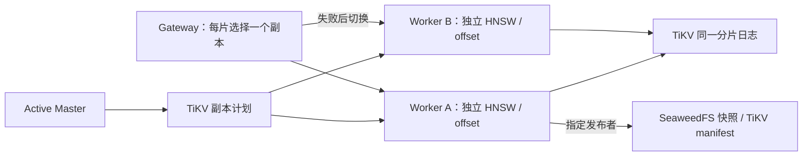

# 双副本与先恢复后退出的迁移

本阶段提供可选的 **每个索引分片两个 Worker 副本**，不改变 ID hash 数据分区和数据→索引的一一对应关系。两个副本位于不同 Worker，分别保存 HNSW 和增量消费位点；TiKV 仍保存唯一的逻辑原始记录和日志，SeaweedFS 保存共享快照。

## 使用

默认 `REPLICAS=1` 保留原行为。独立服务进程设置 `REPLICAS=2`；onebox 使用：

```bash
export API_TOKEN=local-public-api-token
export CLUSTER_TOKEN=local-peer-rpc-secret
export VECTOR_CONTROL_SOCKET="$PWD/.state/replica-control.sock"
.tools/vectorctl cluster start --namespace demo/replicas-v1 \
  --workers 3 --partitions 8 --dimension 3 --replicas 2 --grpc-port 18250
```

至少两个存活 Worker 才能满足双副本；建议三个或更多 Worker，使单个 Worker 故障后仍有位置补足两个副本。只剩一个 Worker 时继续服务，但冗余不足。

**必须使用新的 namespace。** 双副本采用 `cluster-mode=v3-replicas-2` 和 v6 schema；不支持直接把已有单副本 namespace 改为双副本，不与旧二进制混跑。旧数据没有自动迁移，原 namespace 未被修改。未来需另行实现在线协议升级或导入工具。

## 控制流程



Master 按同一分片的 rendezvous hash 排名选择前两个未排空 Worker，不根据 CPU、内存或 QPS 调度。

每片持久化 `ReplicaPlan`：

- `desired`：最终目标副本。
- `serving`：当前需要保留的副本，包括正在恢复的新副本和迁移期间仍保留的旧副本。该列表不是全部 ready 的承诺。
- `barrier`：本轮目标变化时，事务读取的数据分片日志 head。
- `publisher`：唯一允许发布快照、推进清理位点的副本身份。

目标变化时先为新副本创建 assignment，保留仍存活的旧副本。新副本取得自己的 ownership epoch，加载共享快照、重放日志，并上报消费位点。**所有目标副本 ready 且 offset 达到 barrier 后，Master 才移除旧副本。** 迁移期间可能暂时超过两个副本，需留出额外内存。

barrier 固定为迁移开始时的 head，避免持续写入让迁移永远追赶不上；没有 visibility token 的查询仍遵循原来的最终一致性。带 min_visible 的查询会在实际选中的副本上同步并验证版本，副本切换后重新执行该检查。

## 查询切换

Gateway 每片仅取一个成功副本的结果，再合并全局 Top-K，不把同一片两个副本的结果合并。每次 search/sync 尝试给一个副本最多 2 秒，失败后尝试其他 ready 且租约有效的副本；全部失败时刷新一次计划，仍受原请求截止时间约束。

HTTP、gRPC 和两套 SDK 共用此行为。维护操作只访问指定 publisher，不自动重试可能已提交的快照/清理操作。故障期间查询可能变慢；客户端 deadline 小于切换耗时时仍可能超时。此功能不保证全部副本、TiKV/PD 或网络同时故障时成功，也不返回缺片的部分结果。

## 排空和缩容

`vectorctl cluster scale --workers N` 在双副本模式下、N>0 时：

1. 向待退出 Worker 发 `POST /v1/drain`，使用 API_TOKEN。
2. Worker 注册为 draining，继续服务旧副本和续租。
3. Master 为它安排替代副本，等待恢复追赶，再从 serving 中移除。
4. 启动器确认全部分片仍 ready 且无计划依赖该 Worker 后，才停止它。

排空等待超过 90 秒会报错并保留 Worker 进程；排空状态仍有效，不会假装回滚。状态查询可判断剩余计划。默认 CLI 请求超时 90 秒，连续缩掉多个 Worker 时可使用更长的全局 `--timeout`。

`scale 0` 和 `cluster stop` 明确停止全部 Worker，不提供持续查询保证；直接 SIGTERM/SIGKILL 不执行排空，只依赖其他副本接替。当前未实现取消排空 API。

## 发布权限与日志安全

每个副本独立持有租约和 fencing token。快照发布/日志清理的同一个 TiKV 事务同时检查：

- 当前副本租约、session、epoch 有效。
- 当前计划指定它为 publisher。
- 写入同一计划键，保证发布权限或成员变更与在途操作发生事务冲突。

因此旧 publisher 即使检查后暂停，也无法在新计划提交后继续提交旧事务。日志删除上限为已发布快照 offset 与 **serving 中全部副本上报 offset 的最小值**。尚未上报的新副本会阻止进一步清理；故障副本在 Master 从计划移除前也会保留日志。成员变化与清理在同一计划键上串行化，防止新副本加入时日志被并发删掉。

## 状态

`cluster status` / `cluster partitions`、HTTP `/v1/cluster` 和 gRPC GetCluster 增加：

- `replicas`：目标副本数。
- `replica_plans`：期望、保留、barrier、publisher。
- `replica_owners[分片].owners`：当前 ready 且租约有效的副本、epoch 和 offset。
- `fully_replicated`：所有分片至少有两个 ready 副本；不足时 HTTP JSON 可能省略 false 值，按 false 处理。
- `nodes[].draining`：排空标记。

`ready` 只要求每片至少有一个 ready 副本；`owners` 在双副本模式下仅保留一个候选供旧状态读取者参考，完整归属应查看 replica_owners。`local_partitions` 此时是带节点/session 的副本身份，不是纯逻辑分片名。

## 验收与后续

`scripts/verify_replicas.py` 使用真实 TiKV/SeaweedFS、640 条结构化向量，持续查询全部记录并并发更新，注入 SIGSTOP、SIGKILL、扩容、排空缩容和替代 Worker 恢复。验证无重复/缺失、visibility token 版本约束与测试进程清理。报告：reports/replicas-http.json。

单测覆盖先保留旧副本再切换、唯一 publisher、过期分配拒绝、慢副本/恢复副本保留日志和协议隔离；真实 TiKV 测试覆盖旧 publisher 在途事务与计划切换的写冲突。

验收仍是单机多进程，不代表跨机网络隔离或存储仲裁故障保证。下一阶段再补负载指标和调度，不改变当前固定分片及非聚类路由。

负载调度已作为独立协议提供，可在新 namespace 使用 `--scheduler load`，见 [BALANCING.md](BALANCING.md)。上文 rendezvous hash 描述对应默认 hash 策略。
